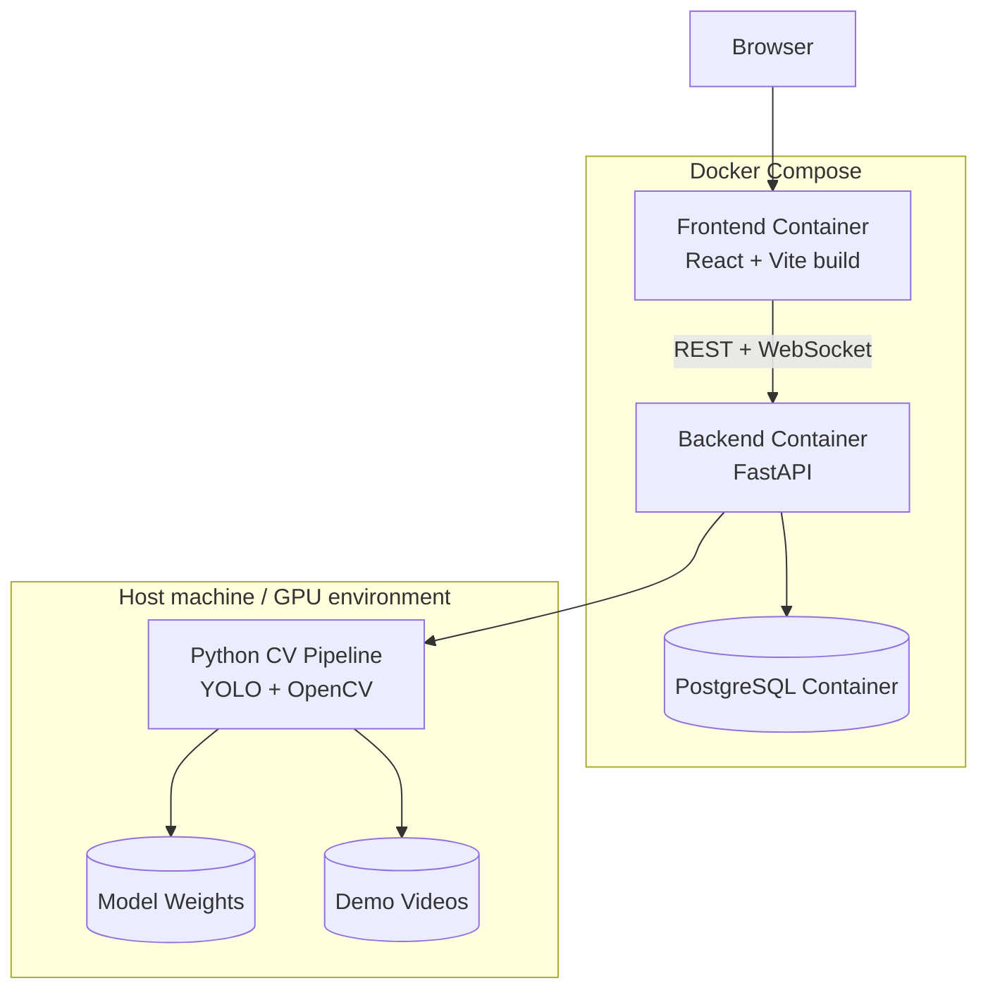
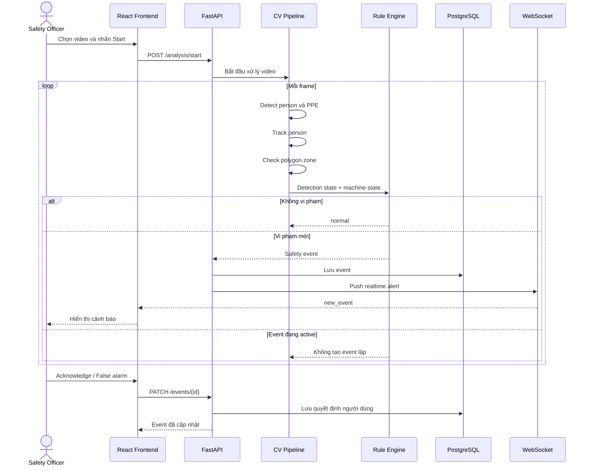

# Architecture Document

## System Overview

AI Agent Giám Sát An Toàn PPE & Khu Vực Nguy Hiểm Bằng Computer Vision (PPE & Zone Safety Agent).
Hệ thống sử dụng Computer Vision (YOLO) để phát hiện người, đánh giá việc tuân thủ quy định về PPE và cảnh báo theo thời gian thực nếu có xâm nhập vào các khu vực nguy hiểm được định nghĩa bằng Polygon. Backend sử dụng FastAPI kết nối với PostgreSQL để lưu trữ và quản lý event.

## Architecture Diagram

## Data Flow Diagram

## Components

### 1. Computer Vision Pipeline (Python)
- **Person Detection:** YOLO pretrained
- **PPE Detection:** YOLO pretrained / fine-tuned cho helmet & safety_vest
- **Tracking:** ByteTrack (qua Ultralytics)
- **Zone Logic:** OpenCV `pointPolygonTest`
- **Privacy:** Làm mờ khuôn mặt bằng OpenCV

### 2. Backend (FastAPI)
- **Mục đích:** API điều phối video, đánh giá rule engine, lưu trữ sự kiện, WebSocket đẩy cảnh báo.
- **Rule Engine:** Viết bằng Python thuần kiểm tra các rule nghiệp vụ.
- **WebSocket:** Cập nhật real-time tới frontend.

### 3. Frontend (React + TypeScript + Vite)
- **Mục đích:** Live monitor, alert, event log, dashboard.
- **Styling:** Tailwind CSS
- **Charts:** Recharts

### 4. Database
- **Type:** PostgreSQL
- **ORM:** SQLAlchemy + Alembic

## Design Decisions

| Decision | Choice | Reason |
|----------|--------|--------|
| Zone Logic | OpenCV | `pointPolygonTest` đủ dùng mà không cần model AI phức tạp |
| Backend | FastAPI | Python stack, dễ tích hợp CV pipeline, hỗ trợ WebSocket tốt |
| Frontend | React + Vite | Phù hợp quản lý state real-time, Vite nhẹ và nhanh |
| Architecture | Modular Monolith | Một repo, các thành phần gọi nội bộ thay vì microservices ở giai đoạn đầu |
