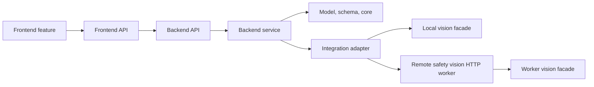
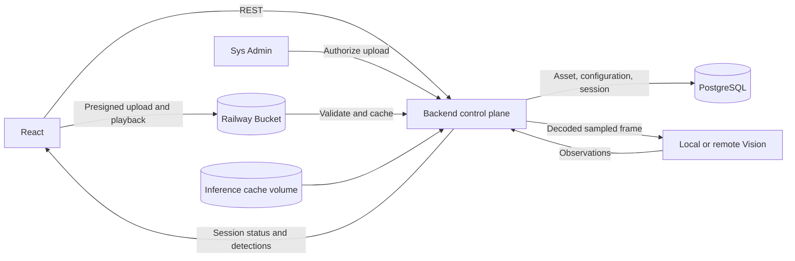
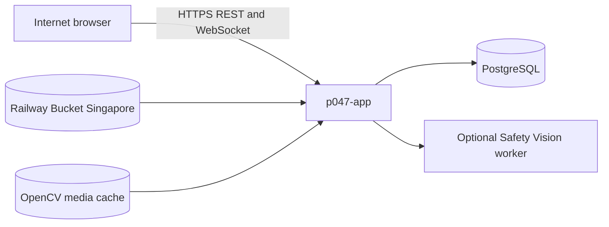

# Kiến trúc hệ thống P-047

Tài liệu này là nguồn kiến trúc duy nhất của dự án. Nó mô tả hướng đích; runtime hiện tại
được ghi rõ để không nhầm phần đã chạy với phần còn phải triển khai.

## Mục tiêu và ràng buộc

- Phân tích video/ảnh mô phỏng để phát hiện người, thiếu mũ bảo hộ/áo phản quang và xâm nhập vùng nguy hiểm.
- Một stream có thể chứa nhiều vùng bốn điểm; xâm nhập vùng enabled luôn là critical, không phụ thuộc trạng thái máy mô phỏng. Kết quả mơ hồ phải chuyển Human-in-the-Loop (HITL).
- Cảnh báo gần realtime, không tạo event lặp cho một vi phạm liên tục.
- Không lưu video thô; chỉ lưu snapshot sự kiện sau khi che danh tính thành công.
- Ba vai trò được backend phân quyền: `system_admin`, `safety_officer` và `area_manager`.
- MVP là một stream mô phỏng; camera thật, PLC, tự dừng máy và multi-stream nằm ngoài phạm vi.

## Kiến trúc đích

Giữ **modular monolith** để giao nhanh và triển khai đơn giản. `frontend/`, `backend/` và
`vision/` là ba owner production; chỉ tách service khi có nhu cầu scale hoặc vận hành đã đo được.
Sơ đồ component và data flow runtime nằm trong `docs/architecture_diagram.md`.

## Boundary và dependency

| Owner | Trách nhiệm | Không được làm |
|---|---|---|
| Frontend | Capture frame, UI state, overlay, review và dashboard | Tự quyết severity hoặc authorization |
| Backend API | Parse/authenticate/map REST và WebSocket | Chứa SQL, CV hoặc rule nghiệp vụ |
| Backend services | Use case, rule, transaction, dedup, RBAC, analytics và reporting | HTTP rendering hoặc provider SDK details |
| Integrations | Adapter vision, storage, LLM và notification | Quyết định event state hoặc permission |
| Vision | Detection, association, tracking, geometry, confidence, redaction | Biết HTTP, database, user hoặc event lifecycle |

Luồng phụ thuộc bắt buộc:

Executable contracts hiện hành (FastAPI/Pydantic, frontend wire types, SQLAlchemy/Alembic và
tests) là nguồn sự thật. Thay đổi breaking phải được phê duyệt và có migration hoặc
compatibility test.

Các bất biến an toàn:

1. LLM chỉ diễn giải hoặc đề xuất rule có schema; deterministic code quyết định severity/routing.
2. Zone entry của một vùng enabled luôn critical, dù machine state là `running` hay `stopped`. Machine state vẫn là audit/operational context, không phải điều kiện chặn zone alert. Lỗi kênh ngoài không làm mất cảnh báo trong ứng dụng.
3. PPE chỉ được đánh giá khi máy đang `running`; khi máy `stopped`, các switch requirement và observation PPE không được tạo PPE alert.
4. Dedup theo session + track + rule key có `zone_id` + occurrence; retry dùng idempotency key. Zone collection không có giới hạn số lượng nghiệp vụ cố định và phải bị từ chối nếu hai polygon giao, chạm hoặc chứa nhau.
5. Privacy thất bại thì không persist snapshot và không được gắn `privacy_blurred=true`.
6. Audit giữ rule version, `zone_id`, machine state của zone, shift, confidence, actor và transition; không giữ raw stream. Một review nhiều vùng vẫn lưu event riêng theo từng zone.

## Trạng thái triển khai

Hiện đã có React → FastAPI qua REST/WebSocket, person detection, collection nhiều polygon với
machine state riêng, zone-scoped occurrence, grouped review, privacy gate in-memory, PostgreSQL
event history, PPE production model và RBAC. Safety Vision có thể chạy trong backend hoặc qua worker HTTP `safety_vision_v1`; phiên video/ảnh trực tiếp đi qua `FrameInferenceService`, còn rule, occurrence, HITL và persistence vẫn thuộc backend. PostgreSQL là database duy nhất cho mọi môi trường; SQLite và database fallback là đường tương thích cũ phải được loại bỏ trước khi tuyên bố hoàn tất chuyển đổi. Các capability nâng cao khác vẫn là đích cần triển khai.

Thứ tự tiến hóa theo backlog:

1. **Đóng MVP:** PPE + tracking/dedup + multi-zone một stream + event state + auth/RBAC + image parity + metrics.
2. **Bổ sung context:** zone/shift và confidence-based HITL.
3. **Nâng cao:** escalation → analytics theo zone/shift → reporting.
4. **Vận hành:** cloud, observability, backup/restore, security/performance và UAT.

## Kiến trúc media trực tiếp

Backend là owner duy nhất của asset registry, file content, camera configuration và
inference-session lifecycle. Browser chỉ gửi `asset_id` và camera command, không gửi
filesystem path hoặc URL nguồn tùy ý. Railway Bucket là canonical storage cho upload
mới; browser chỉ nhận presigned URL ngắn hạn sau khi backend kiểm tra quyền. Backend
xác minh object và frame đầu, sau đó dùng volume tại `MEDIA_ASSET_DIR` làm read-through
cache cho OpenCV. PostgreSQL giữ storage backend/key, metadata, assignment và lifecycle evidence.

### Luồng runtime của một camera

```mermaid
flowchart LR
    config[Saved asset, zones and PPE] --> run[Run or Replay command]
    run --> reset[Fresh session and reset tracking/occurrences]
    reset --> source[Open validated volume file]
    source -->|Video sampled and paced| inference[FrameInferenceService]
    source -->|Image exactly once| inference
    inference --> first[First real result sets RUNNING]
    first --> ws[WebSocket detections and rolling FPS]
    ws --> eof[Video EOF sets COMPLETED and enables Replay]
```

Camera identity là một trong `cam_1` đến `cam_4`. Mỗi Run/Replay tạo UUID session
mới; output phiên cũ bị bỏ qua. Save cấu hình không khởi động hoặc dừng inference.
Sau restart, cấu hình được giữ nhưng phiên đang chạy chuyển `STOPPED` và không tự resume.

### Topology Railway hiện tại

Streamer, MediaMTX, FFmpeg publisher, HLS, RTSP và MJPEG simulation không còn là
runtime hoặc deployment dependency.
