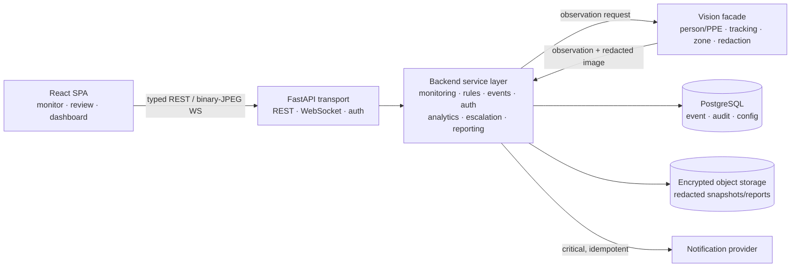
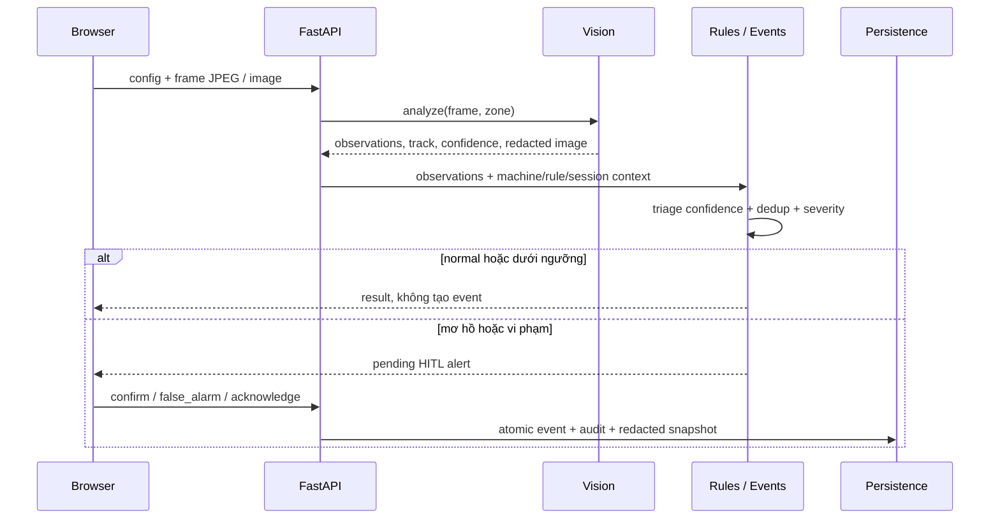

# Kiến trúc hệ thống P-047

Tài liệu này là nguồn kiến trúc duy nhất của dự án. Nó mô tả hướng đích; runtime hiện tại
được ghi rõ để không nhầm phần đã chạy với phần còn phải triển khai.

## Mục tiêu và ràng buộc

- Phân tích video/ảnh mô phỏng để phát hiện người, thiếu mũ/kính/găng và xâm nhập vùng nguy hiểm.
- Xâm nhập vùng chỉ là critical khi máy chạy; kết quả mơ hồ phải chuyển Human-in-the-Loop (HITL).
- Cảnh báo gần realtime, không tạo event lặp cho một vi phạm liên tục.
- Không lưu video thô; chỉ lưu snapshot sự kiện sau khi che danh tính thành công.
- Hai vai trò được backend phân quyền: `safety_officer` và `zone_manager`.
- MVP là một stream mô phỏng; camera thật, PLC, tự dừng máy và multi-stream nằm ngoài phạm vi.

## Kiến trúc đích



Giữ **modular monolith** để giao nhanh và triển khai đơn giản. `frontend/`, `backend/` và
`vision/` là ba owner production; chỉ tách service khi có nhu cầu scale hoặc vận hành đã đo được.

## Boundary và dependency

| Owner | Trách nhiệm | Không được làm |
|---|---|---|
| Frontend | Capture frame, UI state, overlay, review và dashboard | Tự quyết severity hoặc authorization |
| Backend API | Parse/authenticate/map REST và WebSocket | Chứa SQL, CV hoặc rule nghiệp vụ |
| Backend services | Use case, rule, transaction, dedup, RBAC, analytics và reporting | HTTP rendering hoặc provider SDK details |
| Integrations | Adapter vision, storage, LLM và notification | Quyết định event state hoặc permission |
| Vision | Detection, association, tracking, geometry, confidence, redaction | Biết HTTP, database, user hoặc event lifecycle |

Luồng phụ thuộc bắt buộc:

```text
frontend feature → frontend api → backend api → backend service
                                             → model/schema/core
                                             → integration → vision facade/provider
```

Executable contracts hiện hành (FastAPI/Pydantic, frontend wire types, SQLAlchemy/Alembic và
tests) là nguồn sự thật. Thay đổi breaking phải được phê duyệt và có migration hoặc
compatibility test.

## Luồng quyết định an toàn



Các bất biến an toàn:

1. LLM chỉ diễn giải hoặc đề xuất rule có schema; deterministic code quyết định severity/routing.
2. Zone entry khi máy chạy luôn critical; lỗi kênh ngoài không làm mất cảnh báo trong ứng dụng.
3. Dedup theo session + track + rule + occurrence; retry dùng idempotency key.
4. Privacy thất bại thì không persist snapshot và không được gắn `privacy_blurred=true`.
5. Audit giữ rule version, machine/zone/shift, confidence, actor và transition; không giữ raw stream.

## Trạng thái triển khai

Hiện đã có React → FastAPI qua REST/WebSocket, person detection, polygon/machine rule,
review và SQLite event history. PostgreSQL, PPE production model, tracking/dedup hoàn chỉnh,
privacy gate, RBAC và các capability nâng cao vẫn là đích cần triển khai.

Thứ tự tiến hóa theo backlog:

1. **Đóng MVP:** PPE + tracking/dedup + event state + privacy + auth/RBAC + image parity + metrics.
2. **Bổ sung context:** zone/shift và confidence-based HITL.
3. **Nâng cao:** escalation → analytics theo zone/shift → reporting.
4. **Vận hành:** cloud, observability, backup/restore, security/performance và UAT.
