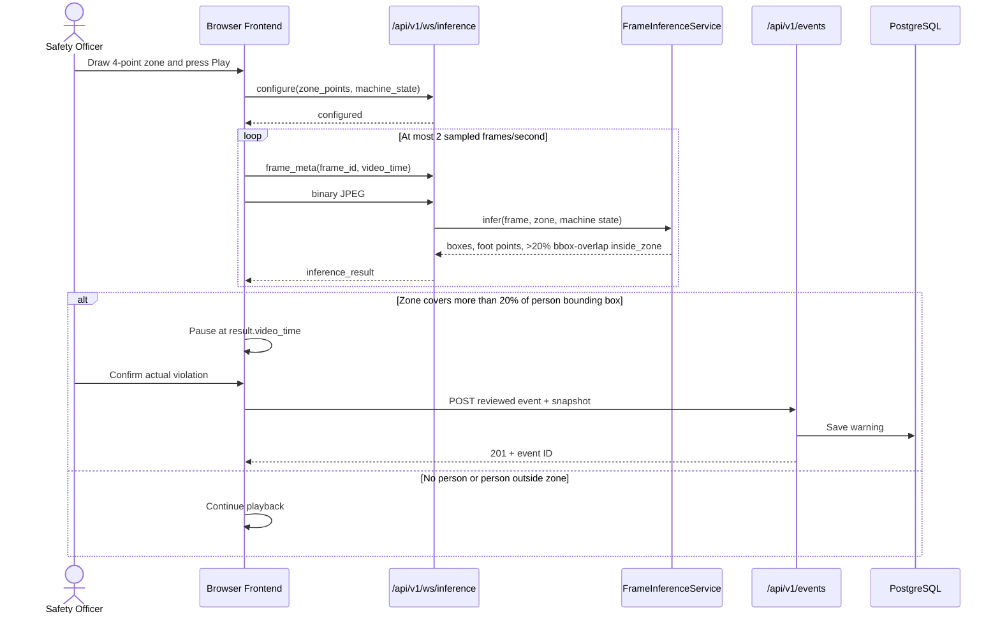
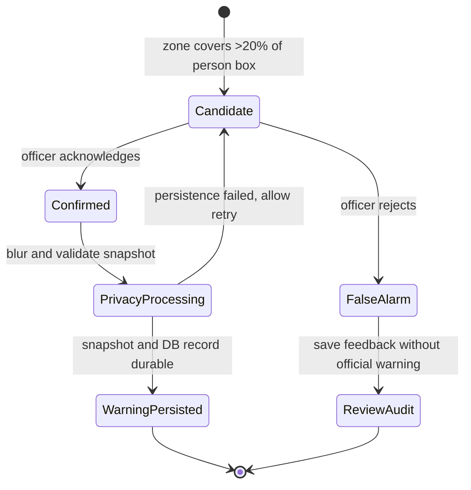

# Backend Module - PPE & Zone Safety Monitoring System

## Overview
Phân hệ `backend` là FastAPI web application theo kiến trúc Modular Monolith. Phân hệ đảm nhận vai trò API Gateway, quản lý trạng thái phiên phân tích video, ghi nhận và xử lý các sự kiện vi phạm quy định an toàn (PPE & xâm nhập vùng nguy hiểm), đẩy cảnh báo thời gian thực qua WebSocket, và cung cấp AI Safety Agent tư vấn xử lý sự cố.


## Setup & Running
```bash
# From the repository root
make run

# Run backend test suite
PYTHONPATH=. .venv/bin/pytest backend/tests -v
```

REST routes are interactive at <http://localhost:8000/docs>. The inference WebSocket at `ws://localhost:8000/api/v1/ws/inference` is intentionally absent from Swagger because WebSocket operations are not part of the generated OpenAPI schema.

Operational monitoring is deliberately lightweight: one process writes rotated, privacy-safe JSONL events to `data/operational-metrics.jsonl`; `GET /api/v1/operational-metrics?window_minutes=60` returns bounded request latency, inference outcomes, and stable error-kind aggregates. The stream never contains frames, snapshots, IDs, raw URLs/query strings, credentials, addresses, or exception text. This file-backed writer is single-process only; use a centralized sink before enabling multiple backend workers.

PostgreSQL from `DATABASE_URL` is the only supported database for local, test and deployment environments. Local settings load `.env.development` first and then `.env`; the effective URL must be reachable from the process that runs Alembic or FastAPI. A Railway private hostname (`*.railway.internal`) is valid only inside the same Railway project/environment, not from a developer machine; local execution must use local PostgreSQL or the Railway TCP Proxy URL. Database fallback must remain disabled, and an unavailable PostgreSQL dependency must fail migration/startup instead of selecting SQLite. Supabase is optional; any standard managed PostgreSQL service is sufficient. Snapshots are redacted in memory before writing; if privacy processing or database persistence fails, the backend does not create the event and removes any unreferenced redacted snapshot.

The repository is transitioning from a legacy SQLite-compatible path. Until `bootstrap_legacy_sqlite.py`, fallback settings and SQLite-specific tests are removed, treat them as deprecated implementation debt rather than a supported operating mode.

PostgreSQL uses a bounded LIFO connection pool with TCP keepalive and five-minute connection recycling. `DATABASE_POOL_PRE_PING` defaults to `false` so a warm connection checkout does not add a database round-trip to every request. Enable it only for a provider that repeatedly drops idle sessions. ORM sessions keep loaded values after commit, avoiding an automatic response-time reload; explicit queries remain the source of truth for subsequent requests.

Remote Vision defaults to backward-compatible `safety_vision_v1`. Setting `VISION_REMOTE_CONTRACT_VERSION=safety_vision_v2` makes the backend persist the worker-neutral ByteTrack/PPE continuation envelope in PostgreSQL with short revision compare-and-swap transactions. `VISION_TRACKING_STATE_TTL_SECONDS` defaults to `86400` and `VISION_TRACKING_STATE_MAX_BYTES` to `524288`. The GPU call occurs outside the database transaction, state is deleted when the monitoring session ends, and corrupt/expired/conflicting state fails closed instead of resetting in worker RAM.

## Frontend–Backend Interaction

US-29 uses backend-owned media and explicit sessions:

- `POST /api/v1/media-assets/upload-requests` lets System Admin upload directly to the
  configured Railway Bucket with a short-lived presigned POST; completion validates
  metadata and the first decoded frame before publishing `READY`.
- `POST /api/v1/media-assets` remains the compatible server-proxied upload contract.
- Bucket playback uses a short-lived presigned GET with byte ranges; OpenCV keeps a
  server-owned read-through cache under `MEDIA_ASSET_DIR` for inference.
- `PUT /api/v1/camera-configurations/{camera_id}` atomically saves asset, machine state, zones and PPE for fixed `cam_1` through `cam_4`.
- `POST /api/v1/simulation-runs` and per-camera Replay create fresh direct-file inference sessions.
- `GET /api/v1/events` accepts an optional `camera_id` filter for camera-scoped violation logs; existing status, zone and event-type filters remain compatible.
- `/api/v1/ws/camera-detections` carries session lifecycle, rolling FPS and source-coordinate inference results.
- Before publishing a newly opened direct-camera occurrence, the runtime persists it as an `unacknowledged` safety event with a privacy-redacted snapshot. Live Monitor reloads this durable pending inbox after navigation or refresh; a completed HITL submission transitions the same occurrence-backed event to `acknowledged` or `false_alarm`. Terminal model state is released without invalidating queued occurrence context.
- HITL debounce is seven consecutive accepted violating frames for every violation type. A normal or unknown observation resets the pending sequence; vision-side PPE confirmation remains a separate observation gate.
- Streamer, MediaMTX, HLS, RTSP and Connect/Disconnect are not runtime contracts.

Inference keeps the decoded source frame at its original resolution until the
YOLO boundary. Ultralytics performs the only resize/letterbox step using
`YOLO_INFERENCE_IMAGE_SIZE` (`960`, producing a `960x960` model tensor by
default). Benchmark detection recall, latency, and memory when changing that
model input size.
Camera sessions use isolated YOLO/ByteTrack instances and may run concurrently. Calls within one session remain serialized; sampled video frames that exceed one sampling interval of source lag are dropped before model execution instead of building a stale queue. Running FPS persistence is throttled to five seconds while WebSocket results remain per-frame.

Reviewed-event and statistics endpoints require a logged-in user. Safety officers and system administrators can record reviews; an area manager receives only events and statistics for their assigned `managed_area_id`. A Telegram alert is queued for that matching manager only when a review is saved as `acknowledged`, never when the AI merely opens a candidate.

US-27 persists the operator's zone collection through `GET/PUT /api/v1/cameras/{camera_id}/monitoring-zones`. Saves use `expected_revision`, reject stale writes, and atomically reject intersecting, touching or containing active polygons. Multi-zone configure must echo that saved revision. Connected-camera inference loads safety requirements for each saved `(camera_id, zone_id)` pair.

The versioned `hat_vest_v1` profile uses a shared persisted PPE requirement resource for the fixed MVP camera–zone pair:

```http
GET /api/v1/ppe-requirements/{camera_id}/{zone_id}
PUT /api/v1/ppe-requirements/{camera_id}/{zone_id}
```

GET returns `profile`, `hat_required`, `vest_required`, `restricted_area_detection_enabled`, and `zone_intrusion_enabled`; a missing record defaults intrusion ON and the other rules OFF with `is_configured=false`. PUT accepts the same additive booleans for compatibility. The fixed-camera aggregate persists `ppe_requirements` at camera level, including when `zones=[]`; hat/vest apply to every qualified person in the frame only while the camera-wide machine state is running. Restricted-area and intrusion switches remain per-zone. The PPE adapter invokes `yolo11n_safety_kd_best.pt` once per frame and the public detection contract accepts only `person`, `hat`, `vest`.

US-08 adds a client-generated `monitoring_session_id` that remains stable for one selected video across pause, review, and reconnect. Each person has a session-local `track_id` and `active_violations`; only the first violation alert for that person in the session sets `review_required=true`. Later rules or re-violations remain observable without opening another review. Reviewed event requests carry the occurrence IDs, and the database unique constraint makes retries idempotent while conflicting reuse returns `409`.



## Frame Inference Contract

This section is the canonical protocol specification. It includes the message sequence, complete input/output examples, field semantics, decision formula, common outcomes, and error behavior.

### WebSocket endpoint

```text
ws://localhost:8000/api/v1/ws/inference
```

This endpoint answers: **where are the people/hat/vest objects in this frame, and does a configured danger zone cover more than 20% of any person's bounding box?** One YOLO11n Safety KD call selects source classes `[0, 3, 4]`: class `3` supplies canonical people for zone geometry, foot-point diagnostics and ByteTrack, while `hat`/`vest` feed PPE observations. It uses a stateful WebSocket protocol rather than one HTTP request, so it does not appear in Swagger/OpenAPI.

### Input sequence

#### 1. Configure once per connection

Send four normalized points to activate zone evaluation, or an empty list to run detection without a zone, together with the current machine state:

```json
{
  "type": "configure",
  "monitoring_session_id": "3cddfe85-9428-44d7-afbf-0cd9e5fc0640",
  "zone_points": [
    {"x": 0.12, "y": 0.30},
    {"x": 0.72, "y": 0.28},
    {"x": 0.81, "y": 0.88},
    {"x": 0.09, "y": 0.91}
  ],
  "machine_state": "running"
}
```

`x` and `y` are normalized to the source frame and must be between `0` and `1`. The backend responds with:

```json
{"type": "configured", "monitoring_session_id": "3cddfe85-9428-44d7-afbf-0cd9e5fc0640"}
```

Send `configure` again when the machine state or zone changes.

#### 2. Send metadata for one frame

```json
{
  "type": "frame_meta",
  "frame_id": 15,
  "video_time": 7.5
}
```

- `frame_id` is a non-negative client sequence number used to correlate and reject stale results.
- `video_time` is the frame position in the source video, in seconds.

#### 3. Send the frame

Immediately after `frame_meta`, send the corresponding JPEG as a **binary WebSocket message**. It is not JSON or Base64 during transfer. Only one frame may be pending on a connection.

### Output: `inference_result`

The backend returns one correlated JSON result for each accepted JPEG:

```json
{
  "type": "inference_result",
  "frame_id": 15,
  "video_time": 7.5,
  "result": "violate",
  "review_required": true,
  "people": [
    {
      "track_id": 7,
      "bbox": [420, 115, 535, 610],
      "confidence": 0.91,
      "foot_point": [477, 610],
      "inside_zone": true,
      "ppe": {
        "hat": {"status": "missing", "confidence": null},
        "vest": {"status": "present", "confidence": 0.88}
      },
      "missing_required_ppe": ["hat"]
    }
  ],
  "detections": [
    {"class_id": 3, "class_name": "person", "bbox": [420, 115, 535, 610], "confidence": 0.91, "person_index": 0},
    {"class_id": 4, "class_name": "vest", "bbox": [438, 250, 520, 510], "confidence": 0.88, "person_index": 0}
  ],
  "snapshot_data": "data:image/jpeg;base64,...",
  "rule": {
    "person_inside_zone": true,
    "machine_state": "running",
    "ppe_profile": "hat_vest_v1",
    "camera_id": "uploaded_video",
    "zone_id": "zone_01",
    "ppe_requirements": {
      "profile": "hat_vest_v1",
      "hat_required": true,
      "vest_required": true
    },
    "ppe_alert": false
  }
}
```

| Field | Meaning |
|---|---|
| `frame_id`, `video_time` | Copied from `frame_meta` so the frontend can match the result to the analyzed frame. |
| `people` | Every person detected by YOLO; an empty array means no person was detected. |
| `detections` | Typed list limited to canonical `person` plus YOLO11n Safety KD `hat`/`vest`: class ID/name, original-frame `bbox`, confidence and nullable `person_index`. It can contain unassociated PPE when `people` is empty. |
| `track_id` | ByteTrack association ID scoped to one monitoring session; it is not a personal identity. |
| `active_violations` | Per-track rule occurrences. Only `is_new=true` opens a new review candidate. |
| `bbox` | Person rectangle in original-frame pixels as `[x1, y1, x2, y2]`. |
| `confidence` | YOLO's confidence that the detection is a person. |
| `foot_point` | Bottom-center of `bbox`, retained in original-frame pixels for display and diagnostics. |
| `inside_zone` | `true` only when the polygon intersection covers more than 20% of that person's `bbox`; exactly 20% and boundary-only contact are outside. |
| `ppe`, `missing_required_ppe` | Per-person `hat`/`vest` observations and only the currently required items that passed qualified-absence guards. |
| `review_required` | `true` when a zone overlap or qualified missing-PPE occurrence becomes newly active after its confirmation gate. The frontend pauses only for this value. |
| `result` | `violate` when `review_required=true`; otherwise `normal`. |
| `snapshot_data` | The analyzed JPEG as a Base64 data URL, included only when review is required. It is not persisted until officer confirmation. |
| `rule` | Decision inputs included for debugging and audit context, including the persisted PPE requirements active for this frame and whether an explicit missing-PPE alert fired. |

The current decision is:

```text
person_inside_zone = any(zone/person-bbox intersection area > 20% of that bbox for person in people)
ppe_violation = machine_state == "running" AND any(person.missing_required_ppe for person in people)
observed_violation = person_inside_zone OR ppe_violation
review_required = any newly confirmed per-track occurrence after debounce
result = "violate" if observed_violation else "normal"
```

Common outcomes:

| Detection | Machine | `inside_zone` | `result` | `review_required` | Snapshot |
|---|---|---:|---|---:|---:|
| No person | Running or stopped | — | `normal` | `false` | No |
| Person outside zone | Running or stopped | `false` | `normal` | `false` | No |
| Person inside zone | Stopped | `true` | `violate` | `true` | Yes |
| Person inside zone | Running | `true` | `violate` | `true` | Yes |

Bounding boxes and `inside_zone` remain available when the machine is stopped; zone intrusion ignores machine state. A qualified required-PPE absence requests review only while the machine is running.

### Protocol errors

Invalid ordering, validation, JPEG, or inference failures return:

```json
{
  "type": "error",
  "code": "invalid_frame",
  "message": "image_data could not be decoded as an image"
}
```

The server processes messages sequentially. The frontend additionally enforces one frame in flight, which prevents model overload and stale queues.

### Detection and zone evaluation

YOLO returns a person bounding box `[x1, y1, x2, y2]`. The service still exposes the bottom-center point for display and diagnostics:

```text
foot_x = (x1 + x2) / 2
foot_y = y2
```

The four normalized zone points are converted to frame pixels. The backend sets `inside_zone=true` when the person bounding box and polygon share any area or touch at a boundary. The test covers rectangle corners inside the polygon, polygon vertices inside the rectangle, and crossing edges. Zone intrusion ignores `machine_state`; `foot_point` no longer decides membership.

The REST fallback `POST /api/v1/analysis/frame` remains available and returns the same core `FrameInferenceResponse` without WebSocket correlation fields.

## Reviewed Warning Persistence

### Current baseline

The browser holds an unpersisted `pendingViolation` after zone entry. Only after the officer chooses a review action does it call:

```http
POST /api/v1/events
Content-Type: application/json
```

Example confirmed violation:

```json
{
  "zone_id": "zone_01",
  "camera_id": "uploaded_video",
  "event_type": "missing_ppe_and_intrusion",
  "severity": "high",
  "status": "acknowledged",
  "acknowledged_by": "Safety Officer",
  "snapshot_data": "data:image/jpeg;base64,...",
  "details": {
    "inference_result": "violate",
    "review_result": "actual_violation",
    "machine_state": "running",
    "video_timestamp_seconds": 12.5,
    "people": [],
    "zone_points": []
  }
}
```

`EventService` validates and decodes `snapshot_data`, then calls the privacy adapter independently from PPE inference. It accepts transient `snapshot_people` and `snapshot_detections` from the reviewed frame, redacts first, and only then draws canonical person plus `hat`/`vest` boxes before JPEG encoding; these fields are excluded from event persistence/response. It writes only the processed JPEG under `data/snapshots`, sets `privacy_blurred=true` itself, then commits the event. Client-provided privacy/path values cannot bypass this gate.

The privacy policy runs OpenCV YuNet once per reviewed snapshot and expands/blurs only detected face regions. If no face is detected, or YuNet inference fails, no person-head fallback blur is applied; the detector failure is still emitted as a stable operational warning. A missing/corrupt artifact fails startup. If no valid person region exists or any redaction/annotation/encoding step fails, processing is fail-closed: no snapshot and no reviewed event are created. YuNet is independent from YOLO11m Safety and does not add privacy classes to the PPE contract.

The baseline also persists `false_alarm` using the same endpoint so model quality can be evaluated.

For current per-person reviews, `POST /api/v1/events` includes the session-local `track_id` and uses `(monitoring_session_id, track_id)` as the log identity. A person's missing-hat, missing-vest, restricted-area and zone-intrusion occurrences are accumulated into that single `person_safety_violation` event for the video session; this is tracking, not biometric identity.

US-16 adds an optional, versioned `decision_context` to reviewed event creation. The browser supplies the observed frame, people/PPE detections, zone snapshot, active rule keys and system result; the backend stamps `decision_context_v1`, `safety_rule_v1`, the configured debounce, canonical camera/zone/severity, and the authenticated review actor. A completed context cannot be replaced through PATCH. Legacy requests without this additive field remain valid and return `decision_context=null`.

`GET /api/v1/events/{event_id}` returns the structured context plus a short incident `summary`. The summary uses the optional LLM only as presentation; failures and unconfigured environments use a deterministic formatter, and neither path modifies the stored audit. `false_alarm` records remain queryable with `GET /api/v1/events?status=false_alarm` but are excluded from official statistics. No raw video or session replay is stored.

Each new event records metadata retention through `AUDIT_RETENTION_DAYS` (default 365). A persisted blurred snapshot separately records `SNAPSHOT_RETENTION_DAYS` (default 90). These deadlines make retention explicit; automated deletion is not part of this delivery slice.

### Recommended production design

Use a two-level record model:

1. Keep detections transient until review, identified by a generated `detection_id`. Do not create an official warning merely because the model fired.
2. On `acknowledged`, create the immutable safety warning, derive `acknowledged_by` from the authenticated officer, blur faces before storage, and persist the snapshot plus inference metadata in one controlled operation.
3. On `false_alarm`, write a lightweight review-audit/feedback record for model metrics, but do not create a safety warning or retain the unblurred snapshot unless policy explicitly requires it.
4. Require `detection_id` as an idempotency key so reconnects or repeated clicks cannot create duplicate warnings.
5. Store production snapshots in protected object storage and keep only the object key, checksum, privacy status, and retention deadline in PostgreSQL.

Recommended confirmed-warning lifecycle:

```text
detected in memory
    → officer acknowledged
    → validate detection_id
    → privacy blur snapshot
    → persist snapshot
    → insert immutable warning + review audit
    → return event ID
```



If snapshot persistence or the database transaction fails, return an error and keep the frontend review pending so the officer can retry. Do not report a saved warning until both the event metadata and protected snapshot reference are durable.
