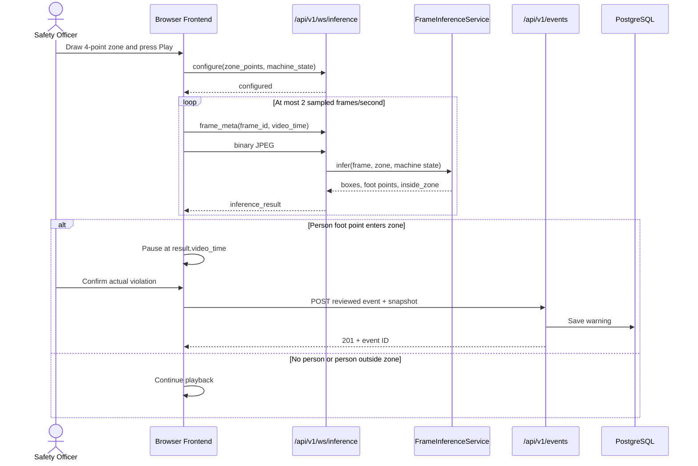
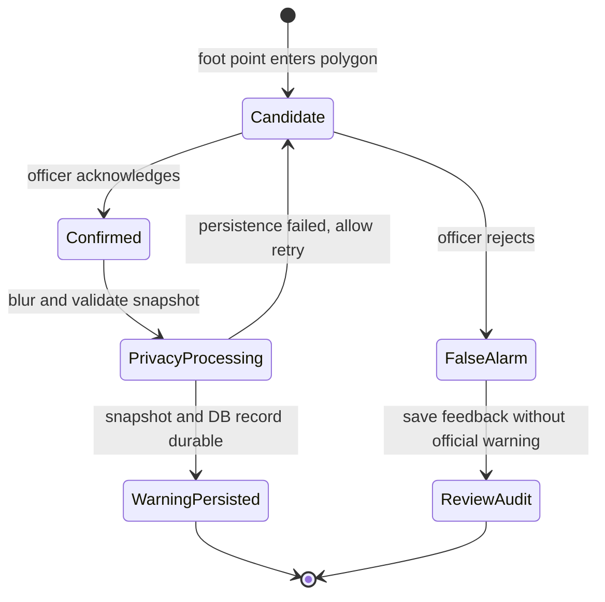

# Backend Module - PPE & Zone Safety Monitoring System

## Overview
Phân hệ `backend` là FastAPI web application theo kiến trúc Modular Monolith. Phân hệ đảm nhận vai trò API Gateway, quản lý trạng thái phiên phân tích video, ghi nhận và xử lý các sự kiện vi phạm quy định an toàn (PPE & xâm nhập vùng nguy hiểm), đẩy cảnh báo thời gian thực qua WebSocket, và cung cấp AI Safety Agent tư vấn xử lý sự cố.


## Setup & Running
```bash
# From the repository root
make run

# Run backend test suite
PYTHONPATH=. .venv/bin/pytest backend/tests -v
```

REST routes are interactive at <http://localhost:8000/docs>. The inference WebSocket at `ws://localhost:8000/api/v1/ws/inference` is intentionally absent from Swagger because WebSocket operations are not part of the generated OpenAPI schema.

Baseline development persists reviewed events in `data/safety_events.db` via SQLite. Production deployments should override `DATABASE_URL` with the managed PostgreSQL connection string. Snapshots are redacted in memory before writing; if privacy processing or database persistence fails, the backend does not create the event and removes any unreferenced redacted snapshot.

## Frontend–Backend Interaction

The baseline uses two transports with separate responsibilities:

- WebSocket `/api/v1/ws/inference` carries either the legacy one-zone configuration or a saved multi-zone collection, sampled JPEG frames, and additive per-zone inference results.
- REST `/api/v1/events` persists a legacy reviewed outcome; `/api/v1/event-batches` atomically persists grouped zone reviews.

US-27 persists the operator's zone collection through `GET/PUT /api/v1/cameras/{camera_id}/monitoring-zones`. Saves use `expected_revision`, reject stale writes, and atomically reject intersecting, touching or containing active polygons. Multi-zone configure must echo that saved revision; PPE requirements continue to use the unchanged `uploaded_video/zone_01` resource.

US-07 adds a shared persisted PPE requirement resource for the fixed MVP camera–zone pair:

```http
GET /api/v1/ppe-requirements/{camera_id}/{zone_id}
PUT /api/v1/ppe-requirements/{camera_id}/{zone_id}
```

GET returns helmet, safety-glasses and gloves requirements; a missing record materializes as three OFF values with `is_configured=false`. PUT requires all three strict booleans and atomically saves them. The current configuration UI uses `uploaded_video` and `zone_01`. The PPE adapter returns all 17 SH17 detections plus per-person PPE observations through `vision.api`. Backend derives `missing` only when a person meets the confidence/association guard and has no associated required PPE detection.

US-08 adds a client-generated `monitoring_session_id` that remains stable for one selected video across pause, review, and reconnect. Each person has a session-local `track_id` and `active_violations`; only a newly opened occurrence sets `review_required=true`. Reviewed event requests carry the new occurrence IDs, and the database unique constraint makes retries idempotent while conflicting reuse returns `409`.



## Frame Inference Contract

This section is the canonical protocol specification. It includes the message sequence, complete input/output examples, field semantics, decision formula, common outcomes, and error behavior.

### WebSocket endpoint

```text
ws://localhost:8000/api/v1/ws/inference
```

This endpoint answers: **where are the people/PPE objects in this frame, and is any person's foot inside the configured danger zone while the machine is running?** SH17 class `0` detects people; the same checkpoint detects all PPE/object classes. It uses a stateful WebSocket protocol rather than one HTTP request, so it does not appear in Swagger/OpenAPI.

### Input sequence

#### 1. Configure once per connection

Send four normalized points to activate zone evaluation, or an empty list to run detection without a zone, together with the current machine state:

```json
{
  "type": "configure",
  "monitoring_session_id": "3cddfe85-9428-44d7-afbf-0cd9e5fc0640",
  "zone_points": [
    {"x": 0.12, "y": 0.30},
    {"x": 0.72, "y": 0.28},
    {"x": 0.81, "y": 0.88},
    {"x": 0.09, "y": 0.91}
  ],
  "machine_state": "running"
}
```

`x` and `y` are normalized to the source frame and must be between `0` and `1`. The backend responds with:

```json
{"type": "configured", "monitoring_session_id": "3cddfe85-9428-44d7-afbf-0cd9e5fc0640"}
```

Send `configure` again when the machine state or zone changes.

#### 2. Send metadata for one frame

```json
{
  "type": "frame_meta",
  "frame_id": 15,
  "video_time": 7.5
}
```

- `frame_id` is a non-negative client sequence number used to correlate and reject stale results.
- `video_time` is the frame position in the source video, in seconds.

#### 3. Send the frame

Immediately after `frame_meta`, send the corresponding JPEG as a **binary WebSocket message**. It is not JSON or Base64 during transfer. Only one frame may be pending on a connection.

### Output: `inference_result`

The backend returns one correlated JSON result for each accepted JPEG:

```json
{
  "type": "inference_result",
  "frame_id": 15,
  "video_time": 7.5,
  "result": "violate",
  "review_required": true,
  "people": [
    {
      "track_id": 7,
      "bbox": [420, 115, 535, 610],
      "confidence": 0.91,
      "foot_point": [477, 610],
      "inside_zone": true,
      "safety_shirt": false
    }
  ],
  "snapshot_data": "data:image/jpeg;base64,...",
  "rule": {
    "person_inside_zone": true,
    "machine_state": "running",
    "safety_shirt_required": true,
    "camera_id": "uploaded_video",
    "zone_id": "zone_01",
    "ppe_requirements": {
      "helmet_required": true,
      "safety_glasses_required": false,
      "gloves_required": false
    },
    "ppe_alert": false
  }
}
```

| Field | Meaning |
|---|---|
| `frame_id`, `video_time` | Copied from `frame_meta` so the frontend can match the result to the analyzed frame. |
| `people` | Every person detected by YOLO; an empty array means no person was detected. |
| `detections` | Additive list of every SH17 model detection: `class_id`, `class_name`, original-frame `bbox`, confidence and nullable `person_index`. It can be non-empty even when `people` is empty. |
| `track_id` | ByteTrack association ID scoped to one monitoring session; it is not a personal identity. |
| `active_violations` | Per-track rule occurrences. Only `is_new=true` opens a new review candidate. |
| `bbox` | Person rectangle in original-frame pixels as `[x1, y1, x2, y2]`. |
| `confidence` | YOLO's confidence that the detection is a person. |
| `foot_point` | Bottom-center of `bbox`, in original-frame pixels; this is the point used for polygon evaluation. |
| `inside_zone` | `true` when `foot_point` is inside or on the polygon boundary. |
| `safety_shirt` | Baseline high-visibility-shirt heuristic; supplementary metadata, not the zone-intrusion trigger. |
| `review_required` | `true` when the machine is running and at least one foot point is inside, or when a required PPE is `missing` for a qualified person. The frontend pauses only for this value. |
| `result` | `violate` when `review_required=true`; otherwise `normal`. |
| `snapshot_data` | The analyzed JPEG as a Base64 data URL, included only when review is required. It is not persisted until officer confirmation. |
| `rule` | Decision inputs included for debugging and audit context, including the persisted PPE requirements active for this frame and whether an explicit missing-PPE alert fired. |

The current decision is:

```text
person_inside_zone = any(person.inside_zone for person in people)
ppe_alert = any(person.missing_required_ppe for person in people)
review_required = (person_inside_zone AND machine_state == "running") OR ppe_alert
result = "violate" if review_required else "normal"
```

Common outcomes:

| Detection | Machine | `inside_zone` | `result` | `review_required` | Snapshot |
|---|---|---:|---|---:|---:|
| No person | Running or stopped | — | `normal` | `false` | No |
| Person outside zone | Running or stopped | `false` | `normal` | `false` | No |
| Person inside zone | Stopped | `true` | `normal` | `false` | No |
| Person inside zone | Running | `true` | `violate` | `true` | Yes |

Bounding boxes and `inside_zone` remain available when the machine is stopped; zone-driven review, video pause, and snapshot generation are suppressed. A qualified required-PPE absence still requests review.

### Protocol errors

Invalid ordering, validation, JPEG, or inference failures return:

```json
{
  "type": "error",
  "code": "invalid_frame",
  "message": "image_data could not be decoded as an image"
}
```

The server processes messages sequentially. The frontend additionally enforces one frame in flight, which prevents model overload and stale queues.

### Detection and zone evaluation

YOLO returns a person bounding box `[x1, y1, x2, y2]`. The service represents the person's ground position as the bottom-center point:

```text
foot_x = (x1 + x2) / 2
foot_y = y2
```

The four normalized zone points are converted to frame pixels. OpenCV `pointPolygonTest` sets `inside_zone=true` when the foot point is on or inside the polygon. Zone review is based on this foot point, not bounding-box overlap. A review, snapshot, and violation are produced only when the foot point is inside while `machine_state` is `running`; bounding boxes remain available while the machine is stopped.

The REST fallback `POST /api/v1/analysis/frame` remains available and returns the same core `FrameInferenceResponse` without WebSocket correlation fields.

## Reviewed Warning Persistence

### Current baseline

The browser holds an unpersisted `pendingViolation` after zone entry. Only after the officer chooses a review action does it call:

```http
POST /api/v1/events
Content-Type: application/json
```

Example confirmed violation:

```json
{
  "zone_id": "zone_01",
  "camera_id": "uploaded_video",
  "event_type": "missing_ppe_and_intrusion",
  "severity": "high",
  "status": "acknowledged",
  "acknowledged_by": "Safety Officer",
  "snapshot_data": "data:image/jpeg;base64,...",
  "details": {
    "inference_result": "violate",
    "review_result": "actual_violation",
    "machine_state": "running",
    "video_timestamp_seconds": 12.5,
    "people": [],
    "zone_points": []
  }
}
```

`EventService` validates and decodes `snapshot_data`, invokes the shared SH17 facade, and writes only the returned redacted JPEG under `data/snapshots`. It accepts additive transient `snapshot_people` and `snapshot_detections` fields from the same reviewed frame, then draws their person and SH17 boxes only **after** redaction and before JPEG encoding; these fields are excluded from event persistence/response. It sets `privacy_blurred=true` itself only after redaction succeeds, stores the `/snapshots/...` path in the event row, then commits the database record. A client-provided `privacy_blurred` or `snapshot_path` is ignored for compatibility and cannot bypass this gate. Reviewed records receive `acknowledged_at` on the server.

The US-12 MVP policy blurs every `face`, `face-guard`, `face-mask` and `head` detected by SH17. Each `person` without one of those identity detections receives a conservative blur over the top 40% of its bounding box. If SH17 returns neither an identity region nor a person, processing fails closed: no snapshot is written and no reviewed event is created.

The baseline also persists `false_alarm` using the same endpoint so model quality can be evaluated.

### Recommended production design

Use a two-level record model:

1. Keep detections transient until review, identified by a generated `detection_id`. Do not create an official warning merely because the model fired.
2. On `acknowledged`, create the immutable safety warning, derive `acknowledged_by` from the authenticated officer, blur faces before storage, and persist the snapshot plus inference metadata in one controlled operation.
3. On `false_alarm`, write a lightweight review-audit/feedback record for model metrics, but do not create a safety warning or retain the unblurred snapshot unless policy explicitly requires it.
4. Require `detection_id` as an idempotency key so reconnects or repeated clicks cannot create duplicate warnings.
5. Store production snapshots in protected object storage and keep only the object key, checksum, privacy status, and retention deadline in PostgreSQL.

Recommended confirmed-warning lifecycle:

```text
detected in memory
    → officer acknowledged
    → validate detection_id
    → privacy blur snapshot
    → persist snapshot
    → insert immutable warning + review audit
    → return event ID
```



If snapshot persistence or the database transaction fails, return an error and keep the frontend review pending so the officer can retry. Do not report a saved warning until both the event metadata and protected snapshot reference are durable.
