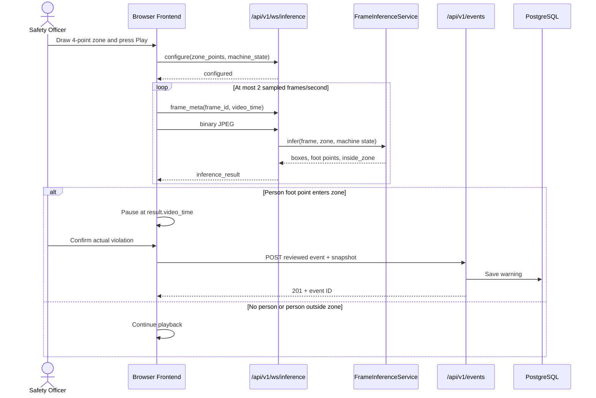
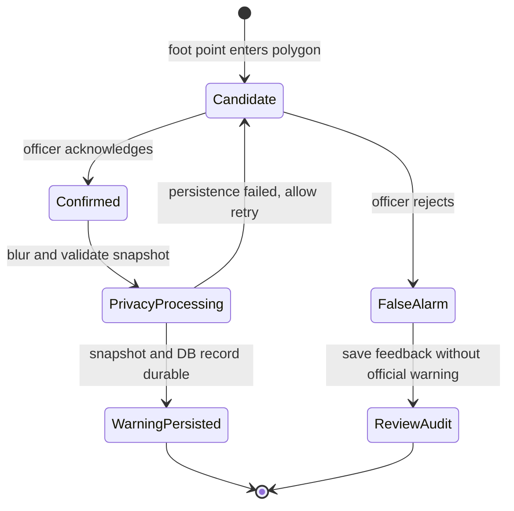

# Backend Module - PPE & Zone Safety Monitoring System

## Overview
Phân hệ `backend` là FastAPI web application theo kiến trúc Modular Monolith. Phân hệ đảm nhận vai trò API Gateway, quản lý trạng thái phiên phân tích video, ghi nhận và xử lý các sự kiện vi phạm quy định an toàn (PPE & xâm nhập vùng nguy hiểm), đẩy cảnh báo thời gian thực qua WebSocket, và cung cấp AI Safety Agent tư vấn xử lý sự cố.

## Directory Structure
```text
backend/
├── app/
│   ├── api/
│   │   └── v1/
│   │       ├── agent.py       # AI Safety Agent chat & recommendation endpoint
│   │       ├── analysis.py    # Video stream analysis orchestration
│   │       ├── events.py      # Safety violation event CRUD & acknowledgment
│   │       ├── statistics.py  # Safety compliance & violation metrics
│   │       └── websocket.py   # Alert and binary frame inference WebSockets
│   │   └── router.py          # API v1 aggregator
│   ├── core/
│   │   ├── config.py          # Pydantic Settings, CORS & env configuration
│   │   └── database.py        # SQLAlchemy Engine & session setup
│   ├── models/
│   │   └── event.py           # SafetyEvent ORM model
│   ├── schemas/
│   │   ├── analysis.py        # Analysis DTO schemas
│   │   ├── event.py           # Event DTO schemas
│   │   └── statistics.py     # Statistics DTO schemas
│   ├── services/
│   │   ├── analysis_service.py # Stream analysis state management
│   │   ├── event_service.py    # Event database CRUD service
│   │   ├── llm_service.py     # AI Agent reasoning service (LangChain / OpenAI)
│   │   └── statistics_service.py # Compliance & metric calculations
│   └── main.py                # FastAPI Application entrypoint & lifespan
├── migrations/                # Alembic database migrations
├── tests/                     # Pytest suite for backend endpoints & services
└── README.md                  # This documentation file
```

Project-wide decisions and progress live only in root [`DECISIONS.md`](../DECISIONS.md) and [`PROGRESS.md`](../PROGRESS.md).

## Setup & Running
```bash
# Run backend development server
uvicorn backend.app.main:app --reload --host 0.0.0.0 --port 8000

# Run backend test suite
PYTHONPATH=. .venv/bin/pytest backend/tests -v
```

## Frontend–Backend Interaction

The baseline uses two transports with separate responsibilities:

- WebSocket `/api/v1/ws/inference` carries zone configuration, sampled JPEG frames, and inference results.
- REST `/api/v1/events` persists a reviewed outcome and its snapshot.



## Frame Inference Contract

### WebSocket endpoint

`GET ws://<host>/api/v1/ws/inference`

The socket is stateful per connection:

1. A JSON `configure` message must contain exactly four normalized `zone_points` and `machine_state` (`running` or `stopped`).
2. Each JSON `frame_meta` supplies a non-negative `frame_id` and `video_time`.
3. The next message must be binary JPEG bytes for that metadata.
4. Inference runs outside the FastAPI event loop and returns one correlated `inference_result`.

Invalid ordering, validation, JPEG, or inference failures return:

```json
{
  "type": "error",
  "code": "invalid_frame",
  "message": "image_data could not be decoded as an image"
}
```

The server processes messages sequentially. The frontend additionally enforces one frame in flight, which prevents model overload and stale queues.

### Detection and zone evaluation

YOLO returns a person bounding box `[x1, y1, x2, y2]`. The service represents the person's ground position as the bottom-center point:

```text
foot_x = (x1 + x2) / 2
foot_y = y2
```

The four normalized zone points are converted to frame pixels. OpenCV `pointPolygonTest` sets `inside_zone=true` when the foot point is on or inside the polygon. Zone review is based on this foot point, not bounding-box overlap. Machine state affects PPE violation severity but does not suppress zone-entry review.

The REST fallback `POST /api/v1/analysis/frame` remains available and returns the same core `FrameInferenceResponse` without WebSocket correlation fields.

## Reviewed Warning Persistence

### Current baseline

The browser holds an unpersisted `pendingViolation` after zone entry. Only after the officer chooses a review action does it call:

```http
POST /api/v1/events
Content-Type: application/json
```

Example confirmed violation:

```json
{
  "zone_id": "zone_01",
  "camera_id": "uploaded_video",
  "event_type": "missing_ppe_and_intrusion",
  "severity": "high",
  "status": "acknowledged",
  "acknowledged_by": "Safety Officer",
  "snapshot_data": "data:image/jpeg;base64,...",
  "privacy_blurred": false,
  "details": {
    "inference_result": "violate",
    "review_result": "actual_violation",
    "machine_state": "running",
    "video_timestamp_seconds": 12.5,
    "people": [],
    "zone_points": []
  }
}
```

`EventService` validates and decodes `snapshot_data`, writes a JPEG under `data/snapshots`, stores its `/snapshots/...` path in the event row, commits the database record, and returns `201 Created`. Reviewed records receive `acknowledged_at` on the server.

The baseline also persists `false_alarm` using the same endpoint so model quality can be evaluated.

### Recommended production design

Use a two-level record model:

1. Keep detections transient until review, identified by a generated `detection_id`. Do not create an official warning merely because the model fired.
2. On `acknowledged`, create the immutable safety warning, derive `acknowledged_by` from the authenticated officer, blur faces before storage, and persist the snapshot plus inference metadata in one controlled operation.
3. On `false_alarm`, write a lightweight review-audit/feedback record for model metrics, but do not create a safety warning or retain the unblurred snapshot unless policy explicitly requires it.
4. Require `detection_id` as an idempotency key so reconnects or repeated clicks cannot create duplicate warnings.
5. Store production snapshots in protected object storage and keep only the object key, checksum, privacy status, and retention deadline in PostgreSQL.

Recommended confirmed-warning lifecycle:

```text
detected in memory
    → officer acknowledged
    → validate detection_id
    → privacy blur snapshot
    → persist snapshot
    → insert immutable warning + review audit
    → return event ID
```



If snapshot persistence or the database transaction fails, return an error and keep the frontend review pending so the officer can retry. Do not report a saved warning until both the event metadata and protected snapshot reference are durable.
