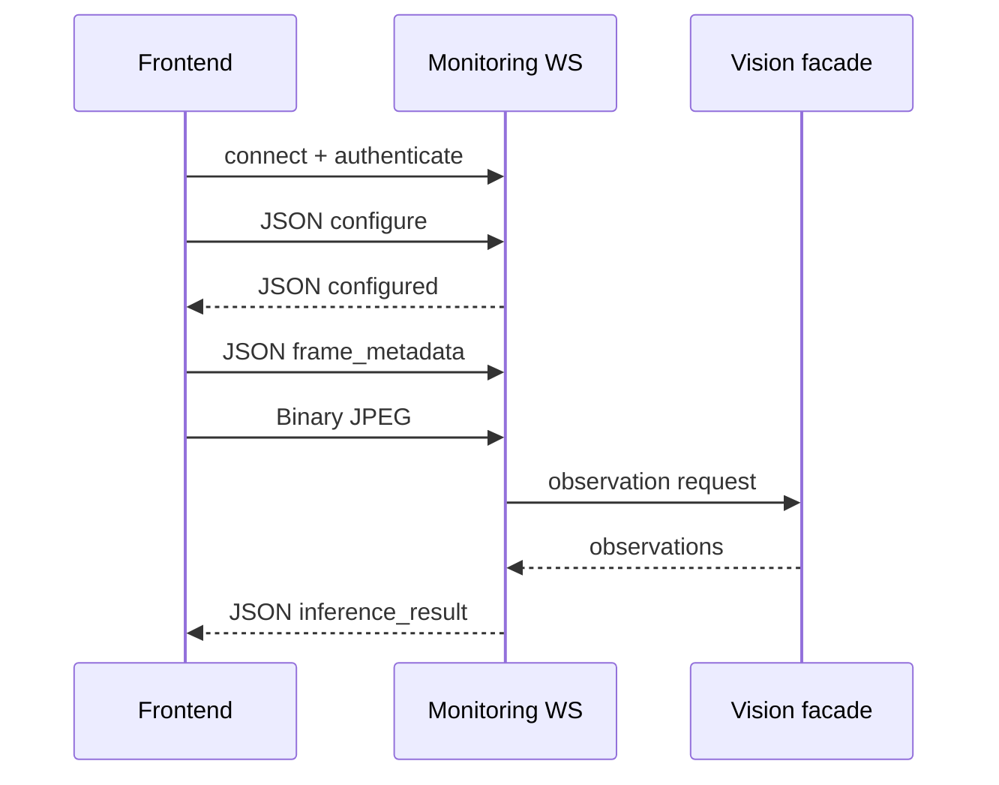

# API Contract — Auth, Monitoring và Inference

> Chỉ mục: [`README.md`](README.md) · Kiểu chung: [`01-foundations.md`](01-foundations.md)

## 5. Contract nghiệp vụ chính

### 5.1 Auth

`POST /api/v1/auth/login`

```json
{
  "email": "officer@example.com",
  "password": "<redacted>"
}
```

`200 OK`:

```json
{
  "access_token": "<opaque>",
  "token_type": "bearer",
  "expires_in": 900,
  "refresh_token": "<opaque>",
  "user": {
    "id": "7fd4...",
    "display_name": "Safety Officer A",
    "role": "safety_officer",
    "zone_ids": ["985c..."]
  }
}
```

Password không bao giờ xuất hiện trong response/audit. Refresh token phải được hash/revoke ở server.

### 5.2 Monitoring session

`POST /api/v1/monitoring/sessions`

```json
{
  "source_type": "video",
  "zone_id": "985c...",
  "shift_id": "1b87...",
  "timezone": "Asia/Ho_Chi_Minh",
  "machine_state": "stopped",
  "polygon": [
    {"x": 0.25, "y": 0.25},
    {"x": 0.75, "y": 0.25},
    {"x": 0.75, "y": 0.75},
    {"x": 0.25, "y": 0.75}
  ],
  "rule_version_id": "a1b2..."
}
```

`201 Created` trả `id`, toàn bộ cấu hình đã normalize, `status=active`, `created_by`, `started_at`. MVP UI vẫn có thể giữ video local; server chỉ lưu metadata phiên, không lưu raw video liên tục.

### 5.3 REST frame/image inference

`POST /api/v1/analysis/frame` giữ contract compatibility hiện tại. Contract đích cho frame và `POST /api/v1/analysis/image` dùng `multipart/form-data`:

- `file`: JPEG/PNG theo allowlist và size limit cấu hình.
- `metadata`: JSON chứa `session_id`, `frame_id`, `captured_at`, `correlation_id`, `machine_state`, polygon/rule override nếu endpoint compatibility yêu cầu.

`200 OK` dùng cùng `InferenceResult` như WebSocket:

```json
{
  "schema_version": "1.0",
  "session_id": "54aa...",
  "frame_id": "frame-000184",
  "correlation_id": "01J4...",
  "captured_at": "2026-08-06T08:30:00.120Z",
  "processed_at": "2026-08-06T08:30:00.280Z",
  "latency_ms": 160,
  "machine_state": "running",
  "observations": [{
    "track_id": "track-12",
    "class_name": "person",
    "box": [0.10, 0.20, 0.30, 0.80],
    "foot_point": [0.20, 0.80],
    "confidence": 0.95,
    "inside_zone": true,
    "ppe": [
      {"item": "helmet", "state": "missing", "confidence": 0.91},
      {"item": "glasses", "state": "present", "confidence": 0.88},
      {"item": "gloves", "state": "unknown", "confidence": 0.44}
    ]
  }],
  "decisions": [{
    "rule_version_id": "a1b2...",
    "track_id": "track-12",
    "violation_type": "zone_intrusion",
    "severity": "critical",
    "confidence": 0.95,
    "requires_review": true,
    "reason_codes": ["person_inside_zone", "machine_running"]
  }],
  "error": null
}
```

Vision chỉ tạo `observations`; backend `rules` tạo `decisions`; backend `events` quản lý lifecycle/dedup.

### 5.4 WebSocket inference

Trình tự bắt buộc:



Client chỉ gửi tối đa một frame đang xử lý và baseline lấy mẫu 2 FPS. Mỗi binary frame phải có đúng một `frame_metadata` ngay trước nó.

```json
{
  "type": "configure",
  "schema_version": "1.0",
  "session_id": "54aa...",
  "polygon": [{"x": 0.25, "y": 0.25}, {"x": 0.75, "y": 0.25}, {"x": 0.75, "y": 0.75}, {"x": 0.25, "y": 0.75}],
  "machine_state": "running",
  "rule_version_id": "a1b2..."
}
```

```json
{
  "type": "frame_metadata",
  "frame_id": "frame-000184",
  "correlation_id": "01J4...",
  "captured_at": "2026-08-06T08:30:00.120Z",
  "content_type": "image/jpeg",
  "byte_length": 84321
}
```

Server trả `configured`, `inference_result` (payload mục 5.3 thêm `type`) hoặc:

```json
{
  "type": "error",
  "code": "invalid_message_sequence",
  "message": "Binary frame requires preceding frame_metadata",
  "retryable": false,
  "correlation_id": "01J4..."
}
```

Reconnect tạo transport mới nhưng có thể tiếp tục `session_id`; dedup dựa trên session/track/rule/violation occurrence, không dựa trên socket.
