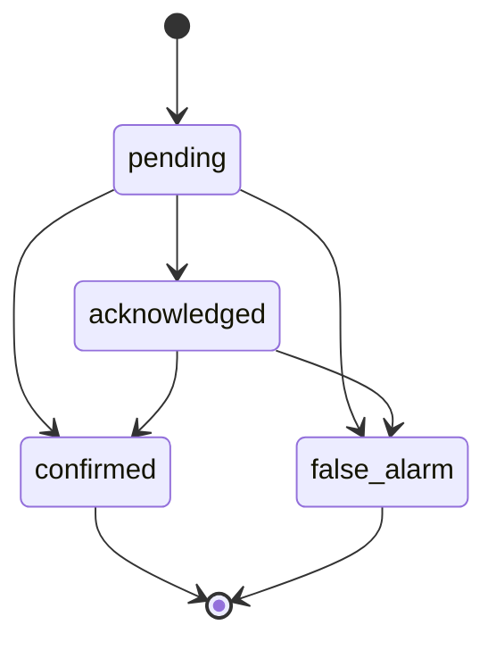

# API Contract — Rules, Events và Nghiệp Vụ Hậu Inference

> Chỉ mục: [`README.md`](README.md) · Inference đầu vào: [`03-auth-monitoring-inference.md`](03-auth-monitoring-inference.md)

## 5. Contract nghiệp vụ chính — phần tiếp theo

### 5.5 Rule preview và confirm

`POST /api/v1/rules/preview`:

```json
{
  "description": "Cảnh báo critical khi có người vào vùng cấm lúc máy chạy; cảnh báo high nếu thiếu mũ",
  "required_ppe": ["helmet", "glasses", "gloves"],
  "low_confidence_threshold": 0.50,
  "high_confidence_threshold": 0.80
}
```

Response gồm `normalized_rule`, `validation_errors`, `explanation`, `generator=llm|deterministic`. Preview chưa được inference sử dụng. `POST /rules` nhận normalized rule + `preview_token`, tạo immutable `version`; sửa rule tạo version mới.

### 5.6 Event và HITL lifecycle

Event state machine:



`POST /api/v1/events` là route compatibility. Payload đích:

```json
{
  "session_id": "54aa...",
  "track_id": "track-12",
  "rule_version_id": "a1b2...",
  "zone_id": "985c...",
  "shift_id": "1b87...",
  "violation_type": "zone_intrusion",
  "severity": "critical",
  "detected_at": "2026-08-06T08:30:00.280Z",
  "confidence": 0.95,
  "machine_state": "running",
  "correlation_id": "01J4...",
  "decision_context": {
    "reason_codes": ["person_inside_zone", "machine_running"],
    "ppe": []
  }
}
```

Snapshot không được coi là hợp lệ chỉ vì client gửi `privacy_blurred=true`; server policy phải xác minh/xử lý trước persistence. `POST /events/{id}/transitions`:

```json
{
  "to_status": "confirmed",
  "reason_code": "operator_verified",
  "note": "Đã kiểm tra video mô phỏng",
  "occurred_at": "2026-08-06T08:31:02Z"
}
```

Response `200` gồm event hiện tại và audit transition. Transition terminal sai trả `409`. False alarm vẫn được lưu cho metric nhưng bị loại khỏi danh sách vi phạm chính thức mặc định.

`GET /events` filters: `status`, `violation_type`, `severity`, `zone_id`, `shift_id`, `from`, `to`, `timezone`, `cursor`, `limit`. `GET /events/{id}` trả decision context immutable, rule version, actor review, transitions và snapshot metadata đã blur.

Dedup key logic: `session_id + track_id + rule_version_id + violation_type + occurrence`. Một occurrence active chỉ có một event; event mới chỉ sau khi violation kết thúc rồi tái diễn hoặc hết cooldown.

### 5.7 Analytics

`GET /api/v1/statistics/summary` được giữ cho baseline. `GET /api/v1/analytics/compliance` nhận `from`, `to`, `timezone`, `zone_id[]`, `shift_id[]`, `violation_type[]`, `severity[]`, `bucket=hour|day|week`.

```json
{
  "filters": {"from": "2026-08-01T00:00:00Z", "to": "2026-08-08T00:00:00Z", "timezone": "Asia/Ho_Chi_Minh"},
  "totals": {
    "alerts": 120,
    "confirmed": 72,
    "false_alarms": 18,
    "ppe_violations": 42,
    "zone_intrusions": 30,
    "false_alarm_rate": 0.20,
    "compliance_rate": 0.88
  },
  "metric_definitions": {
    "false_alarm_rate": "false_alarms / reviewed_alerts",
    "compliance_rate": "compliant_observations / eligible_observations"
  },
  "series": [],
  "top_risks": []
}
```

Mẫu số phải xuất hiện trong contract/query implementation; không suy compliance chỉ từ số người khác nhau nếu hệ thống chưa đo eligible observations.

### 5.8 Organization

Zone gồm `name`, `timezone`, polygon mặc định, `active`; shift gồm `name`, local `start_time`, `end_time`, `timezone`, ngày áp dụng; assignment gắn user với zone, trách nhiệm và hiệu lực. `DELETE` là soft-delete (`204`), trả `409` nếu hành động làm hỏng tham chiếu/assignment đang hiệu lực. Shift giao nhau trong cùng zone trả `409 shift_overlap`.

### 5.9 Escalation

Critical event tạo tối đa một escalation logic; mỗi provider attempt là delivery riêng. Trạng thái escalation: `pending → delivering → delivered → acknowledged`, hoặc `failed` sau retry limit. Provider lỗi không làm mất in-app alert.

`POST /escalations/{id}/acknowledge` nhận `occurred_at`, `note`; `POST /retry` bắt buộc `Idempotency-Key`, chỉ hợp lệ cho `failed` hoặc retryable delivery. Response luôn cho biết `attempt_count`, `next_retry_at`, `recipient`, `channel`, `last_error_code` đã sanitize.

### 5.10 Reporting

Report schedule gồm `frequency=daily|weekly`, timezone, zone/shift scope, recipient list, format `html|pdf|csv`, `next_run_at`, `active`. Mỗi kỳ (`schedule_id + period_start + period_end`) chỉ sinh một report. Report lưu aggregation snapshot để tải lại không đổi số liệu; diễn giải LLM chỉ dùng dữ liệu snapshot, có deterministic fallback và không quyết định metric.
