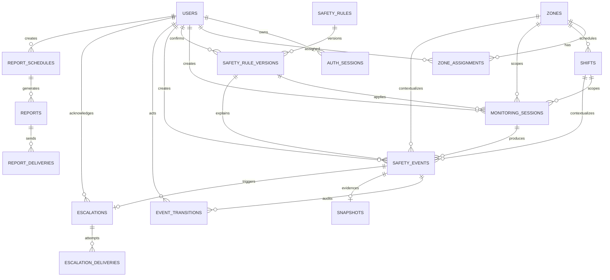

# Database Schema — Nền Tảng, ERD và Ownership

> Chỉ mục: [`README.md`](README.md) · Quy tắc migration: [`05-constraints-and-operations.md`](05-constraints-and-operations.md)

## 1. Mục tiêu và nguyên tắc

Schema này là contract chung để Backend, Frontend, Analytics, QA và DevOps thống nhất dữ liệu. Mỗi bảng có đúng một module owner; module khác truy cập qua public service/contract, không import ORM model hoặc repository nội bộ.

- Khóa chính dùng UUID; thời gian dùng `timestamptz` UTC; timezone nghiệp vụ lưu bằng IANA name.
- Mọi bảng mutable có `created_at`, `updated_at`; bảng audit/transition/delivery attempt là append-only.
- Soft-delete bằng `deleted_at`; không xóa cứng zone/shift/user/rule đã được event tham chiếu.
- JSONB chỉ dùng cho snapshot context bất biến hoặc cấu trúc thay đổi theo version; field cần filter/join phải là cột chuẩn.
- Raw video không lưu trong database. Snapshot chỉ lưu object key/metadata; pixel đã blur nằm ở storage.
- `privacy_blurred=true` chỉ sau khi xử lý thành công; không có object raw tồn tại sau transaction.
- LLM summary là dữ liệu dẫn xuất, không thay thế structured audit context.

## 2. Sơ đồ ERD tổng thể

## 3. Ownership và bảng

| Module owner | Bảng sở hữu | Mục đích |
|---|---|---|
| `auth` | `users`, `auth_sessions` | Identity, role, token/session lifecycle |
| `organization` | `zones`, `shifts`, `zone_assignments` | Khu vực, ca, timezone, người phụ trách |
| `rules` | `safety_rules`, `safety_rule_versions` | Rule identity và version bất biến |
| `monitoring` | `monitoring_sessions` | Context của phiên video/ảnh |
| `events` | `safety_events`, `event_transitions`, `snapshots` | Dedup, HITL lifecycle, audit và evidence policy |
| `escalation` | `escalations`, `escalation_deliveries` | Routing, acknowledge, retry/idempotency |
| `reporting` | `report_schedules`, `reports`, `report_deliveries` | Schedule, aggregation snapshot, artifact và delivery |
| `analytics` | Không sở hữu source table ở MVP | Đọc qua public query contract; materialized view chỉ thêm khi đo được nhu cầu |

Vision không sở hữu bảng và không persistence observation. Observation chỉ trở thành event/audit khi backend rules/events quyết định.
