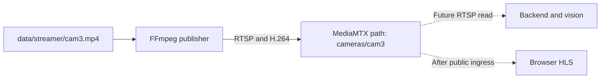
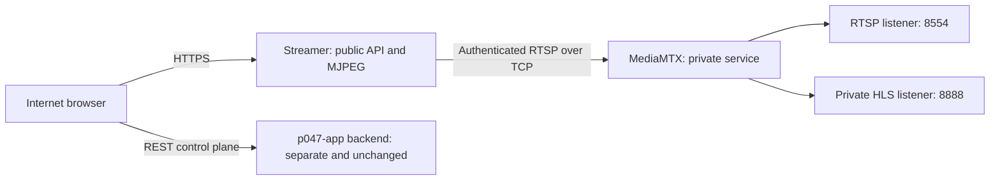
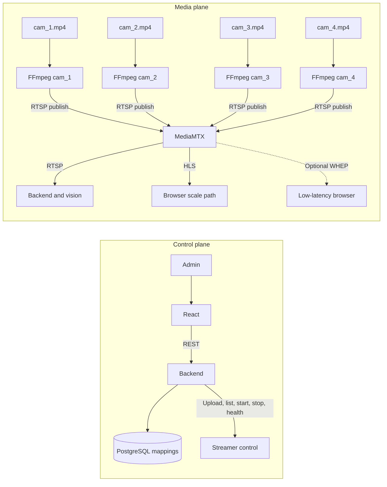
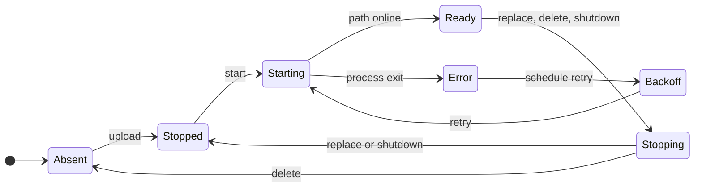
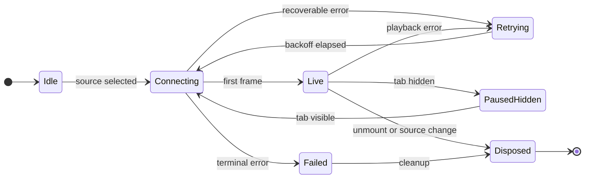

# Đặc tả giải pháp media RTSP-first cho mô phỏng CCTV

## 1. Trạng thái, mục tiêu và phạm vi

- Trạng thái: kiến trúc đã chốt; publisher RTSP và gateway riêng đã được triển
  khai trên Railway ngày 2026-08-21. Browser HLS, RTSP inference và capacity gate
  vẫn chưa hoàn tất.
- Mục tiêu: mô phỏng đúng boundary camera CCTV và phục vụ tối đa 200 người,
  mỗi người có thể xem bốn camera (tối đa 800 playback session).
- Phạm vi: media simulation, gateway, browser player và điểm tích hợp
  backend/vision.
- Không đổi: rule an toàn, RBAC, event lifecycle, privacy và persisted mapping.

Runtime hiện tại là file → FFmpeg → MJPEG → FastAPI → ``. Shared worker đã
giới hạn một FFmpeg/camera và latest-frame buffer, nhưng MJPEG không phải source
contract CCTV, FastAPI vẫn vận chuyển media bytes và H.264 scale băng thông tốt
hơn JPEG độc lập.

### Đọc nhanh cho người mới

Hãy tách hệ thống thành hai mặt phẳng:

- **Control plane** trả lời “camera nào tồn tại, camera nào được gán vào ô nào,
  ai được phép đổi mapping”. React, backend/PostgreSQL và API của streamer nằm ở
  đây. Payload nhỏ, có RBAC và không mang video H.264.
- **Media plane** vận chuyển hình ảnh. Một FFmpeg process đọc lặp một file MP4,
  encode H.264 và publish RTSP vào MediaMTX. MediaMTX giữ một input cho mỗi camera
  rồi fan-out cho consumer; số browser không làm sinh thêm FFmpeg publisher.

Ví dụ với `cam3`:



Ba điều dễ nhầm:

1. `/stream/cam3` là MJPEG rollback do streamer phục vụ; nó không chứng minh RTSP.
2. HLS phát được không chứng minh model đã đọc RTSP hoặc tạo alert.
3. `GET /health` chỉ chứng minh HTTP process sống; inventory và MediaMTX log mới
   chứng minh publisher/path tương ứng đang online.

### Trạng thái Railway đã kiểm chứng ngày 2026-08-21



- `streamer` và `mediamtx` là hai Railway service độc lập.
- MediaMTX pin `1.20.1`; RTSP publisher dùng credential và path đã validate.
- Bốn source trên volume (`cam3`, `cam4`, `fullppe`, `nohat`) được inventory báo
  `ready`, zero restart; MediaMTX xác nhận bốn path H.264 online.
- MediaMTX chưa có public domain. URL HLS trong inventory là private Railway DNS,
  chỉ workload cùng project/environment truy cập được; browser Internet không
  resolve hostname này.
- Vì vậy production browser vẫn dùng MJPEG rollback. Muốn bật HLS phải thêm HTTPS
  playback ingress, viewer authorization, CORS allowlist và canary một camera;
  không được chỉ public port `8888` hoặc đưa reader credential vào frontend.

## 2. Quyết định kiến trúc

1. RTSP over TCP + H.264 là contract nguồn camera nội bộ.
2. MediaMTX là media gateway; FastAPI không proxy media bytes trong kiến trúc đích.
3. Một FFmpeg publisher cho mỗi camera mô phỏng.
4. Backend/vision đọc RTSP; browser đọc HLS mặc định.
5. WebRTC/WHEP là slice tùy chọn nếu yêu cầu latency thấp hơn HLS.
6. Mapping, quyền và metadata tiếp tục thuộc backend/PostgreSQL.
7. MJPEG được giữ làm rollback trong migration window.
8. MediaMTX Docker image phải pin exact version; không dùng `latest` hoặc tag trôi.
9. Không tuyên bố đạt 200 × 4 nếu chưa có load/soak test thật.



## 3. Boundary và ownership

| Component | Sở hữu | Không sở hữu |
|---|---|---|
| React | Player state, visibility, retry, cleanup | Authorization/safety rule |
| Backend | Persisted mapping, RBAC, public app contract | Relay/transcode media |
| Streamer control | Upload, publisher lifecycle, inventory/readiness | Browser fan-out |
| FFmpeg | Loop/normalize source, publish một RTSP path | Viewer retry |
| MediaMTX | RTSP ingest/read, HLS/WebRTC egress | User/event database |
| Backend/vision consumer | RTSP decode, inference/rule flow | Browser playback |

| Boundary | Protocol |
|---|---|
| Simulator → MediaMTX | RTSP/TCP, H.264 |
| MediaMTX → backend/vision | RTSP/TCP |
| MediaMTX → scale browser | HLS/HTTPS |
| MediaMTX → low-latency browser | WebRTC/WHEP, deferred |
| React → backend | Existing authenticated REST |

## 4. Identity và URL contract

- `camera_id`: slot nghiệp vụ, ví dụ `cam_1`–`cam_4`.
- `stream_camera_id`: source đã đăng ký, giữ contract hiện tại.
- `media_path`: derive server-side sau validation, ví dụ `cameras/cam_1`.

Browser không được gửi URL tùy ý. Server tạo URL từ ID và configured base origin
để tránh SSRF, path traversal và lộ credential.

```text
Publish: rtsp://mediamtx:8554/cameras/cam_1
Vision:  rtsp://mediamtx:8554/cameras/cam_1
HLS:     https://MEDIA_PUBLIC_ORIGIN/cameras/cam_1/index.m3u8
WHEP:    https://MEDIA_PUBLIC_ORIGIN/cameras/cam_1/whep
```

`MEDIA_PUBLIC_ORIGIN` không hard-code trong TypeScript/database. RTSP origin và
publisher credential chỉ nằm trong server configuration.

Inventory mới phải additive/versioned, không breaking response string hiện tại:

```json
{
  "version": "camera_inventory_v1",
  "cameras": [{
    "stream_camera_id": "cam_1",
    "status": "ready",
    "transports": {"hls": "/cameras/cam_1/index.m3u8", "webrtc": "/cameras/cam_1/whep"}
  }]
}
```

## 5. Media profile ban đầu

| Thuộc tính | Baseline để test |
|---|---|
| Codec/pixel | H.264 / `yuv420p` |
| Audio | Không bắt buộc |
| Resolution | Giữ source, load fixture tối đa 1280×720 |
| FPS | 10 FPS cho capacity baseline |
| Bitrate | 600–1000 kbit/s/camera, phải đo |
| GOP | Khoảng 2 giây, đồng bộ HLS segment policy |
| RTSP transport | TCP trong Docker/local |

Nếu source tương thích có thể thử `-c copy`; nếu browser/gateway không tương thích,
transcode về profile trên. Không mặc định mọi MP4 đều stream-copy được.

## 6. Publisher lifecycle



- Tối đa một publisher process cho mỗi `stream_camera_id` trong một controller.
- Replace dừng publisher cũ trước khi công bố source mới.
- Delete dừng publisher và path không còn ready.
- Exit bất ngờ dùng bounded exponential backoff, không spin.
- Shutdown terminate, chờ timeout, rồi kill nếu cần.
- Readiness kiểm tra MediaMTX và required path, không chỉ HTTP process.
- Không chạy bốn FFmpeg background trong một shell thiếu supervisor.

## 7. Browser player contract

Frontend thay `` bằng `HlsVideo` trong HLS mode.



- Render `<video muted autoPlay playsInline>`.
- Safari/native HLS qua `canPlayType`; MSE browser dùng npm-pinned `hls.js`.
- Cleanup luôn `hls.destroy()` khi đổi URL/unmount.
- Native cleanup: pause, remove `src`, gọi `load()`.
- Cancel retry/timer/request khi unmount, đổi source hoặc tab hidden.
- Fatal retry có exponential backoff + jitter + max delay.
- Hidden tab dừng network sau grace period; visible reconnect tại live edge.
- Mapping disconnect không retry.
- `onError` không giữ badge LIVE hoặc frame cũ như live evidence.
- Buffer giới hạn `maxBufferLength`, `maxMaxBufferLength`, `backBufferLength`;
  giá trị cuối dựa trên measurement.

## 8. Đồng bộ mapping nhiều client

- Poll `GET /api/v1/stream-config` mỗi 15 giây.
- Jitter ±20% để 200 client không đồng loạt gọi.
- Pause polling khi hidden; backoff khi backend lỗi.
- Chỉ restart player có mapping thực sự thay đổi.
- Cancel request/timer khi unmount.

SSE/WebSocket config push chỉ triển khai sau khi polling được đo là không đủ.

## 9. Latency và capacity

HLS là delivery transport, không phải camera contract và không thay inference
evidence. HLS phù hợp khi product chấp nhận latency vài giây. Nếu requirement là
sub-second/gần 1 giây, mở WebRTC/WHEP slice.

```text
encoder workload ≈ active cameras
egress ≈ viewers × cameras/viewer × bitrate/camera
200 × 4 × 0.8 Mbit/s ≈ 640 Mbit/s (planning example, không phải cam kết)
```

MediaMTX loại FastAPI khỏi media path nhưng không loại network egress. CDN/edge
chỉ thêm sau khi đo single-instance.

## 10. Security và observability

- RTSP/publisher ports ở private network; public playback dùng TLS.
- Publisher path không anonymous; credential không vào frontend/log/repository.
- Demo public-read chỉ trong demo environment và không có camera thật.
- Production CORS dùng allowlist; rate/connection limit ở ingress/gateway.
- Quan sát publisher state/restart, readers/sessions, CPU/RSS, file descriptors,
  egress, manifest/segment errors, first-frame time và retries.
- `/health/live` chứng minh process sống; `/health/ready` chứng minh MediaMTX và
  required path. Không tạo 800 viewer trong readiness.

## 11. Migration và rollback

1. Additive infrastructure: pin MediaMTX, publish một fixture, chứng minh RTSP + HLS.
2. One-camera canary: `HlsVideo`, flag `mjpeg|hls`, chỉ `cam_1` dùng HLS.
3. Four-camera rollout: bốn publisher/path, polling/visibility/retry đầy đủ.
4. Capacity: test 1/10/25/50/100/200 users, 1 và 4 camera/user, soak ≥30 phút.

Rollback đổi transport flag về MJPEG, dừng gateway/publisher mới và chạy legacy
smoke. Không xóa MJPEG/data/API trong release migration.

## 12. Acceptance criteria

1. Bốn fixture publish thành bốn RTSP path ổn định và đọc được bằng client thật.
2. Mỗi camera tối đa một publisher; exit/replace/delete/shutdown không để orphan.
3. Mỗi path có HLS manifest và playable media segment thật.
4. Live Monitor render bốn `<video>` theo mapping.
5. Chromium Hls.js và native-HLS branch có test; cleanup dừng request cũ.
6. Hidden tab dừng tải; visible reconnect; error không báo LIVE giả.
7. Retry bounded backoff+jitter và bị cancel đúng lifecycle.
8. Viewer khác nhận admin mapping change trong tối đa một polling interval.
9. FastAPI không proxy HLS segment hoặc RTSP bytes.
10. Mapping/RBAC không breaking; MJPEG rollback vẫn chạy.
11. RTSP → backend/vision → model/rule/alert chạy thật, tách khỏi playback proof.
12. Báo cáo 200 × 4 có CPU, RSS, egress, errors, first-frame latency và soak.
13. RSS đạt plateau; sau disconnect resource trở về trạng thái dự kiến.
14. Không pass nếu load generator không tải segment hoặc browser subset không decode.

## 13. Test strategy

- Unit: path validation, publisher state/command, backoff.
- Component: native/MSE, destroy/cleanup, visibility, retry, mapping delta.
- Integration: FFmpeg → RTSP → MediaMTX; RTSP read; HLS manifest/segment.
- Browser: four players, source change cleanup, hidden/visible, failure/recovery.
- E2E: seed/map four cameras; reroute one; stop/restore publisher.
- AI E2E riêng: RTSP → inference → deterministic rule → real alert/event.

## 14. Nguồn chính thức phải re-check khi triển khai

- `https://mediamtx.org/docs/kickoff/install`
- `https://mediamtx.org/docs/publish/ffmpeg`
- `https://mediamtx.org/docs/read/rtsp`
- `https://mediamtx.org/docs/read/hls`
- `https://mediamtx.org/docs/read/web-browsers`
- `https://mediamtx.org/docs/read/webrtc`
- `https://github.com/video-dev/hls.js/blob/master/docs/API.md`

## 15. Non-goals

- ONVIF/camera thật, PLC/tự dừng máy trong slice đầu.
- CDN trước measurement.
- Xóa MJPEG cùng migration.
- Coi HLS là inference source.
- Hứa CPU/RAM/browser memory cố định trước load test.
