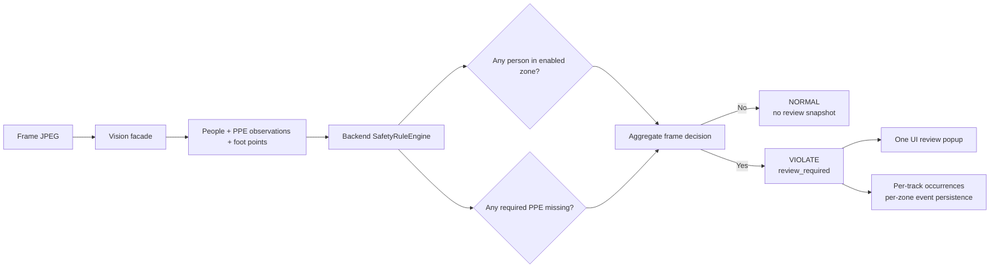

# Contract rule alert theo khung hình

## Trạng thái

Đây là contract đã được Product Owner xác nhận ngày 2026-08-16, dùng để triển khai và review team. Cho đến khi code và test được cập nhật, runtime hiện tại vẫn còn điều kiện `machine_state=running` cho zone alert.

## Rule sau khi triển khai

Một frame là `violate` khi có ít nhất một điều kiện sau:

- Có ít nhất một người trong một zone đang `enabled`.
- Có ít nhất một người thiếu PPE đang được yêu cầu (`hat_required` hoặc `vest_required`).

Zone alert không phụ thuộc `machine_state`: cả `running` và `stopped` đều alert. `machine_state` vẫn được giữ trong request, zone config, response và event details để làm context/audit.

Không có người thì frame luôn `normal`; không đánh giá thiếu PPE khi không có person detection.

## Ma trận hành vi

| Có người | Trong zone enabled | Thiếu PPE bắt buộc | Máy | Kết quả |
|---|---:|---:|---|---|
| Không | — | — | ON/OFF | `normal` |
| Có | Không | Không | ON/OFF | `normal` |
| Có | Có | Không | ON | `violate` |
| Có | Có | Không | OFF | `violate` |
| Có | Không | Có | ON/OFF | `violate` |
| Có | Có | Có | ON/OFF | `violate` |

Với nhiều người, chỉ cần một người vi phạm là toàn frame `violate` và UI mở một review popup. Backend vẫn giữ `track_id`, `occurrence_id` và `zone_id` riêng để dedup, audit, thống kê và persist event theo zone.

## Luồng runtime

## Boundary không thay đổi

- Vision chỉ phát hiện/track/đo foot point và trả observation; không quyết định alert.
- Backend service là nơi quyết định `result`, `review_required` và occurrence.
- REST/WebSocket payload hiện hành giữ nguyên; không tạo schema frame-event mới.
- Review được gộp ở UI theo frame, nhưng persistence vẫn tạo event riêng theo zone.
- Privacy snapshot vẫn fail-closed và chỉ persist sau khi operator xác nhận.

## Team checklist

- [ ] Unit rule test cho machine `running` và `stopped` có cùng kết quả khi người ở zone.
- [ ] REST/WebSocket test cho stopped-zone trả `violate` và `review_required=true`.
- [ ] Test không có người trả `normal` dù PPE requirement bật.
- [ ] Test nhiều người chỉ cần một người vi phạm thì aggregate frame là `violate`.
- [ ] Kiểm tra occurrence/dedup và event theo zone không bị thay đổi.
- [ ] Cập nhật `DECISIONS.md`, `PROGRESS.md`, `ARCHITECTURE.md` và `backend/README.md` sau khi implementation hoàn tất.
