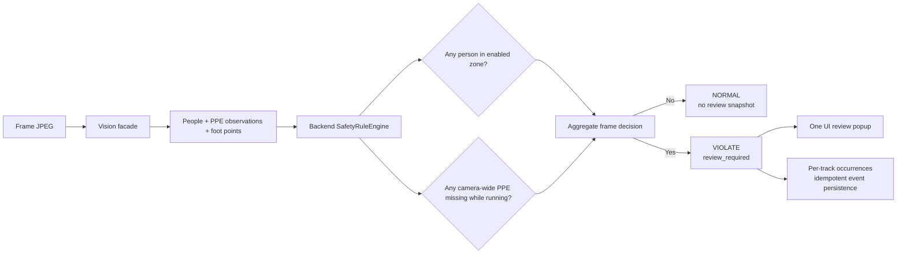

# Contract rule alert theo khung hình

## Trạng thái

Đây là business contract bắt buộc đọc trước khi sửa `SafetyRuleEngine`,
`FrameInferenceService`, camera configuration PPE hoặc các payload inference.
Không được tự ý thay đổi các quy tắc dưới đây chỉ để làm xanh một test; mọi
thay đổi cần xác nhận sản phẩm, decision record và regression tests.

Bản chốt theo `DECISIONS.md` (2026-08-24):
- **Zone Intrusion (`zone_intrusion_enabled=true`)**: Xâm nhập vùng nguy hiểm luôn báo vi phạm (`violate`), bất kể trạng thái máy `running` hay `stopped`.
- **PPE Requirements (`hat_required`, `vest_required`)**: PPE là cấu hình cấp camera, áp dụng cho mọi người trong toàn khung hình và không cần zone. Thiếu PPE chỉ báo vi phạm khi `machine_state=running`; `stopped` gate cảnh báo PPE.

## Rule sau khi triển khai

Một frame là `violate` khi có ít nhất một điều kiện sau:

- Có ít nhất một người nằm trong zone có `zone_intrusion_enabled=true` (bất kể máy `running` hay `stopped`).
- Có ít nhất một người trong khung hình khi máy `running` mà thiếu PPE bắt buộc (`hat_required` hoặc `vest_required`).
- Có ít nhất một người thuộc vùng nguy hiểm bị kích hoạt `restricted_area_detection_enabled=true`.

Không có người thì frame luôn `normal`; không đánh giá thiếu PPE khi không có person detection.

## Ma trận hành vi

| Có người | Trong zone intrusion | Thiếu PPE bắt buộc | Trạng thái máy | Kết quả frame |
|---|---:|---:|---|---|
| Không | — | — | ON / OFF | `normal` |
| Có | Không | Không | ON / OFF | `normal` |
| Có | Có (`intrusion=true`) | Không | ON / OFF | `violate` |
| Có | Không | Có | OFF | `normal` |
| Có | Không | Có | ON | `violate` |
| Có | Có (`intrusion=true`) | Có | OFF | `violate` (bởi zone intrusion) |
| Có | Có (`intrusion=true`) | Có | ON | `violate` |

Với nhiều người, chỉ cần một người vi phạm là toàn frame `violate` và UI mở một review popup. Backend vẫn giữ `track_id` và `occurrence_id` riêng để dedup/audit; `zone_id` chỉ gắn cho rule thuộc zone.

## Luồng runtime

## Boundary không thay đổi

- Vision chỉ phát hiện/track/đo foot point và trả observation; không quyết định alert.
- Backend service là nơi quyết định `result`, `review_required` và occurrence.
- Camera configuration thêm `ppe_requirements` cấp camera; field PPE trong zone được giữ tương thích trong giai đoạn chuyển đổi.
- Review được gộp ở UI theo frame; persistence tạo tối đa một request cho mỗi occurrence và một event theo track/session.
- Privacy snapshot vẫn fail-closed và chỉ persist sau khi operator xác nhận.

## Team checklist

- [ ] Unit rule test cho PPE ngoài zone khi `running` và không cảnh báo PPE khi `stopped`.
- [ ] Camera configuration test lưu/reload PPE với `zones=[]`.
- [ ] Test không có người trả `normal` dù PPE requirement bật.
- [ ] Test nhiều người chỉ cần một người vi phạm thì aggregate frame là `violate`.
- [ ] Kiểm tra occurrence trùng trong popup chỉ tạo một request và popup đóng sau khi lưu thành công.
- [ ] Cập nhật `DECISIONS.md`, `PROGRESS.md`, `ARCHITECTURE.md` và `backend/README.md` sau khi implementation hoàn tất.
