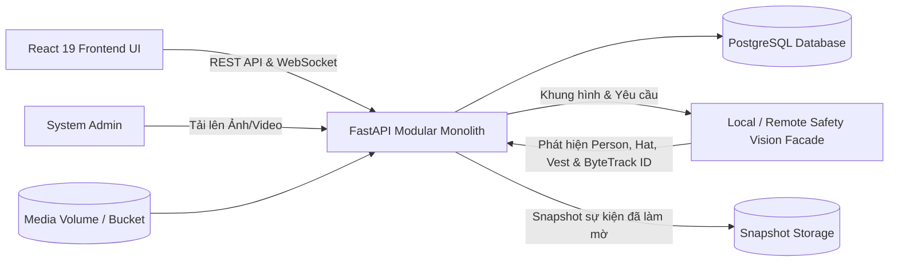
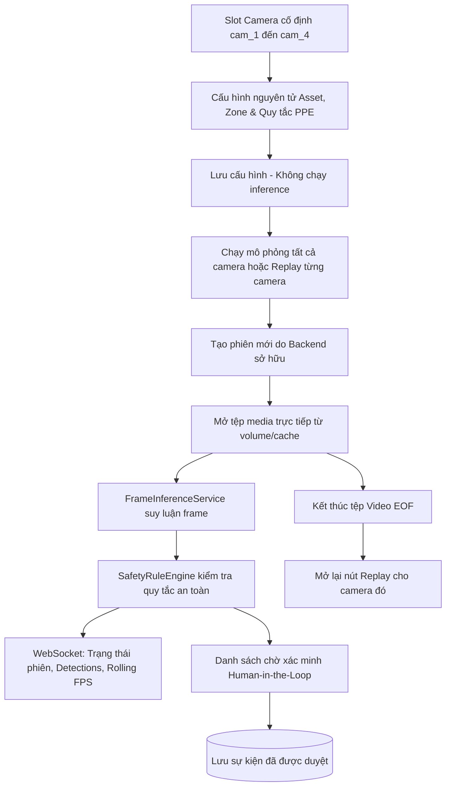
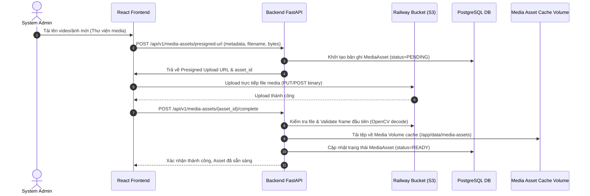
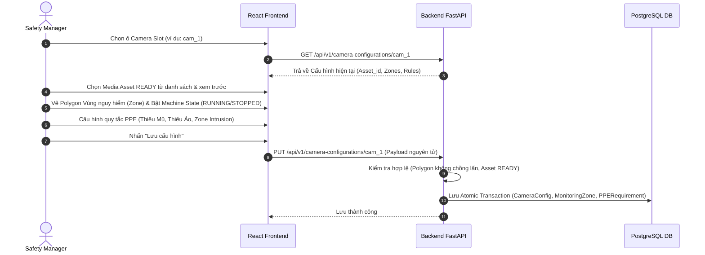
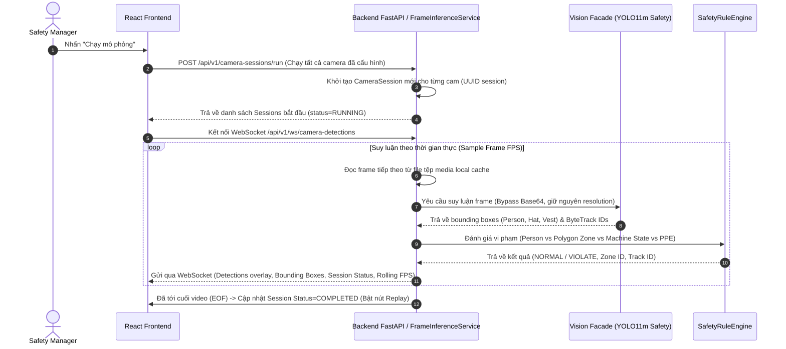
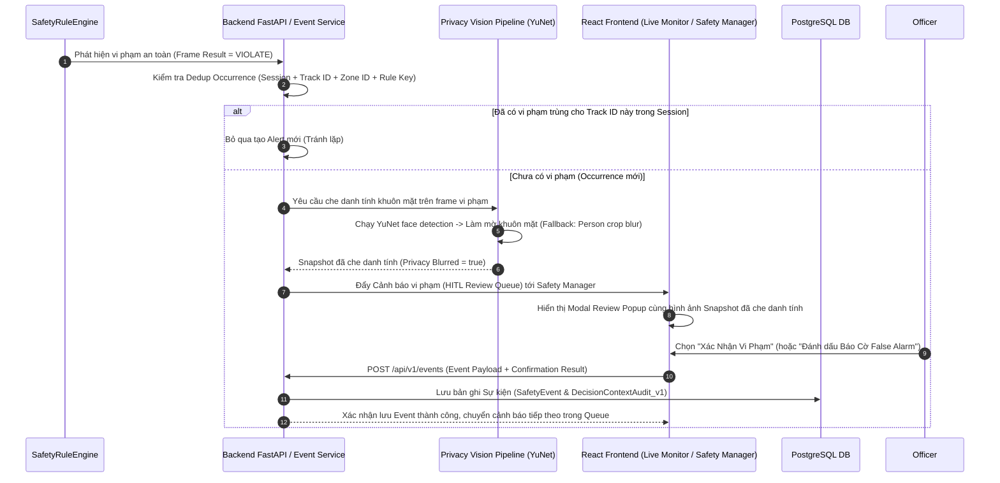

# Sơ Đồ Kiến Trúc & Luồng Hệ Thống (System Diagrams & Sequence Flows)

Tài liệu này tổng hợp các sơ đồ thành phần (Component Diagrams), sơ đồ topo (Topology) và sơ đồ luồng trình tự (Sequence Diagrams) chi tiết của hệ thống **P-047 Safety Monitoring**.

---

## 1. Sơ Đồ Thành Phần Hệ Thống (Component Architecture)

---

## 2. Sơ Đồ Chu Kỳ Cấu HÌnh & Phiên Camera (Camera Configuration & Session Lifecycle)

---

## 3. Các Sơ Đồ Trình Tự Chi Tiết (Detailed Sequence Diagrams)

### 3.1. Luồng Tải Lên & Quản Lý Media Asset (Upload Media Flow)

### 3.2. Luồng Cấu Hình Camera & Vùng An Toàn (Camera & Zone Configuration Flow)

### 3.3. Luồng Chạy Phiên Mô Phỏng & Suy Luận Trực Tiếp (Direct Frame Inference & WebSocket Flow)

### 3.4. Luồng Cảnh Báo Vi Phạm, HITL Review & Lưu Sự Kiện (HITL Review & Event Persistence Flow)

---

## 4. Các Bất Biến Về Mặt Kiến Trúc (Architectural Invariants)

1. **Kiểm duyệt danh tính (Privacy Gate):** Không bao giờ lưu snapshot thô chưa được che danh tính. Nếu pipeline che danh tính báo lỗi, snapshot bị hủy bỏ và không được ghi vào DB/Storage.
2. **Không truyền URL/Path tùy ý từ Client:** Browser chỉ giao tiếp qua `camera_id`, `asset_id` và `session_id`. Backend toàn quyền kiểm soát tệp media và đường dẫn hệ thống tệp.
3. **Độc lập Quy tắc An toàn:** Bộ suy luận Vision chỉ trả về thông số phát hiện (observations: person, hat, vest, track_id). Quyết định vi phạm an toàn do `SafetyRuleEngine` ở Backend chịu trách nhiệm hoàn toàn.
