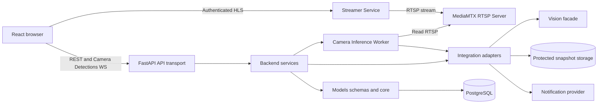
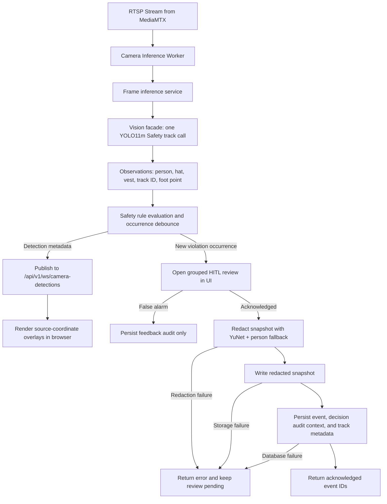

# Sơ đồ hệ thống P-047

Các sơ đồ này mô tả runtime hiện hành và boundary đã chốt. Contract thực thi vẫn nằm ở FastAPI,
Pydantic, frontend wire types, SQLAlchemy/Alembic và tests.

## Sơ đồ components

## Sơ đồ data flow runtime

Runtime realtime hỗ trợ 2 luồng:
1. **Luồng RTSP chính**: Backend đọc RTSP từ MediaMTX qua `CameraInferenceWorker` (2 FPS), phân tích và push metadata qua `/api/v1/ws/camera-detections` cho frontend hiển thị overlay trên luồng HLS.
2. **Luồng Direct Frame Fallback**: Sử dụng `/api/v1/ws/inference` hoặc REST `POST /api/v1/analysis/frame` (mô phỏng client gửi frame trực tiếp).

Snapshot chỉ được ghi sau khi operator xác nhận (`acknowledged`); nếu redaction, storage hoặc database thất bại thì backend không tạo event và UI giữ review để operator thử lại.

