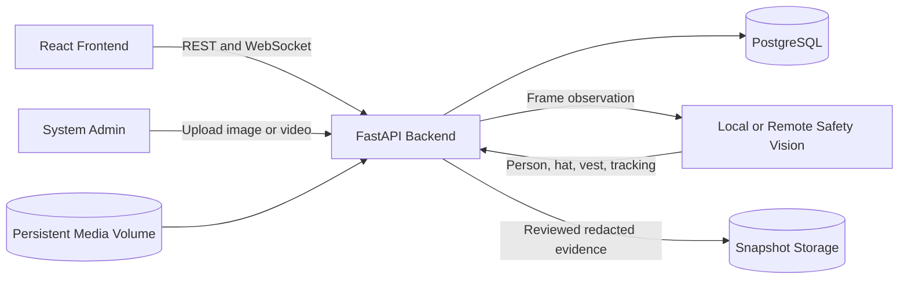
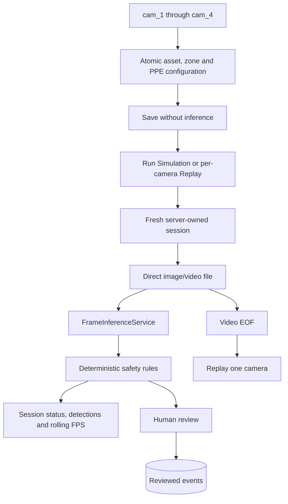

# System Diagrams

## Components

## Camera Session

The browser never supplies a source URL or filesystem path. Images infer exactly
once without frame debounce. Videos stop at EOF. Streamer, MediaMTX, HLS and RTSP
are not part of this topology.
