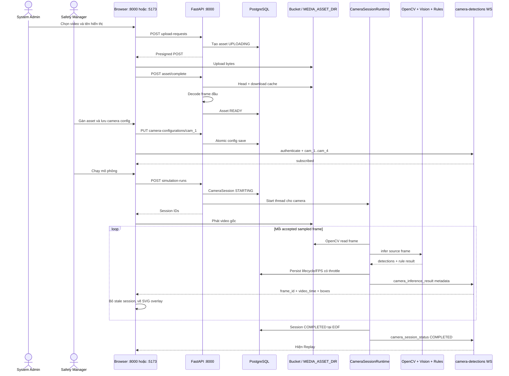

# Luồng video từ upload đến hiển thị từng frame khi chạy local

Tài liệu này mô tả runtime hiện tại của P-047 khi một video được upload, gán cho
camera logic, chạy inference và hiển thị cho người dùng ở môi trường local. Đây
không phải luồng camera CCTV thật và không sử dụng Streamer, HLS, RTSP, MJPEG hay
MediaMTX.

## Kết luận nhanh

Hệ thống có **hai đường dữ liệu chạy song song**:

1. Trình duyệt tải và phát video gốc bằng thẻ `<video>`.
2. Backend đọc cùng asset bằng OpenCV, chọn frame cần infer, chạy Vision/rule và
   gửi **metadata** detection qua WebSocket.

Backend không stream frame đã vẽ box về browser. Frontend nhận bounding box theo
tọa độ frame gốc rồi vẽ một lớp SVG trong suốt lên trên video đang phát.

```mermaid
flowchart LR
    U[System Admin chọn video] --> FEU[Frontend Media Library]
    FEU -->|1. xin upload request| API[FastAPI]
    API -->|presigned POST hoặc backend upload| STORE[(Bucket hoặc local media dir)]
    FEU -->|2. upload bytes| STORE
    FEU -->|3. complete| API
    API -->|kiểm tra metadata và decode frame đầu| DB[(PostgreSQL)]
    DB -->|asset READY| CFG[Safety Manager cấu hình cam_1..cam_4]

    CFG --> RUN[Chạy mô phỏng]
    RUN --> SESSION[CameraSessionRuntime: một worker thread/camera]
    SESSION --> CACHE[File cache MEDIA_ASSET_DIR]
    CACHE --> CV[OpenCV VideoCapture]
    CV --> SAMPLE[Chọn frame theo max inference FPS]
    SAMPLE --> VISION[YOLO + ByteTrack]
    VISION --> RULE[Backend rule + occurrence + HITL debounce]
    RULE --> HUB[CameraDetectionHub]
    HUB -->|metadata WebSocket| OVERLAY[SVG DetectionOverlay]

    STORE -->|presigned GET hoặc authenticated content| VIDEO[Browser video element]
    VIDEO --> VIEW[Khung Camera trên Live Monitor]
    OVERLAY --> VIEW
```



## Các thành phần chịu trách nhiệm

| Thành phần | Trách nhiệm |
|---|---|
| Media Library frontend | Chọn file, gửi thông tin upload, upload bytes và gọi complete. |
| Media Asset API/service | Phân quyền, kiểm tra loại/kích thước, xác minh frame đầu, lưu trạng thái `READY`. |
| PostgreSQL | Lưu metadata asset, cấu hình camera và lifecycle session; không lưu từng frame video. |
| Bucket hoặc `MEDIA_ASSET_DIR` | Lưu media gốc; backend dùng file cache local để OpenCV infer. |
| Camera Session Runtime | Tạo một session/worker cho từng camera được cấu hình, đọc video và điều tiết thời gian. |
| Vision + backend rules | Detect person/hat/vest, tracking, zone/PPE rule, occurrence và quyết định HITL. |
| Camera Detection Hub/WebSocket | Fan-out metadata mới nhất của từng camera; không vận chuyển video frame. |
| Live Monitor frontend | Phát video gốc, lọc đúng session, hiển thị FPS/status, vẽ overlay và mở HITL. |

## Luồng chi tiết

### 1. Upload và chuyển asset sang `READY`

Actor: `system_admin`.

Luồng ưu tiên khi cấu hình S3/Railway Bucket:

1. Frontend gọi `POST /api/v1/media-assets/upload-requests` với tên hiển thị,
   filename, MIME type và kích thước.
2. Backend tạo bản ghi asset trạng thái `UPLOADING` và trả presigned POST.
3. Browser upload file trực tiếp vào bucket. Credential storage không đi qua
   frontend.
4. Frontend gọi `POST /api/v1/media-assets/{asset_id}/complete`.
5. Backend kiểm tra metadata object, tải file về vùng cache tạm và dùng OpenCV
   decode frame đầu.flowchart LR
    U[System Admin chọn video] --> FEU[Frontend Media Library]
    FEU -->|1. xin upload request| API[FastAPI]
    API -->|presigned POST hoặc backend upload| STORE[(Bucket hoặc local media dir)]
    FEU -->|2. upload bytes| STORE
    FEU -->|3. complete| API
    API -->|kiểm tra metadata và decode frame đầu| DB[(PostgreSQL)]
    DB -->|asset READY| CFG[Safety Manager cấu hình cam_1..cam_4]

    CFG --> RUN[Chạy mô phỏng]
    RUN --> SESSION[CameraSessionRuntime: một worker thread/camera]
    SESSION --> CACHE[File cache MEDIA_ASSET_DIR]
    CACHE --> CV[OpenCV VideoCapture]
    CV --> SAMPLE[Chọn frame theo max inference FPS]
    SAMPLE --> VISION[YOLO + ByteTrack]
    VISION --> RULE[Backend rule + occurrence + HITL debounce]
    RULE --> HUB[CameraDetectionHub]
    HUB -->|metadata WebSocket| OVERLAY[SVG DetectionOverlay]

    STORE -->|presigned GET hoặc authenticated content| VIDEO[Browser video element]
    VIDEO --> VIEW[Khung Camera trên Live Monitor]
    OVERLAY --> VIEW
6. Thành công: file được đặt trong `MEDIA_ASSET_DIR`, asset thành `READY`.
   Thất bại: asset thành `ERROR` và object lỗi được dọn theo best effort.

Khi direct upload không khả dụng, frontend fallback sang
`POST /api/v1/media-assets`; FastAPI nhận bytes, kiểm tra và lưu file. Chỉ asset
`READY` mới được Safety Manager chọn.

### 2. Gán video cho camera logic

Actor: `safety_manager`.

Live Monitor luôn có bốn slot cố định: `cam_1`, `cam_2`, `cam_3`, `cam_4`. Safety
Manager mở cấu hình từ đúng slot, chọn một asset `READY`, đặt machine state,
PPE camera-wide và các zone/rule rồi lưu aggregate camera.

- Một asset không được gán đồng thời cho nhiều camera.
- Lưu cấu hình không tự chạy inference.
- Nếu restart backend, cấu hình vẫn còn nhưng session cũ không tự resume.

### 3. User bấm **Chạy mô phỏng**

Frontend gọi `POST /api/v1/simulation-runs`. Backend duyệt bốn camera:

- camera chưa gán asset bị bỏ qua;
- camera hợp lệ tạo một `CameraSession` mới với trạng thái `STARTING`;
- mỗi camera có một worker thread riêng và lỗi độc lập;
- chạy session mới của một camera sẽ dừng worker cũ của chính camera đó;
- response trả các session đã tạo và lỗi theo từng camera.

Browser đồng thời đánh dấu các media là cần phát. Vì vậy playback trong browser
và inference trong backend bắt đầu gần nhau nhưng là hai tiến trình độc lập.

### 4. Backend đọc và chọn từng frame

Với video, worker thực hiện:

1. Mở file cache bằng `cv2.VideoCapture`.
2. Đọc source FPS; nếu FPS không hợp lệ thì dùng inference max FPS.
3. Đọc tuần tự các source frame và tính:

   ```text
   video_time = frame_index / source_fps
   ```

4. Chỉ nhận frame đến mốc sample tiếp theo, cách nhau
   `1 / MEDIA_INFERENCE_MAX_FPS` giây video.
5. Đồng bộ nhịp xử lý với thời gian phát video. Nếu frame đã trễ hơn một
   sampling interval, backend bỏ frame đó thay vì tạo backlog cũ.
6. Chỉ frame thực sự được đưa vào inference mới tăng `frame_id`.

Ví dụ: video nguồn 30 FPS, max inference 2 FPS thì OpenCV vẫn đọc tuần tự video,
nhưng chỉ khoảng các mốc `0.0s`, `0.5s`, `1.0s`, ... được infer. Các frame nằm
giữa vẫn được browser phát bình thường nhưng không có detection mới tương ứng.

### 5. Một frame được infer như thế nào

Frame BGR ở độ phân giải gốc đi vào `FrameInferenceService`. Backend không
resize trước; Ultralytics resize/letterbox tại biên YOLO theo
`YOLO_INFERENCE_IMAGE_SIZE`.

Trong mỗi accepted frame:

1. YOLO detect `person`, `hat`, `vest` một lần.
2. ByteTrack gắn `track_id` trong phạm vi session hiện tại.
3. Kết quả được quy đổi về tọa độ source frame.
4. Backend tính foot point của person và kiểm tra polygon zone.
5. Backend áp dụng PPE camera-wide, machine state, zone rules, occurrence và
   debounce HITL hiện hành.
6. Nếu frame mở review mới, backend JPEG-encode riêng frame đó thành
   `snapshot_data` tạm để hiển thị HITL. Snapshot này chưa phải event đã lưu.

Đối với video, frame vi phạm phải đi qua gate liên tiếp theo alert contract trước
khi `review_required=true`. Một kết quả bình thường/không xác định sẽ reset chuỗi
pending tương ứng.

### 6. Metadata được gửi tới browser

Backend tạo `camera_inference_result`, gồm các trường quan trọng:

```text
camera_id, session_id, asset_id
frame_id, video_time
frame_width, frame_height
session_status, inference_fps
people, detections, active_violations
result, review_required
snapshot_data (chỉ khi cần review)
```

Payload đi qua `CameraDetectionHub` tới
`/api/v1/ws/camera-detections`. Hub dùng queue nhỏ theo kiểu latest-first: khi
viewer chậm, metadata cũ bị bỏ để UI không ngày càng trễ. WebSocket yêu cầu token
và danh sách từ một đến bốn camera.

### 7. Browser hiển thị video và overlay

Đường video:

- Với S3, frontend xin `GET /api/v1/media-assets/{asset_id}/playback-url` và gắn
  presigned GET vào `<video src>`.
- Với storage local, frontend lấy authenticated `/content`, tạo Blob URL rồi gắn
  vào `<video>`.

Đường detection:

1. `CameraDetectionClient` subscribe bốn camera qua WebSocket.
2. UI chỉ nhận payload nếu `session_id` khớp session mới nhất của camera.
3. `DetectionOverlay` dùng `frame_width`/`frame_height` làm hệ tọa độ SVG và vẽ
   box/label lên trên `<video>` đang phát.
4. Badge hiển thị `STARTING`, `RUNNING`, `COMPLETED` hoặc `ERROR`; FPS infer là
   throughput hoàn thành trong cửa sổ rolling năm giây.
5. Khi `review_required=true`, UI đưa occurrence mới vào hàng đợi HITL. User xác
   nhận thì frontend mới gọi event API để lưu outcome và bằng chứng đã xử lý
   privacy.

Do playback và inference độc lập, overlay là kết quả gần thời điểm `video_time`,
không phải một video frame đã được backend render sẵn. Khi model chậm, frame
inference cũ bị drop để ưu tiên độ tươi; đây là chủ đích của runtime.

### 8. Kết thúc và Replay

Khi OpenCV đọc tới EOF:

- session chuyển `COMPLETED`;
- backend phát lifecycle event cuối cùng;
- worker và model/tracker state nặng được release;
- context occurrence nhẹ còn tồn tại theo TTL để HITL đang chờ vẫn hợp lệ;
- frontend hiện nút Replay cho video.

Replay gọi `POST /api/v1/camera-sessions/{camera_id}/replay`, tạo session ID mới,
reset playback về đầu và chỉ chạy lại camera được chọn.

## Sequence diagram runtime local



## Cách chạy và quan sát local

### Cách A — một process tích hợp

```bash
make setup
make run
```

Mở <http://localhost:8000>. `make run` chạy migration, build frontend rồi để
FastAPI serve frontend build cùng API/WebSocket.

### Cách B — frontend dev server riêng

Terminal 1:

```bash
set -a
. ./.env.development
set +a
.venv/bin/uvicorn backend.app.main:app --reload --host 0.0.0.0 --port 8000
```

Terminal 2:

```bash
make frontend-dev
```

Mở <http://localhost:5173>. Vite proxy `/api` và WebSocket sang port 8000.

Local vẫn cần PostgreSQL reachable và model runtime hợp lệ. Kiểm tra
`.env.development` đang trỏ tới local PostgreSQL trước khi migrate/chạy; hostname
`*.railway.internal` không truy cập được trực tiếp từ laptop.

### Checklist quan sát bằng UI và DevTools

1. Đăng nhập System Admin, upload video và chờ asset thành `READY`.
2. Đăng nhập Safety Manager, mở một slot camera, gán asset và lưu cấu hình.
3. Mở Live Monitor và bấm **Chạy mô phỏng**.
4. Trong Network, quan sát request `simulation-runs`, request playback URL/content
   và WebSocket `ws/camera-detections`.
5. Trong WebSocket Messages, đối chiếu `session_id`, `frame_id`, `video_time`,
   `frame_width`, `frame_height` và `inference_fps`.
6. Trên UI, xác nhận video gốc vẫn chạy trong lúc box SVG thay đổi theo metadata.
7. Chờ EOF, xác nhận status `COMPLETED` và nút Replay xuất hiện.

## Những gì hệ thống không làm

- Không gửi mọi source frame qua WebSocket.
- Không Base64 video hoặc từng frame bình thường để phát cho user.
- Không lưu từng detection frame vào PostgreSQL.
- Không infer trong browser.
- Không dùng technical `track_id` như nhận dạng danh tính người.
- Không tự khẳng định đồng bộ frame tuyệt đối giữa `<video>` và backend worker.
- Không tự resume session sau restart.

## Source-of-truth code map

| Việc cần truy | File hiện hành |
|---|---|
| Upload API và playback | `backend/app/api/v1/media_assets.py` |
| Kiểm tra asset, cache và frame đầu | `backend/app/services/media_asset_service.py` |
| Run/Replay API | `backend/app/api/v1/camera_sessions.py` |
| Đọc video, sampling, frame payload, lifecycle | `backend/app/services/camera_session_runtime.py` |
| Vision/rule trên decoded frame | `backend/app/services/frame_inference_service.py` |
| Latest-only metadata fan-out | `backend/app/services/camera_detection_hub.py` |
| Authenticated camera WebSocket | `backend/app/api/v1/websocket.py` |
| Frontend upload/playback transport | `frontend/src/api/media-assets.ts` |
| Frontend WebSocket client | `frontend/src/api/camera-detection-client.ts` |
| Bốn camera, session filter, HITL queue | `frontend/src/features/monitor/StreamViewer.tsx` |
| Media element | `frontend/src/features/media/AuthenticatedMedia.tsx` |
| SVG boxes | `frontend/src/features/monitor/DetectionOverlay.tsx` |

Nếu executable contracts thay đổi, các file trong bảng trên là nguồn sự thật cần
được kiểm tra trước khi cập nhật lại tài liệu này.
