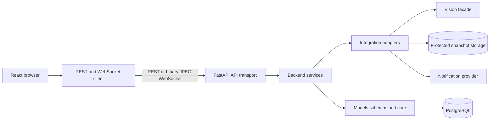
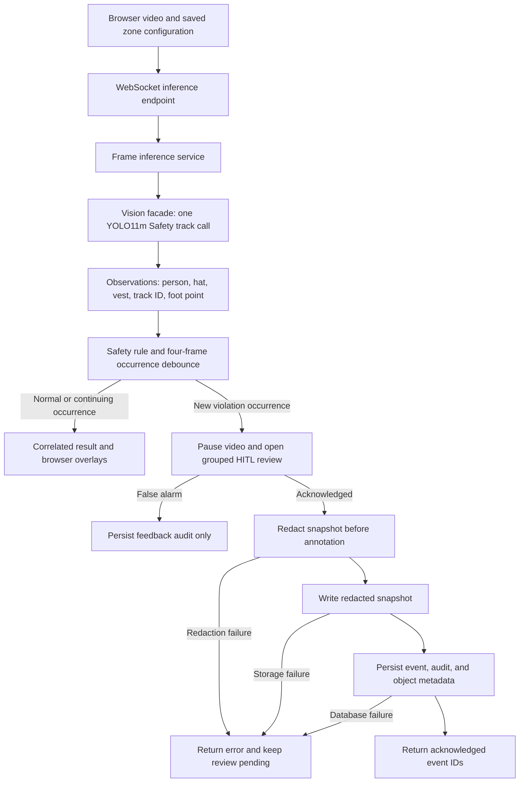

# Sơ đồ hệ thống P-047

Các sơ đồ này mô tả runtime hiện hành và boundary đã chốt. Contract thực thi vẫn nằm ở FastAPI,
Pydantic, frontend wire types, SQLAlchemy/Alembic và tests.

## Sơ đồ components

## Sơ đồ data flow runtime

Runtime realtime dùng `/api/v1/ws/inference`: browser chỉ gửi tối đa hai frame mẫu mỗi giây và
chỉ có một frame đang chờ. `POST /api/v1/analysis/frame` là REST fallback, không có state debounce
giữa các request. Snapshot chỉ được ghi sau acknowledgment; nếu redaction, storage hoặc database
thất bại thì backend không tạo event và UI giữ review để operator thử lại.
