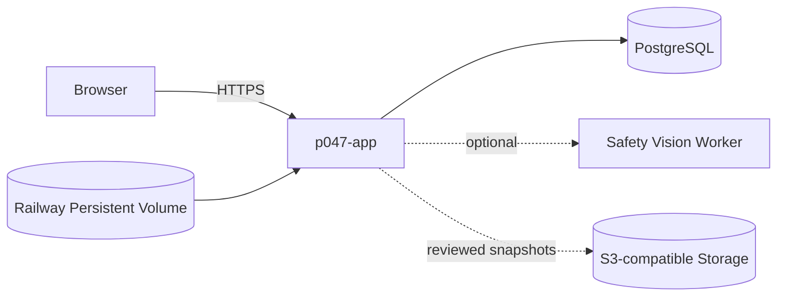
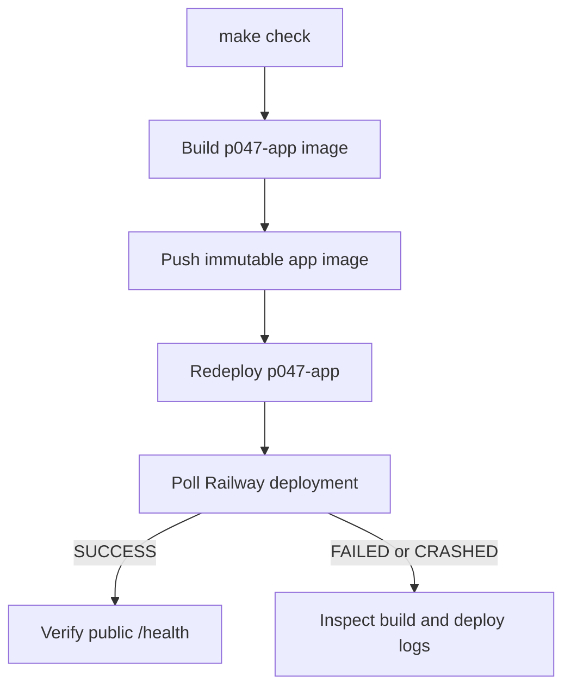

# Deployment Flow

## Production Topology

Production no longer deploys Streamer or MediaMTX. Mount the application volume at
`/app/data/media-assets` and set `MEDIA_ASSET_DIR` to the same path.

## Release

`scripts/deploy_all_production.sh` runs focused US-29/frontend gates, publishes
the application image, redeploys `p047-app`, waits for terminal `SUCCESS`, then
checks the public health endpoint. A queued deployment is not release success.

## Required Runtime Configuration

| Variable/resource | Purpose |
|---|---|
| `DATABASE_URL` | PostgreSQL connection |
| Railway volume at `/app/data/media-assets` | Durable uploaded media |
| `MEDIA_ASSET_DIR=/app/data/media-assets` | Backend asset directory |
| `MAX_MEDIA_ASSET_BYTES` | Per-upload size ceiling |
| `MEDIA_INFERENCE_MAX_FPS` | Bounded direct-file sampling rate |
| `SNAPSHOT_STORAGE_*` | Production redacted evidence storage |

Rollback uses a known-good app image/deployment. Database migrations are not
rewritten or removed during rollback; uploaded media remains on the volume.
