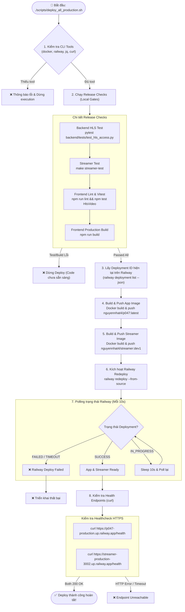

# Quy Trình Triển Khai Hệ Thống (Deployment Flow & Team Runbook)

Tài liệu này chi tiết hóa luồng triển khai hệ thống **P-047** lên hạ tầng **Railway**, phục vụ việc phối hợp giữa các thành viên trong team khi thực hiện deploy thủ công qua script `scripts/deploy_all_production.sh`.

---

## 1. Luồng Chạy Script Deployment (`scripts/deploy_all_production.sh`)

Sơ đồ bên dưới mô tả thứ tự thực hiện các bước khi chạy script deploy từ máy cá nhân:



---

## 2. Phân Định Dịch Vụ Trên Railway (Service Matrix)

| Dịch vụ | Service Name trên Railway | Dockerfile | Nhiệm vụ chính | Healthcheck Endpoint |
|---|---|---|---|---|
| **App Main** | `p047-app` | `/Dockerfile` | FastAPI Backend, React Frontend, YOLO Vision Inferences, PostgreSQL Auth/Events | `https://p047-production.up.railway.app/health` |
| **Streamer** | `streamer` | `/streamer/Dockerfile` | HLS / RTSP Gateway proxy, MediaMTX streaming plane | `https://streamer-production-3002.up.railway.app/health` |

---

## 3. Yêu Cầu Chuẩn Bị Cho Team (Onboarding Checklist)

Để một thành viên mới trong team có thể chạy được script deployment, Admin cần cung cấp và thành viên cần chuẩn bị các thông tin sau:

1. **Công cụ hệ thống (CLI)**: Cài đặt `docker`, `railway`, `jq`, `curl`, `make`, `npm`.
2. **Quyền tài khoản**:
   - Invite vào **Railway Workspace/Project** (`3aeb66d7-0d02-4a6d-a9e8-57cac403b049`).
   - Phân quyền Push vào Docker Hub repositories (`nguyennhat4/p047` và `nguyennhat4/streamer`).
3. **Đăng nhập CLI ở máy cá nhân**:
   ```bash
   docker login
   railway login
   ```
4. **Tạo file `.env.production` ở gốc dự án**:
   ```env
   VITE_STREAMER_URL=https://streamer-production-3002.up.railway.app
   VITE_MEDIA_PUBLIC_ORIGIN=https://p047-production.up.railway.app
   VITE_STREAM_TRANSPORT=hls
   ```
5. **Cấu hình môi trường local**:
   ```bash
   make setup
   ```
