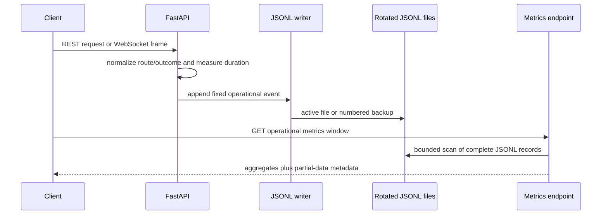

# JSONL Operational Metrics - Plan

## Goal Capsule

- **Objective:** Add a lightweight, persisted operational-metrics endpoint for the FastAPI runtime without Prometheus, Grafana, a database, or another service.
- **Authority:** The user selected rotating JSONL logs as the durable metrics source. Existing REST and WebSocket contracts remain additive.
- **Execution profile:** Backend-only change. Preserve the two-command developer path: `make setup` then `make run`.
- **Stop conditions:** Do not add raw-log access, capture sensitive runtime inputs, measure US-13 precision/recall from live traffic, or introduce multi-process log aggregation.

---

## Product Contract

### Summary

The backend will record a small, fixed set of operational events in a rotating JSONL file under the existing runtime data mount.
An additive API endpoint will return bounded aggregates for a requested recent window.
It will not expose individual log records or safety evidence.

### Problem Frame

The current backend has normal text logs but does not record stable route, latency, inference-result, or error fields.
The Product Owner needs a quick operational view that survives a process restart without deploying a monitoring stack.

### Requirements

- R1. The backend writes one valid UTF-8 JSON object per operational event to a rotating JSONL file in `data/`.
- R2. The JSONL schema uses a finite event type and fixed aggregate fields for HTTP completion, WebSocket connection lifecycle, inference completion, and controlled inference failure.
- R3. The system records only normalized route templates, method, status class, bounded outcome/error kind, UTC timestamp, and duration where applicable.
- R4. The system never writes frame bytes, Base64 images, snapshots, raw URLs or query values, IDs for people/video/camera/session/frame, authorization data, client IPs, or raw exception text to the metrics JSONL stream.
- R5. `GET /api/v1/operational-metrics` returns aggregate counts, latency statistics, inference outcomes, data-quality metadata, and window metadata without returning raw log lines or the local file path.
- R6. The endpoint validates a bounded recent time window and reports partial data when a scan cap or a safe read failure prevents complete aggregation.
- R7. HTTP instrumentation records completed requests except the metrics endpoint itself, so reads do not inflate their own results.
- R8. WebSocket instrumentation records connection and inference events at the endpoint boundary without changing its existing messages or safety decisions.
- R9. The first release supports one application writer process. It uses size-based rotation and bounded file scanning; multi-worker aggregation is deferred.

### Scope Boundaries

- **In scope:** Backend JSONL writer, rotation settings, aggregate reader, additive REST route, request/WebSocket event instrumentation, focused tests, and operating documentation.
- **Deferred for later:** Prometheus, Grafana, alert routing, distributed tracing, multi-worker log writing, and frontend dashboard UI.
- **Outside this feature:** US-13 offline precision/recall and false-alarm evaluation, browser-to-render latency, raw-log search, and any data retention policy for safety evidence.

### Acceptance Examples

- AE1. After a normal REST request and a route-level error, the aggregate endpoint groups them by normalized route and status class without retaining a request body or raw path.
- AE2. After a successful inference frame and an invalid frame, the aggregate endpoint reports separate success and error totals with inference latency only for the completed frame.
- AE3. A malformed or unfinished final JSONL line does not make the endpoint fail. The response reports that it skipped incomplete data.
- AE4. After a process restart, records in the active JSONL file and retained rotation files remain available within the selected window.

---

## Planning Contract

### Key Technical Decisions

- KTD1. **Use a dedicated operational JSONL stream.** (session-settled: user-directed — chosen over Prometheus/Grafana and heavier monitoring tools: keep the first release lightweight and derive metrics from logs.) The feature will not parse arbitrary human-readable application logs because they lack a stable, privacy-reviewed schema.
- KTD2. **Keep infrastructure, aggregation, and HTTP transport in their existing backend layers.** `core` owns logging configuration and JSONL writes, `services` owns bounded aggregation, `schemas` owns the response contract, and `api` owns validation and mapping. This follows the target structure without creating a capability folder or persistence model.
- KTD3. **Use size-based stdlib rotation with explicit query bounds.** A configured active file plus a finite number of numbered backups gives deterministic storage limits. The reader scans a snapshot of only those files and surfaces `partial` rather than returning misleading complete totals after a cap or rotation race.
- KTD4. **Instrument HTTP and WebSocket separately.** HTTP middleware measures completed HTTP requests. The inference WebSocket endpoint emits its own lifecycle, completed-frame, and controlled-failure events because HTTP middleware cannot observe WebSocket frame outcomes.
- KTD5. **Support one writer process only.** Python logging protects handler I/O within one process but does not make file rotation safe across independent workers. The release documents this deployment boundary instead of silently reporting incomplete metrics.

### High-Level Technical Design

### Assumptions

- The first release runs with one Uvicorn writer process, including the normal `make run` workflow.
- The existing Docker data mount is the correct location for runtime JSONL files and will persist them outside the container.
- Size-based retention is acceptable for operational counters. Product retention requirements for raw safety evidence remain unchanged.

### Risks & Dependencies

- The project currently documents a Python 3.11–3.13 test recommendation while `pyproject.toml` declares Python 3.14 or newer. Verification must use the repository's working test environment and report the known TestClient stall if it recurs.
- The app reload process can install logging twice unless handler setup is idempotent. Tests must prove that one request yields one operational record.
- The new route is an additive public contract. Update its schema and focused API tests before wiring a frontend consumer.

### Sources & Research

- `backend/app/main.py`, `backend/app/api/router.py`, and `backend/app/api/v1/websocket.py` show the current FastAPI composition and WebSocket boundary.
- `backend/app/api/v1/statistics.py` is deliberately not reused because it reports database-derived compliance data, including simulated totals, rather than runtime operations.
- [FastAPI middleware documentation](https://fastapi.tiangolo.com/tutorial/middleware/) supports timing completed HTTP requests around `call_next`.
- [Python RotatingFileHandler documentation](https://docs.python.org/3/library/logging.handlers.html#rotatingfilehandler) defines size-based rotation behavior and numbered backups.
- [Python logging documentation](https://docs.python.org/3/library/logging.html#logging.Logger.debug) defines safe custom record fields through `extra`.

---

## Implementation Units

### U1. Establish the persisted operational-event stream

- **Goal:** Configure one idempotent JSONL writer and a finite, privacy-safe event schema.
- **Requirements:** R1, R2, R3, R4, R9.
- **Dependencies:** None.
- **Files:** `backend/app/core/config.py`, `backend/app/core/operational_metrics.py`, `backend/app/main.py`, `backend/tests/test_operational_metrics.py`.
- **Approach:** Add typed settings for JSONL location, active-file size, backup count, and scan limits. Configure the dedicated logger once during app lifecycle. Its formatter writes an allowlisted schema only and uses `RotatingFileHandler` with UTF-8 append behavior. Preserve the user's existing uncommitted configuration change.
- **Patterns to follow:** App composition and lifespan wiring in `backend/app/main.py`; typed settings in `backend/app/core/config.py`.
- **Test scenarios:**
  - A valid operational event becomes exactly one newline-terminated JSON object with only allowlisted fields.
  - Attempted sensitive fields do not appear in the serialized record.
  - A handler configured twice does not append duplicate records for one event.
  - Rotation retains only the configured active file and numbered backups.
  - Invalid rotation configuration fails at settings validation rather than disabling persistence silently.
- **Verification:** A temporary runtime directory contains a valid active JSONL file after an event and has bounded backup files after forced rotation.

### U2. Build bounded JSONL aggregation and the additive metrics contract

- **Goal:** Return durable aggregate metrics without exposing log records or blocking on unbounded file input.
- **Requirements:** R5, R6, R9.
- **Dependencies:** U1.
- **Files:** `backend/app/schemas/operational_metrics.py`, `backend/app/services/operational_metrics_service.py`, `backend/app/api/v1/operational_metrics.py`, `backend/app/api/router.py`, `backend/tests/test_operational_metrics.py`.
- **Approach:** Validate a recent `window_minutes` query with a capped range. Scan the current JSONL file and numbered backups using a fixed file/line/byte budget. Ignore malformed or non-terminated final records. Return request/inference/error aggregates, nearest-rank p50/p95 latency, scanned/skipped counts, and a `partial` indicator with bounded reason categories.
- **Patterns to follow:** Pydantic response schemas and API-service split in `backend/app/schemas/statistics.py`, `backend/app/services/statistics_service.py`, and `backend/app/api/v1/statistics.py`.
- **Test scenarios:**
  - Covers AE3. Empty logs return valid zero aggregates and no division errors.
  - Current and rotated records inside the window aggregate in timestamp order; records outside it do not contribute.
  - Malformed JSON and an incomplete final line increase skipped-record metadata without a server error.
  - A scan cap returns `partial=true` and never reports an incomplete result as complete.
  - Known latency samples produce documented nearest-rank p50 and p95 values.
  - Invalid, zero, and oversized windows receive request validation errors.
  - Covers AE1. The response contains no raw event, raw path, source file path, or sensitive field.
- **Verification:** `GET /api/v1/operational-metrics` returns the documented schema from controlled fixture logs with no database dependency.

### U3. Emit HTTP and inference-WebSocket operational events

- **Goal:** Feed the durable stream from the runtime boundaries that own request and frame outcomes.
- **Requirements:** R2, R3, R4, R7, R8.
- **Dependencies:** U1, U2.
- **Files:** `backend/app/main.py`, `backend/app/api/v1/websocket.py`, `backend/tests/test_operational_metrics.py`, `backend/tests/test_analysis.py`.
- **Approach:** Add one HTTP timing middleware that logs a completed request after its route template and status are available. Exclude the operational-metrics route. In the inference WebSocket endpoint, log connection open/close and each inference success or controlled failure around the existing thread offload. Use finite error kinds and result outcomes only; do not alter WebSocket payloads, tracking semantics, or safety decisions.
- **Patterns to follow:** Existing sequential frame handling and error responses in `backend/app/api/v1/websocket.py`; REST and WebSocket contract tests in `backend/tests/test_analysis.py`.
- **Test scenarios:**
  - A parameterized REST request records its route template rather than the concrete ID path.
  - A successful REST request records one completion event with duration and a `2xx` class.
  - An HTTP error records a bounded status/error classification and re-raises existing behavior unchanged.
  - The metrics route creates no HTTP event.
  - Covers AE2. Mocked WebSocket inference success records one duration/outcome event without exposing session or frame identifiers.
  - Invalid JPEG and stale/inference failures record distinct finite error kinds while retaining their existing WebSocket error messages.
  - A WebSocket disconnect records lifecycle data and does not leak a monitoring session ID.
- **Verification:** Controlled REST and WebSocket tests show matching aggregate increments while their response contracts remain unchanged.

### U4. Document runtime limits and keep repository tracking current

- **Goal:** Make the lightweight monitoring behavior safe to operate and discoverable to future contributors.
- **Requirements:** R4, R5, R6, R9.
- **Dependencies:** U1, U2, U3.
- **Files:** `backend/README.md`, `README.md`, `docs/PROJECT_STRUCTURE.md`, `DECISIONS.md`, `PROGRESS.md`.
- **Approach:** Document endpoint purpose, window and partial-data semantics, single-process limitation, location/size retention behavior, and the boundary between operational counters and US-13 offline evaluation. Record the additive API/retention decision centrally. Update the root documentation index and current structure for created files.
- **Test expectation:** none -- documentation and central tracking do not add runtime behavior.
- **Verification:** A fresh contributor can start the app with the existing two commands and identify the endpoint, storage boundary, and operational limitations from repository documentation.

---

## Verification Contract

| Gate | Applies to | Evidence |
|---|---|---|
| Focused backend tests | U1–U3 | `PYTHONPATH=. .venv/bin/pytest backend/tests/test_operational_metrics.py backend/tests/test_analysis.py -v` passes in the repository's supported test environment. |
| Full repository check | U1–U4 | `make check` passes, or any pre-existing Python 3.14 TestClient stall is reported separately with the focused checks that completed. |
| Startup smoke test | U1–U4 | `make setup` then `make run` starts without new services; a sample request produces an aggregate response after the selected time window. |
| Contract review | U2–U3 | Existing REST and WebSocket tests confirm no response field or protocol behavior changed. |

---

## Definition of Done

- The backend writes bounded, allowlisted operational JSONL records that persist across a single-process restart.
- The additive metrics endpoint returns correct aggregate counts and latency percentiles for the requested window.
- The endpoint never returns raw logs, source file paths, personal data, video/snapshot inputs, tracking IDs, or raw exceptions.
- HTTP and inference WebSocket activity produce exactly one appropriate operational event per measured outcome, excluding metrics self-traffic.
- Malformed lines, rotation races, empty logs, and scan caps cannot produce a 500 response or silently misleading complete totals.
- Documentation, `DECISIONS.md`, `PROGRESS.md`, and `docs/PROJECT_STRUCTURE.md` reflect the shipped files and operational boundary.
- No unused dashboard, external monitoring dependency, database schema, provider, or abandoned instrumentation code remains in the diff.
