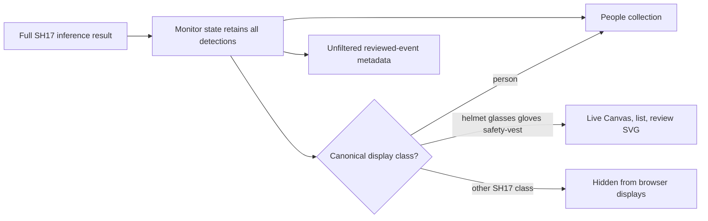

# Curated SH17 Detection Display - Plan

## Goal Capsule

- **Objective:** Reduce operator-facing detection noise by showing only people, helmets, glasses, gloves, and safety vests in the monitor overlay, review overlay, and grouped detection list.
- **Authority:** The approved model vocabulary is the SH17 checkpoint's canonical `class_name` values: `person`, `helmet`, `glasses`, `gloves`, and `safety-vest`.
- **Execution profile:** Frontend-only presentation change. Preserve REST/WebSocket inference payloads, safety decisions, and persisted review metadata.
- **Stop conditions:** Do not alter model detection, PPE-rule evaluation, event persistence, server-side snapshot annotation, or add aliases for noncanonical names such as `safety shirt`.

---

## Product Contract

### Summary

The monitor will present a concise, model-grounded subset of SH17 detections rather than every detected object.
People stay visible through the existing typed `people` collection, while model-derived helmet, glasses, gloves, and safety-vest detections remain visible in each operator-facing display.

### Problem Frame

The current frontend draws and lists all 17 SH17 classes, including tools, shoes, faces, hands, and scene objects that make the live video and review workflow visually noisy.
The Safety Officer needs visual evidence limited to people and the requested PPE classes without losing the complete inference result needed by existing backend behavior.

### Requirements

- R1. The live monitor canvas draws person boxes and only model detections whose canonical SH17 `class_name` is `helmet`, `glasses`, `gloves`, or `safety-vest`.
- R2. The review modal's browser-side SVG overlay follows the same display set: people plus helmet, glasses, gloves, and safety-vest detections.
- R3. The grouped detection list and its count include persons and only the same four model PPE classes; its count is `people.length + filtered PPE detections`; excluded model detections create neither person groups nor scene-object entries.
- R4. The frontend continues to receive, retain, and forward the complete detection collection unchanged for API/WebSocket compatibility and reviewed-event metadata.
- R5. Filtering is based on normalized canonical class names from the SH17 checkpoint, not display-language labels, detector class IDs, or a heuristic safety-shirt field.

### Scope Boundaries

- **In scope:** Live Canvas rendering, review SVG rendering, AlertPanel grouping/counting, focused frontend tests, and frontend behavior documentation.
- **Deferred for later:** Configurable class visibility, per-role display preferences, and a user-managed detection taxonomy.
- **Outside this feature:** Vision checkpoint classes, model inference, PPE alert rules, backend response schemas, stored snapshot annotation, and historical event payloads.

### Acceptance Examples

- AE1. A frame containing a person, helmet, glasses, gloves, safety-vest, tool, shoes, and face shows only the person and four selected PPE classes in the live overlay and grouped list.
- AE2. A reviewed frame with the same mixed detections shows one person box plus only the selected non-person PPE boxes in the browser review overlay.
- AE3. A review submission still includes the original, unfiltered `snapshot_detections` collection for backend processing and persistence.

---

## Planning Contract

### Key Technical Decisions

- KTD1. **Use the SH17 canonical class-name allowlist as the display policy.** (session-settled: user-directed — chosen over a user-language or guessed safety-shirt label: model class names are the authoritative vocabulary.) The UI recognizes `person`, `helmet`, `glasses`, `gloves`, and `safety-vest`; normalization may make matching resilient to casing and surrounding whitespace but must not invent aliases.
- KTD2. **Centralize the display predicate in the established monitor presentation boundary.** The existing AlertPanel and SnapshotOverlay already import presentation helpers from `features/monitor/canvas.ts`, so it remains the exported public owner for the canonical PPE predicate as well as colors. This avoids a new cross-feature dependency and duplicate filters.
- KTD3. **Treat `people` as the single person rendering source.** The SH17 `person` item is allowed conceptually but is not drawn or listed again from `detections`, preventing duplicate person boxes/chips while retaining track, zone, and confidence information from the typed people collection.
- KTD4. **Filter at render/list derivation boundaries, not transport or state ingestion.** `useMonitor` keeps the raw result and review persistence keeps raw snapshot detections so this UI preference cannot change runtime contracts or audit evidence.

### High-Level Technical Design

The following is directional behavior, not implementation code.

### Risks & Dependencies

- The canonical label must remain `safety-vest`; the checkpoint mapping in `models/README.md` and `vision/api.py` lowercases class names before they reach the frontend.
- Existing backend-generated persisted snapshots can remain annotated with all detections. Altering them would be an out-of-scope backend/privacy change; this plan changes only browser-rendered overlays and list content.
- `frontend/README.md` currently describes rendering every SH17 detection and must be corrected so documentation does not promise obsolete UI behavior.

### Sources & Research

- `models/README.md` defines SH17's class mapping, including `person` (0), `glasses` (8), `helmet` (10), and `safety-vest` (16).
- `vision/api.py` lowercases checkpoint names and intentionally returns all SH17 detections; the full payload remains the contract source.
- `frontend/src/features/monitor/canvas.ts`, `frontend/src/features/alerts/AlertPanel.tsx`, and `frontend/src/features/alerts/SnapshotOverlay.tsx` own the three presentation surfaces.
- No repository `docs/solutions/` learning corpus currently exists.

---

## Implementation Units

### U1. Define and apply the shared model-display policy

- **Goal:** Give all frontend presentation surfaces one canonical, testable answer to whether a model detection should be displayed.
- **Requirements:** R1, R2, R3, R5.
- **Dependencies:** None.
- **Files:** `frontend/src/features/monitor/canvas.ts`, `frontend/src/features/monitor/canvas.test.ts`.
- **Approach:** Export a narrowly named predicate from the existing monitor Canvas presentation boundary. It recognizes only the four non-person model detection names after safe string normalization. Update Canvas drawing to apply it before drawing model detections, while keeping person drawing driven solely by the existing `people` collection.
- **Patterns to follow:** Existing `getDetectionColor` utility and pure helper coverage in `canvas.ts` and `canvas.test.ts`.
- **Test scenarios:**
  - Canonical `helmet`, `glasses`, `gloves`, and `safety-vest` return displayable; `tool`, `shoes`, and `face` do not.
  - Case and surrounding-whitespace normalization, if supported by the predicate, does not widen the allowlist.
  - A Canvas invocation with mixed model detections emits drawing operations only for the allowed PPE boxes; the person is still drawn once from `people`.
- **Verification:** The shared predicate is the only model-detection filter used by downstream frontend display surfaces.

### U2. Filter alert summary and review overlay presentation

- **Goal:** Make the list and review popup match the live overlay without changing their inputs or review metadata.
- **Requirements:** R2, R3, R4, R5.
- **Dependencies:** U1.
- **Files:** `frontend/src/features/alerts/AlertPanel.tsx`, `frontend/src/features/alerts/AlertPanel.test.tsx`, `frontend/src/features/alerts/SnapshotOverlay.tsx`, `frontend/src/features/alerts/ReviewModal.test.tsx`.
- **Approach:** Derive a filtered PPE-detection collection at the AlertPanel and SnapshotOverlay rendering boundaries using U1's shared policy. Calculate the header count as `people.length + filtered PPE detections.length`; derive associated groups and Scene Objects from filtered PPE detections only. Keep `people` as the person row/box source and suppress raw SH17 `person` detections to prevent duplicate presentation. Continue passing the original arrays through MonitorPage and ReviewModal unchanged.
- **Patterns to follow:** AlertPanel's existing person-associated versus unassociated grouping and SnapshotOverlay's aspect-ratio-preserving SVG box rendering.
- **Test scenarios:**
  - A mixed collection produces a list count and chips only for helmet, glasses, gloves, and safety-vest; excluded classes do not create chips, groups, or a Scene Objects card.
  - A person remains visible in the list even when all associated model detections are filtered out.
  - After review-image load, the SVG box count equals the typed person boxes plus allowed PPE model boxes, with no duplicate raw model-person box.
  - The existing review action behavior and callback payload shape remain unchanged.
- **Verification:** All three visible UI surfaces agree on the same selected detection classes for the same inference result.

### U3. Align frontend documentation and regression coverage

- **Goal:** Document the presentation-only boundary and prove it preserves raw inference/review data.
- **Requirements:** R4, R5, AE3.
- **Dependencies:** U1, U2.
- **Files:** `frontend/README.md`, `frontend/src/features/monitor/use-monitor.test.ts`.
- **Approach:** Replace the frontend runtime-flow statement that promises drawing every SH17 detection with the four-class display policy and its canonical names. Add or retain a focused monitor-state/review-payload test demonstrating that `snapshot_detections` remains the original full collection even though views filter it.
- **Patterns to follow:** Existing snapshot-payload assertions in `use-monitor.test.ts` and runtime-flow documentation in `frontend/README.md`.
- **Test scenarios:**
  - A pending review built from mixed SH17 detections preserves every original detection in `snapshot_detections`.
  - Documentation names `safety-vest`, not an ambiguous translated or guessed model label.
- **Verification:** A reviewer can distinguish the UI display filter from unchanged transport, safety, and persistence behavior.

---

## Verification Contract

| Scope | Evidence | Done signal |
|---|---|---|
| U1 | Focused Canvas unit tests | Canonical class filtering and one-source person drawing are covered. |
| U2 | AlertPanel and ReviewModal component tests | Mixed detections yield matching filtered list and review-overlay output. |
| U3 | Monitor hook payload test and frontend checks | Raw review metadata remains complete and the React frontend type-checks, lints, tests, and builds. |
| Repository | `make check` | Project-wide quality gate remains green after the frontend-only change. |

---

## Definition of Done

- The live monitor, grouped alert list, and browser review overlay show people plus only SH17 `helmet`, `glasses`, `gloves`, and `safety-vest` detections.
- No raw SH17 `person` detection is duplicated over the typed person rendering.
- Excluded SH17 classes remain available in inference state and reviewed-event metadata, without API, WebSocket, backend, vision, or persistence changes.
- Focused tests cover allowed, excluded, grouped, review-overlay, and raw-payload preservation cases.
- Frontend documentation accurately describes the curated display set, and standard frontend plus repository checks pass.
