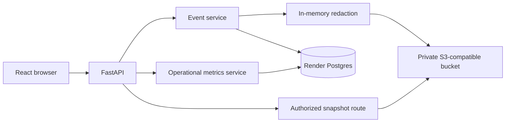

# Render Durable Storage and Observability - Plan

## Goal Capsule

- **Objective:** Make the Render deployment durable and horizontally scalable by moving reviewed snapshots to protected object storage, operational metrics from local JSONL to PostgreSQL, and infrastructure configuration into a Render Blueprint.
- **Authority:** Production must not depend on the container filesystem or a Render Persistent Disk. The existing privacy gate remains fail-closed, and all public REST/WebSocket contracts remain compatible.
- **Execution profile:** Cross-cutting backend and deployment work. Local development stays usable through `make setup` then `make run`; Docker local MVP remains supported through an explicit local-storage mode.
- **Stop conditions:** Do not upload raw video or unredacted frames, embed credentials in the Docker image or repository, expose a storage bucket publicly, create a new top-level production owner, or require a single-instance disk.

---

## Product Contract

### Summary

The currently persisted redacted JPEG snapshots and rotated operational JSONL files are written below `data/`, which is safe for local Docker Compose but not for a Render service's ephemeral filesystem.
The production runtime will use managed PostgreSQL for relational and metric data, and a private S3-compatible object store for redacted snapshot blobs.
The application will retain its current event and metrics APIs while replacing their local persistence implementations behind backend-owned interfaces.

### Problem Frame

A restart, redeploy, or instance replacement on Render can discard local snapshots and operational metrics.
Attaching a disk would preserve files but prevents horizontal scaling and introduces a single-instance deployment constraint.
The safety-monitoring system needs durable reviewed evidence, auditable events, and operational visibility without retaining privacy-sensitive source data.

### Requirements

- R1. Production snapshot persistence stores only successfully redacted JPEG bytes in a private S3-compatible bucket; PostgreSQL stores an opaque object key and required integrity/retention metadata.
- R2. A reviewed event is acknowledged only when its database record and snapshot object are both durable; failures leave no misleading acknowledged event and clean up best-effort orphaned objects.
- R3. Existing event responses and the `/snapshots/{filename}` browser-access contract remain compatible while access to snapshot bytes is authorized and no bucket URL/key is exposed as a public API detail.
- R4. Operational events use the existing allowlisted, privacy-safe schema but persist centrally in PostgreSQL, safely accepting concurrent writes from multiple application instances.
- R5. `GET /api/v1/operational-metrics` preserves its bounded aggregate response semantics and excludes its own reads, without scanning JSONL files or returning raw metric records.
- R6. Metric retention is explicit, bounded, and runs without affecting safety-event retention or availability.
- R7. Production configuration is environment-driven: Render receives its PostgreSQL connection through its private network and object-storage credentials only as runtime secrets.
- R8. A repository-managed Render Blueprint describes the web service, Render Postgres, health check, deployment region, and non-secret configuration; it must not contain secret values.
- R9. Deployment smoke coverage proves migrations, health readiness, redacted snapshot upload/read authorization, and metrics aggregation on the configured production-shaped dependencies.

### Scope Boundaries

- **In scope:** S3-compatible storage adapter, database metadata and metric persistence, transactional/error semantics, protected snapshot delivery, Render Blueprint/configuration, migration/retention automation, tests, and operating documentation.
- **Deferred for later:** Multi-region replication, CDN delivery, legal hold workflows, custom metric dashboards/alert rules, distributed traces, and automatic infrastructure cost optimization.
- **Outside this feature:** Raw video storage, changes to CV/redaction behavior, new safety rules, a new mobile client, or migration of local developer SQLite data into production.

### Acceptance Examples

- AE1. After a confirmed review, PostgreSQL contains the event and opaque snapshot reference, the bucket contains only the redacted JPEG, and an authorized UI user can view it without learning bucket credentials or a public object URL.
- AE2. If object upload, database commit, or post-upload verification fails, the API preserves its failure behavior, does not report an acknowledged event, and removes an orphan object when possible.
- AE3. Two application instances can record concurrent HTTP/WebSocket metric events and the metrics endpoint returns correct bounded aggregates with no file-rotation or single-writer condition.
- AE4. A Render redeploy continues to serve prior reviewed snapshots and metrics, because neither relies on the service filesystem.

---

## Planning Contract

### Key Technical Decisions

- KTD1. **Use protected S3-compatible object storage for snapshots.** A provider-neutral adapter in `backend/app/integrations` will keep provider SDK/protocol details out of event lifecycle services and permit Render to use an external object store without a disk.
- KTD2. **Use PostgreSQL as the central operational-metrics sink.** Persisting the existing fixed, allowlisted events in a dedicated table preserves the current in-app aggregate API while eliminating JSONL rotation, scan limits, and single-worker assumptions.
- KTD3. **Preserve compatibility through application-owned snapshot delivery.** The database retains an opaque object key, while the existing snapshot route resolves and streams the object only after authorization; clients do not receive bucket endpoints, signed URLs, or provider metadata.
- KTD4. **Use a compensation-based persistence workflow.** Object stores and PostgreSQL do not share an atomic transaction. Upload the already-redacted bytes, insert the event/metadata in one database transaction, and delete the uploaded object on any later failure; reconciliation records/metrics make cleanup failures visible rather than silently accepting them.
- KTD5. **Make Render infrastructure declarative and secret-free.** `render.yaml` creates the Docker web service and same-region Render Postgres, injects `DATABASE_URL` from the database connection string, and leaves object-storage credentials/endpoint to dashboard-managed secrets.
- KTD6. **Keep local runtime modes explicit.** Development defaults remain local SQLite/filesystem for the two-command workflow; production mode requires PostgreSQL and object storage, disables database fallback, and fails startup validation if its required configuration is absent.

### High-Level Technical Design

### Assumptions

- The deployment team will provision a private S3-compatible bucket and provide its endpoint, bucket, region, and least-privilege runtime credentials as Render secrets.
- The web service and Render Postgres run in the same Render region, and `DATABASE_URL` uses Render's internal connection string.
- The current event model can gain additive snapshot metadata and a new metrics table through Alembic without changing existing endpoint payloads.
- The production service runs with a secure authentication/session configuration before snapshot access is exposed publicly; the implementation will make snapshot authorization match the event-view permission boundary.

### Risks & Dependencies

- Bucket lifecycle/retention must not delete an object while an event remains available. Define one retention owner and test expiry/reconciliation behavior before enabling automatic deletion.
- Existing historic local snapshot paths point to files. Migration must either retain filesystem read support for local data or explicitly declare historical local data out of production migration scope; it must not turn existing event reads into 404 responses.
- Object uploads add network failure modes. Timeouts, retry policy, idempotent object keys, and cleanup observability require focused tests with a fake storage client.
- PostgreSQL metric writes increase database load. Index only aggregate query predicates (`timestamp`, event type, normalized route/status where needed), batch or bound retention work, and verify the event API remains responsive under representative traffic.
- Render deploy commands and the application startup entrypoint both run migrations today. The final implementation must pick one idempotent migration owner to avoid concurrent-upgrade races during scale-out.

### Sources & Research

- `ARCHITECTURE.md` already sets PostgreSQL plus encrypted object storage as the target persistence design.
- `backend/README.md` defines the current privacy gate and recommends object storage with metadata/retention in PostgreSQL for production snapshots.
- `backend/app/core/operational_metrics.py` and `backend/app/services/operational_metrics_service.py` establish the privacy-reviewed event schema and aggregate semantics to preserve.
- [Render persistent disks](https://render.com/docs/disks) confirms that local files are ephemeral by default and an attached disk allows only one service instance.
- [Render Postgres connections](https://render.com/docs/postgresql-creating-connecting) recommends same-region internal database URLs.
- [Render Blueprints](https://render.com/docs/blueprint-spec) supports a repository `render.yaml`, `fromDatabase` connection strings, Docker services, health checks, and secret placeholders.
- [Render environment variables](https://render.com/docs/configure-environment-variables) requires secrets to remain outside source control.

---

## Implementation Units

### U1. Establish production storage configuration and S3-compatible integration

- **Goal:** Give backend services a typed, testable, provider-neutral way to persist and retrieve redacted evidence without using `data/snapshots` in production.
- **Requirements:** R1, R3, R7.
- **Dependencies:** None.
- **Files:** `backend/app/core/config.py`, `backend/app/integrations/README.md`, `backend/app/integrations/snapshot_storage.py`, `backend/tests/test_snapshot_storage.py`, `requirements.docker.txt`, development dependency manifest if required.
- **Approach:** Define a narrow storage protocol and a production S3-compatible adapter plus filesystem adapter for local mode. Validate production settings early, generate deterministic opaque object keys without user/camera/session identifiers, set private content type/cache behavior, and expose only stream/read/delete operations needed by the service layer.
- **Patterns to follow:** `backend/app/integrations/ppe_vision.py` for adapter ownership and cacheable facade wiring; `backend/app/core/config.py` for typed environment settings.
- **Test scenarios:**
  - Production settings reject a missing endpoint, bucket, or credential configuration before traffic is served.
  - A redacted JPEG is uploaded with a generated opaque key and correct private metadata; raw frame data and client-provided path cannot influence the key.
  - Read and deletion translate provider failures into bounded integration errors without credential or provider exception text.
  - Local development uses the existing filesystem behavior without needing object-storage credentials.
- **Verification:** Storage provider mechanics are isolated in the integration layer and can be replaced by a fake in backend tests.

### U2. Make event/snapshot persistence durable and authorized

- **Goal:** Persist the reviewed event plus its redacted snapshot reference safely, then serve evidence only to authorized readers.
- **Requirements:** R1, R2, R3, AE1, AE2.
- **Dependencies:** U1.
- **Files:** `backend/app/models/event.py`, `backend/migrations/versions/<new_revision>_add_snapshot_storage_metadata.py`, `backend/app/schemas/event.py`, `backend/app/services/event_service.py`, `backend/app/api/v1/events.py`, `backend/app/main.py`, `backend/tests/test_event_privacy.py`, `backend/tests/test_events.py`, applicable authentication/authorization tests.
- **Approach:** Add only additive metadata needed to identify, validate, and expire the storage object. Move snapshot save/delete behind U1's storage interface while preserving redaction-before-write, grouped-review sharing, idempotency, and compensating deletion on database failure. Replace unauthenticated static-directory serving with an application route that applies the same event-view policy as event history and streams bytes without revealing storage details.
- **Patterns to follow:** Existing `EventService.create_event`/`create_batch` cleanup paths and `privacy_blurred` invariant; existing API dependencies in `backend/app/api/v1/auth.py` and event routes for role enforcement.
- **Test scenarios:**
  - Covers AE1. A successful single and grouped review persists one redacted object/reference per shared snapshot and returns the existing event payload shape.
  - Covers AE2. Upload failure, redaction failure, annotation failure, database failure, and storage read failure neither acknowledge an event nor leave a falsely accessible snapshot; deletions are attempted for orphaned objects.
  - Client-supplied `snapshot_path`, privacy status, object key, or retention metadata cannot bypass server ownership.
  - An authorized actor can fetch the snapshot through the compatibility route; an unauthenticated or unauthorized actor cannot, and neither response exposes object-store details.
  - Existing local filesystem snapshot fixtures remain supported in local/test mode.
- **Verification:** Every acknowledged event references a durable redacted object, and every delivered snapshot is authorized and redacted.

### U3. Replace JSONL metrics with PostgreSQL-backed aggregates and retention

- **Goal:** Preserve the privacy-safe metrics API while making writes safe across multiple Render instances.
- **Requirements:** R4, R5, R6, AE3.
- **Dependencies:** None.
- **Files:** `backend/app/models/operational_metric.py`, `backend/migrations/versions/<new_revision>_add_operational_metrics.py`, `backend/app/schemas/operational_metrics.py`, `backend/app/core/operational_metrics.py`, `backend/app/services/operational_metrics_service.py`, `backend/app/api/v1/operational_metrics.py`, `backend/app/main.py`, `backend/app/api/v1/websocket.py`, `backend/tests/test_operational_metrics.py`, `backend/tests/test_analysis.py`.
- **Approach:** Retain the fixed event types and field allowlist, but insert rows through a bounded database writer and calculate endpoint aggregates with database queries over an indexed recent window. Define an explicit configurable retention duration and an idempotent cleanup entrypoint suitable for a Render cron job; report a bounded partial/degradation response only for genuine database/retention conditions, not JSONL scanning artifacts.
- **Patterns to follow:** Existing schema/service/API layering for operational metrics and Alembic migration conventions; request middleware and WebSocket boundary instrumentation in `backend/app/main.py` and `backend/app/api/v1/websocket.py`.
- **Test scenarios:**
  - The event schema still discards disallowed fields and never persists frames, snapshots, identifiers, credentials, IP addresses, raw URLs, or exception text.
  - Concurrent sessions write controlled HTTP and WebSocket events without lost records, duplicate rotation artifacts, or changed REST/WebSocket responses.
  - The aggregate endpoint returns existing request, inference, error, WebSocket, percentile, and self-exclusion semantics for a bounded window.
  - Records outside configured retention are removed by an idempotent cleanup run; safety event rows and snapshot metadata remain untouched.
  - Database read/write failure has defined health/error behavior without leaking SQL or provider details.
- **Verification:** The observability page remains functional with two app instances and no JSONL file path in production configuration.

### U4. Define Render infrastructure, deployment lifecycle, and smoke checks

- **Goal:** Make the production topology reproducible and verify it uses no runtime disk state.
- **Requirements:** R7, R8, R9, AE4.
- **Dependencies:** U1, U2, U3.
- **Files:** `render.yaml`, `.env.production.example`, `scripts/production_start.py`, `scripts/render_smoke.py`, `scripts/README.md`, `Makefile`, `Dockerfile`, `docker-compose.yml`, `README.md`, `backend/README.md`, `docs/operational-metrics.md`, `docs/PROJECT_STRUCTURE.md`, `DECISIONS.md`, `PROGRESS.md`.
- **Approach:** Add a Blueprint for a Docker web service and same-region Render Postgres with `/health`, non-secret environment defaults, and a database connection reference. Keep S3 values as `sync: false`/dashboard secrets. Move migrations to one idempotent pre-deploy or startup owner, configure graceful shutdown, and add a production-shaped smoke script that verifies migrated health, authenticated snapshot round-trip, and metrics aggregation against disposable configured dependencies. Update local Docker guidance to distinguish its bind-mounted `data/` fallback from Render production.
- **Patterns to follow:** Current Docker `CMD`/startup validation, `scripts/docker_smoke.py`, `scripts/production_start.py`, and existing `.env.production.example` conventions.
- **Test scenarios:**
  - Blueprint validation accepts the Docker service/database wiring and contains no credentials or literal secret values.
  - Render configuration disables SQLite fallback, requires the storage mode, and injects the database connection through the managed database reference.
  - A clean deploy runs migrations exactly once, passes `/health`, survives a restart, and reads a prior redacted snapshot/metric aggregate from external persistence.
  - Local `make setup` then `make run`, and the Docker-local smoke workflow, remain possible without a Render account or bucket.
- **Verification:** A team member can provision production from the documented Blueprint/secrets checklist and deploy without mounting `/app/data`.

---

## Verification Contract

| Scope | Evidence | Done signal |
|---|---|---|
| U1 | Storage adapter tests with fake client | Production configuration and provider errors are safe; local filesystem mode still works. |
| U2 | Event/privacy/auth API tests | Redacted objects and database records obey the all-or-fail acknowledgement invariant. |
| U3 | Metrics service/API/WebSocket tests with PostgreSQL | Existing aggregate contract works under concurrent writes and retention cleanup. |
| U4 | Blueprint validation and production-shaped smoke test | A clean Render deployment migrates, becomes ready, and survives restart without `/app/data`. |
| Repository | `make check` | Existing quality gate is green after all code, migration, documentation, and configuration changes. |

## Definition of Done

- Production snapshots are redacted before upload, private in object storage, represented by server-owned metadata in PostgreSQL, and readable only through authorized application behavior.
- An event is never reported as acknowledged unless its evidence reference and database state are durable; failed attempts have tested compensation/reconciliation handling.
- Operational metrics retain the current privacy allowlist and aggregate API while using PostgreSQL safely across multiple instances and an explicit retention policy.
- The production container does not require a writable `/app/data` mount for snapshots, metrics, or SQLite.
- `render.yaml` declares non-secret Render infrastructure, uses same-region internal Postgres connectivity, and keeps storage credentials out of Git and the image.
- Deployment, restart, authorization, storage failure, database failure, concurrency, retention, and local compatibility scenarios are covered by focused tests and smoke checks.
- `README.md`, `backend/README.md`, `docs/operational-metrics.md`, `docs/PROJECT_STRUCTURE.md`, `DECISIONS.md`, and `PROGRESS.md` accurately describe the completed production boundary.
