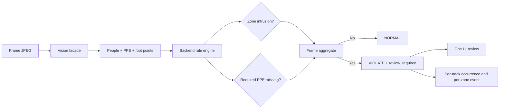

# Frame-level PPE and Zone Alert Rule - Plan

## Goal Capsule

- **Objective:** Apply the confirmed alert matrix: a frame violates when at least one detected person is inside an enabled danger zone or lacks a required PPE item; zone intrusion is a violation whether its machine is running or stopped.
- **Authority:** The user's confirmation on 2026-08-16 overrides the earlier running-machine gate for zone alerts.
- **Execution profile:** Backend rule and inference behavior with focused regression tests and current-behavior documentation. REST/WebSocket payload shapes, zone persistence, vision observations, and event schema remain compatible.
- **Stop conditions:** Do not remove `machine_state`, collapse per-track occurrences, alter privacy processing, or change event persistence from per-zone events to a new frame-event resource.

## Confirmed Product Contract

1. The decision shown to the operator is frame-level: one frame is `violate` if **any** detected person violates any enabled rule; the UI opens at most one review popup for that frame.
2. An enabled zone is violated when any person's foot point is on or inside it, regardless of `machine_state` (`running` or `stopped`).
3. PPE remains per person and per enabled requirement, but only while the machine is `running`. Missing hat alerts only when `hat_required=true`; missing vest alerts only when `vest_required=true`; stopped machines suppress PPE alerts.
4. No detected people always yields `normal`; absent PPE fields without a person do not create an alert.
5. Multiple people do not create multiple popups. Existing track/zone occurrences remain internal evidence and deduplication state, while the response aggregates them through its existing `result`, `review_required`, and `has_active_violation` fields.

## Team Diagram

The standalone team contract is `docs/alert-rule-contract.md`. It is intentionally marked implementation-pending until the focused backend tests pass.

## Compatibility Decisions

- Preserve `machine_state` in requests, zone records, responses, frontend types, canvas labels, and event details as operational context. Only its former gate on zone alerting is removed.
- Preserve `zone_intrusion:{zone_id}` occurrence keys and existing batch persistence: one review can contain occurrences from several zones, while saved events remain per zone for filtering/statistics.
- Preserve the additive REST/WebSocket response schema. No migration is needed because no ORM or persisted payload shape changes.
- Treat the completed US-27 specification's running-only language as historical. Record the superseding product decision in `DECISIONS.md` and update current architecture/backend runtime documentation instead of rewriting history.

## Implementation Units

### U1. Make zone intrusion state-independent in the backend decision path

**Goal:** Ensure the authoritative inference result and occurrence tracker observe zone intrusion for either machine state.

**Files:**

- `backend/app/services/safety_rule_engine.py`
- `backend/app/services/frame_inference_service.py`

**Approach:**

- Change the deterministic rule so an active-zone membership contributes to a violation without inspecting `machine_state`.
- In multi-zone inference, add `zone_intrusion:{zone_id}` to the observed rules for every enabled zone containing a foot point, regardless of that zone's state.
- Set each `rule.zone_results[*].violation` from zone membership alone, and derive the aggregate frame result from PPE or any zone violation.
- Retain `machine_state` only in the response's rule context and primary-zone selection so clients do not lose information.

**Acceptance criteria:**

- A person inside an enabled stopped zone yields `result="violate"`, a new tracked zone occurrence (for a session), `review_required=true`, and a transient snapshot.
- A person inside an enabled running zone retains the same behavior.
- A person outside all zones with required PPE present is `normal` for both machine states.
- No people is `normal` for both machine states, even when PPE requirements are enabled.

**Verification:**

- `PYTHONPATH=. .venv/bin/pytest backend/tests/test_safety_rule_engine.py backend/tests/test_analysis.py backend/tests/test_monitoring_zones.py -v`

**Dependencies:** None.

### U2. Encode the confirmed matrix as focused regression coverage

**Goal:** Prevent a future change from silently restoring a machine-state gate or turning an empty frame into a PPE violation.

**Files:**

- `backend/tests/test_safety_rule_engine.py`
- `backend/tests/test_analysis.py`
- `backend/tests/test_monitoring_zones.py`

**Approach:**

- Replace the running-only truth-table expectation with a parameterized `running`/`stopped` zone-intrusion expectation.
- Add REST and WebSocket coverage for a stopped-zone violation, including response aggregate fields and snapshot behavior.
- Update multi-zone assertions so a person in a stopped enabled zone has a zone occurrence and its `zone_results` item reports `violation=true`.
- Retain tests proving any one person makes the frame violate while the review remains one aggregate popup through the existing `review_required` contract.

**Acceptance criteria:**

- The test matrix covers required hat only, required vest only, both requirements, no person, zone entry with machine ON, zone entry with machine OFF, and multiple people with one violator.
- Tests distinguish aggregate frame alert fields from per-track evidence; they do not require a new event schema.

**Verification:**

- Run the focused pytest command from U1 with local SQLite/test configuration, not a Railway hostname.

**Dependencies:** U1.

### U3. Align current rule documentation and decision governance

**Goal:** Make operator-facing/runtime documentation match the deployed rule and preserve why the old US-27 behavior differs.

**Files:**

- `ARCHITECTURE.md`
- `backend/README.md`
- `DECISIONS.md`
- `PROGRESS.md`

**Approach:**

- Update current-state rule equations and outcome examples to state that enabled-zone intrusion is independent of machine state.
- Record the explicit product decision, compatibility boundary, and unchanged tracking/event behavior in `DECISIONS.md`.
- Update progress only after implementation and verification results are known.

**Acceptance criteria:**

- No current runtime document says a stopped enabled zone suppresses an alert.
- The historical US-27 specification remains unchanged, with the superseding decision traceable from the root decision log.

**Verification:**

- Search current runtime documents for contradictory running-only alert statements and review the diff.

**Dependencies:** U1 and U2.

## Checkpoints

### Checkpoint A: Backend semantics

- Focused tests prove stopped-zone and running-zone behavior is identical for alerting.
- REST and WebSocket remain schema-compatible.

### Checkpoint B: Repository readiness

- `make check` is rerun with a local/test database configuration.
- Frontend type-check, tests, and build remain green; no frontend implementation change is expected because it already consumes aggregate frame fields.
- Runtime documentation, decisions, and progress accurately state completed verification versus any blocked external dependency.

## Risks and Mitigations

| Risk | Impact | Mitigation |
|---|---|---|
| The former machine-state gate exists in both rule engine and multi-zone orchestration. | High | Cover both unit and inference paths for `running` and `stopped`. |
| Interpreting “one alert per frame” as deleting per-track occurrence evidence would break deduplication and per-zone persistence. | High | Keep occurrences unchanged; aggregate only through existing frame fields and one existing review modal. |
| Repository tests currently import a Railway database hostname. | Medium | Run focused suites against the approved local/test database configuration; report an unconfigured DNS dependency separately. |

## Out of Scope

- PLC/real machine-state synchronization or automatic stop.
- New PPE types, model classes, thresholds, or detector retraining.
- A database migration, a changed REST/WebSocket payload shape, or a new frame-alert persistence model.
- UI redesign; the existing one-review-per-frame behavior is retained.
