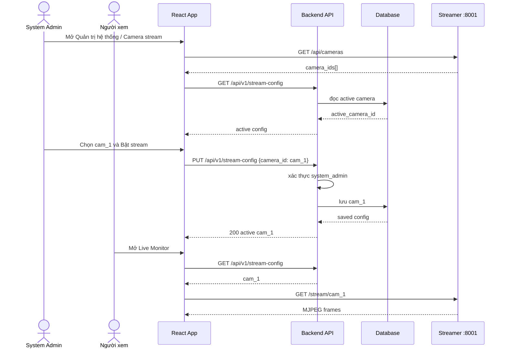
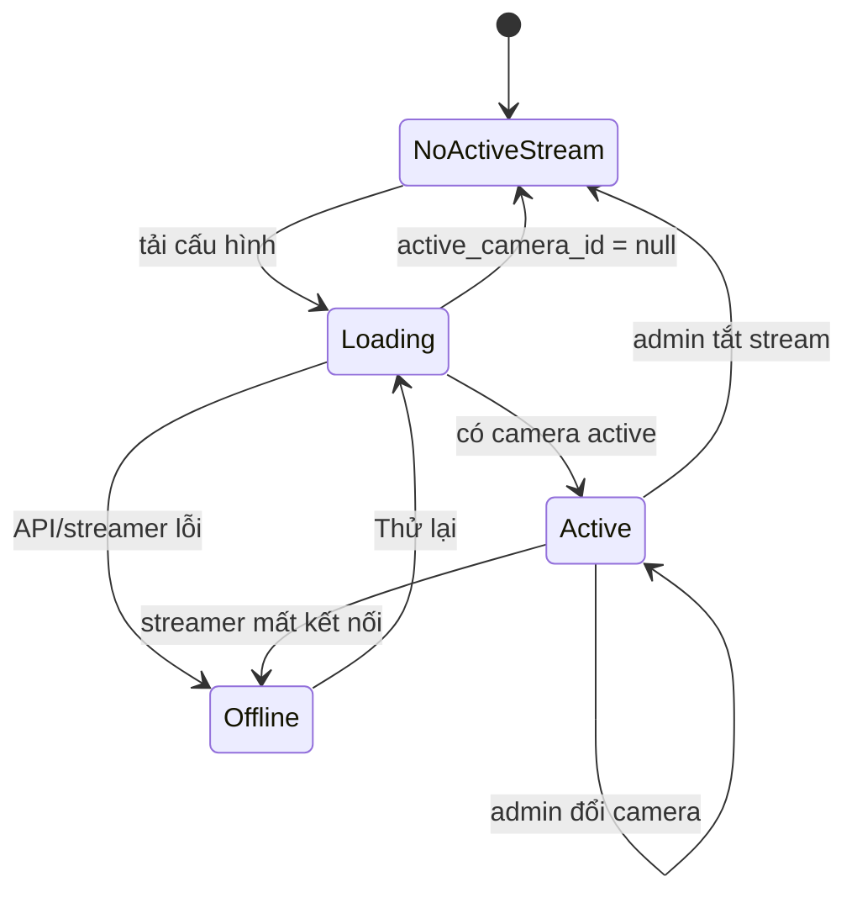

# Use Case: System Admin quản lý camera stream

## Mục tiêu

Cho phép `system_admin` chọn duy nhất một camera đã tồn tại trong mock streamer
container. Trạng thái camera active được lưu ở backend để mọi phiên đăng nhập
nhìn thấy cùng một stream. Ứng dụng không còn upload video; phase này chỉ hiển
thị MJPEG và chưa nối stream vào AI inference.

## Actors và quyền

| Actor | Quyền |
|---|---|
| `system_admin` | Xem danh sách camera, bật một camera hoặc tắt stream |
| `safety_manager` | Chỉ xem camera active |
| `area_manager` | Chỉ xem camera active trong workspace được phép |
| Streamer container | Cung cấp `GET /api/cameras` và `/stream/{camera_id}` |

## Use cases

### UC-01 — Admin xem danh sách camera

1. Admin mở **Quản trị hệ thống → Camera stream**.
2. Frontend gọi `GET /api/cameras` tới streamer container.
3. Danh sách camera được hiển thị cùng trạng thái active hiện tại.

### UC-02 — Admin bật camera

1. Admin chọn một camera.
2. Frontend gọi `PUT /api/v1/stream-config` với `camera_id`.
3. Backend kiểm tra session và role `system_admin`.
4. Backend lưu camera active duy nhất.
5. Live Monitor và các user khác hiển thị `/stream/{camera_id}`.

### UC-03 — User xem camera active

1. User mở Live Monitor.
2. Frontend gọi `GET /api/v1/stream-config`.
3. Nếu có camera active, frontend hiển thị MJPEG stream.
4. User không thấy thao tác chọn/bật camera.

### UC-04 — Tắt stream

1. Admin chọn **Tắt stream**.
2. Backend lưu `camera_id = null`.
3. Live Monitor hiển thị empty state hướng dẫn phù hợp với role.

### UC-05 — Streamer lỗi hoặc không có camera

- Hiển thị trạng thái `Streamer offline` hoặc `Chưa có camera`.
- Có nút **Thử lại**.
- Không làm mất camera active đã lưu ở backend.

## Use-case diagram

```mermaid
flowchart LR
    Admin[System Admin]
    Viewer[Safety Manager / Area Manager]
    UI[React App]
    API[Backend Stream Config API]
    DB[(SQLite/PostgreSQL)]
    Streamer[Streamer Container :8001]

    Admin -->|xem / bật / tắt| UI
    Viewer -->|xem Live Monitor| UI
    UI -->|GET/PUT active config| API
    API -->|RBAC: system_admin cho PUT| API
    API --> DB
    UI -->|GET /api/cameras| Streamer
    UI -->|GET /stream/{camera_id}| Streamer
```

## Sequence diagram — bật và xem stream



## State diagram



## Acceptance criteria

- Chỉ `system_admin` gọi thành công PUT/disable stream.
- Một thời điểm chỉ có tối đa một camera active.
- Reload trình duyệt hoặc user khác vẫn đọc được camera active đã lưu.
- Không còn nút upload/file picker trong Live Monitor.
- Không có camera active thì hiển thị empty state rõ ràng.
- Streamer offline có thông báo lỗi và retry.
- Phase này không gửi frame MJPEG vào WebSocket inference.
