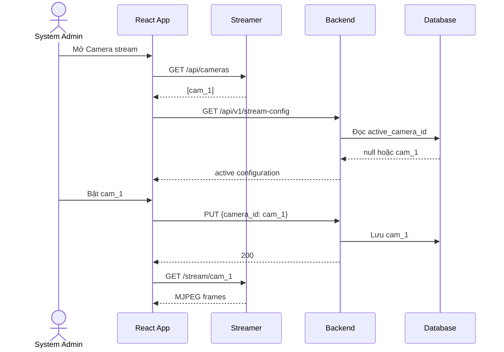
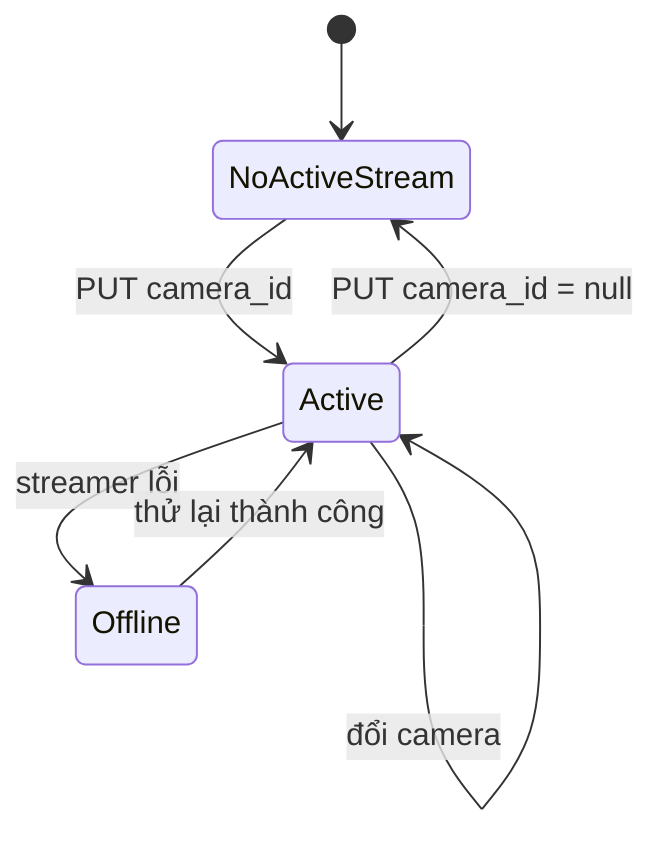

# Camera Stream Requirements and Handoff

## 1. Mục tiêu

Cho phép `system_admin` chọn một camera đã có trong streamer container và bật
cho toàn hệ thống quan sát. Trạng thái active được lưu ở backend. Ứng dụng
chính không upload video và phase này chỉ hiển thị MJPEG, chưa đưa frame vào AI
inference.

## 2. Trạng thái đã triển khai

- Streamer container chạy cổng `8001`.
- Backend chạy cổng `8000`.
- Streamer cung cấp:
  - `GET /api/cameras`
  - `GET /stream/{camera_id}`
  - `GET /health`
- Backend cung cấp:
  - `GET /api/v1/stream-config`: user đã đăng nhập được đọc.
  - `PUT /api/v1/stream-config`: chỉ `system_admin` được cập nhật.
- Database có singleton `stream_configuration`, chỉ lưu tối đa một
  `active_camera_id`.
- Sidebar có mục **Camera stream** riêng, nằm ngay dưới **Quản trị hệ thống**.
- Camera active có nút **Tắt stream** trực tiếp trên card.
- Login có tài khoản demo và nút điền nhanh/copy:
  - `admin@sentinel.local`
  - `antoan@sentinel.local`
  - `khuvuc@sentinel.local`
  - Mật khẩu: `Sentinel123!`

## 3. Actors và quyền

| Actor | Quyền |
|---|---|
| `system_admin` | Xem camera, bật camera, tắt camera |
| `safety_manager` | Xem Live Monitor và camera active, không được chọn |
| `area_manager` | Xem workspace được cấp quyền, không được chọn |
| Streamer | Lưu media và phát MJPEG; không biết user/RBAC/AI |

Frontend chỉ ẩn thao tác theo role để thuận tiện. Backend RBAC mới là lớp bảo vệ
chính và phải giữ nguyên.

## 4. Mô hình triển khai

- **Local:** `docker compose` chạy backend, database và streamer cùng máy.
- **Production:** application/backend service và streamer service được deploy
  riêng. Frontend production phải được build với `VITE_STREAMER_URL` bằng public
  URL của streamer service.
- Không cấu hình production frontend trỏ vào `localhost:8001` hoặc port nội bộ
  của backend.

## 5. Luồng demo local chuẩn

### 4.1 Khởi động Docker

```bash
docker compose down
docker compose up -d --build
```

Kiểm tra:

```bash
docker compose ps
curl http://localhost:8001/health
curl http://localhost:8001/api/cameras
```

Nếu `/api/cameras` trả `[]`, streamer chưa có camera. Camera có thể được nạp
qua trang độc lập `http://localhost:8001/` hoặc được đặt sẵn trong volume
`data/streamer/`. Việc này không phải upload trong app Sentinel.

### 4.2 Bật/tắt camera

1. Mở `http://localhost:8000`.
2. Đăng nhập tài khoản `admin@sentinel.local`.
3. Chọn **Camera stream** ở sidebar, ngay dưới **Quản trị hệ thống**.
4. Bấm **Làm mới** để đọc camera từ streamer.
5. Bấm **Bật stream** trên camera cần demo.
6. Mở **Live monitor** để xem MJPEG.
7. Muốn tắt, bấm **Tắt stream** ngay trên card camera active.

Nếu vừa rebuild Docker, dùng `Ctrl + Shift + R` để loại cache frontend.

## 6. API contract

### Read active configuration

```http
GET /api/v1/stream-config
Authorization: Bearer <token>
```

Response:

```json
{
  "active_camera_id": "cam_1",
  "updated_at": "2026-08-19T14:18:33.955873Z"
}
```

Khi tắt stream, `active_camera_id` là `null`.

### Set or clear active configuration

```http
PUT /api/v1/stream-config
Authorization: Bearer <system-admin-token>
Content-Type: application/json
```

Bật:

```json
{"camera_id": "cam_1"}
```

Tắt:

```json
{"camera_id": null}
```

Non-admin phải nhận `403`. Payload camera ID chỉ cho phép ký tự chữ, số, `_`
và `-`.

## 7. Diagrams

### Use case

```mermaid
flowchart LR
    Admin[System Admin]
    Viewer[Safety Manager / Area Manager]
    UI[React App]
    API[Backend Stream Config API]
    DB[(SQLite/PostgreSQL)]
    S[Streamer :8001]

    Admin -->|bật / tắt| UI
    Viewer -->|xem| UI
    UI -->|GET /api/cameras| S
    UI -->|GET/PUT stream-config| API
    API -->|RBAC PUT| API
    API --> DB
    UI -->|GET /stream/{camera_id}| S
```

### Bật và xem



### Tắt stream



## 8. Acceptance criteria

- Sidebar chỉ hiển thị **Camera stream** cho `system_admin`.
- Camera stream là mục riêng, không nằm trong tab tài khoản.
- Một thời điểm chỉ có một camera active.
- Admin bật được camera và user khác đọc được cùng trạng thái sau reload.
- Admin tắt được camera bằng nút **Tắt stream** trên card active.
- Live Monitor không còn file picker hoặc upload video.
- Không có camera active thì hiển thị empty state.
- Streamer lỗi có trạng thái lỗi và retry.
- Non-admin không thể gọi PUT thành công dù tự gửi request.
- MJPEG chưa được nối vào `/api/v1/ws/inference` trong phase này.

## 9. Files chính

- Frontend shell/navigation: `frontend/src/components/AppShell.tsx`
- Frontend routing: `frontend/src/App.tsx`
- Stream admin UI: `frontend/src/features/auth/AdminUserPage.tsx`
- Stream transport: `frontend/src/api/stream-config.ts`
- Live viewer: `frontend/src/features/monitor/StreamViewer.tsx`
- Backend route: `backend/app/api/v1/stream_configuration.py`
- Backend service: `backend/app/services/stream_configuration_service.py`
- ORM: `backend/app/models/stream_configuration.py`
- Migration: `backend/migrations/versions/20260819_01_add_stream_configuration.py`
- Tests: `backend/tests/test_stream_configuration.py`, `frontend/src/App.test.tsx`

## 10. Việc chưa làm

- Kết nối MJPEG hoặc nguồn camera thật vào AI inference.
- RTSP/HLS và multi-stream inference.
- Metadata camera như tên hiển thị, vị trí, trạng thái online chính thức.
- Persist lịch sử bật/tắt hoặc audit actor cho stream configuration.
