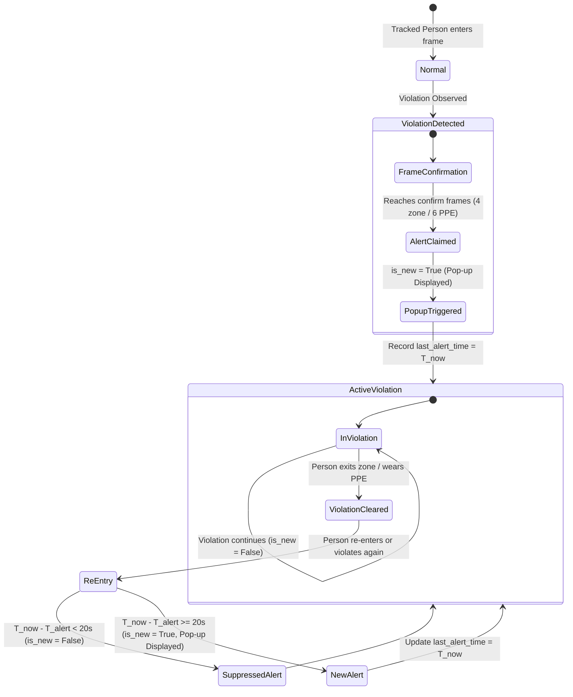
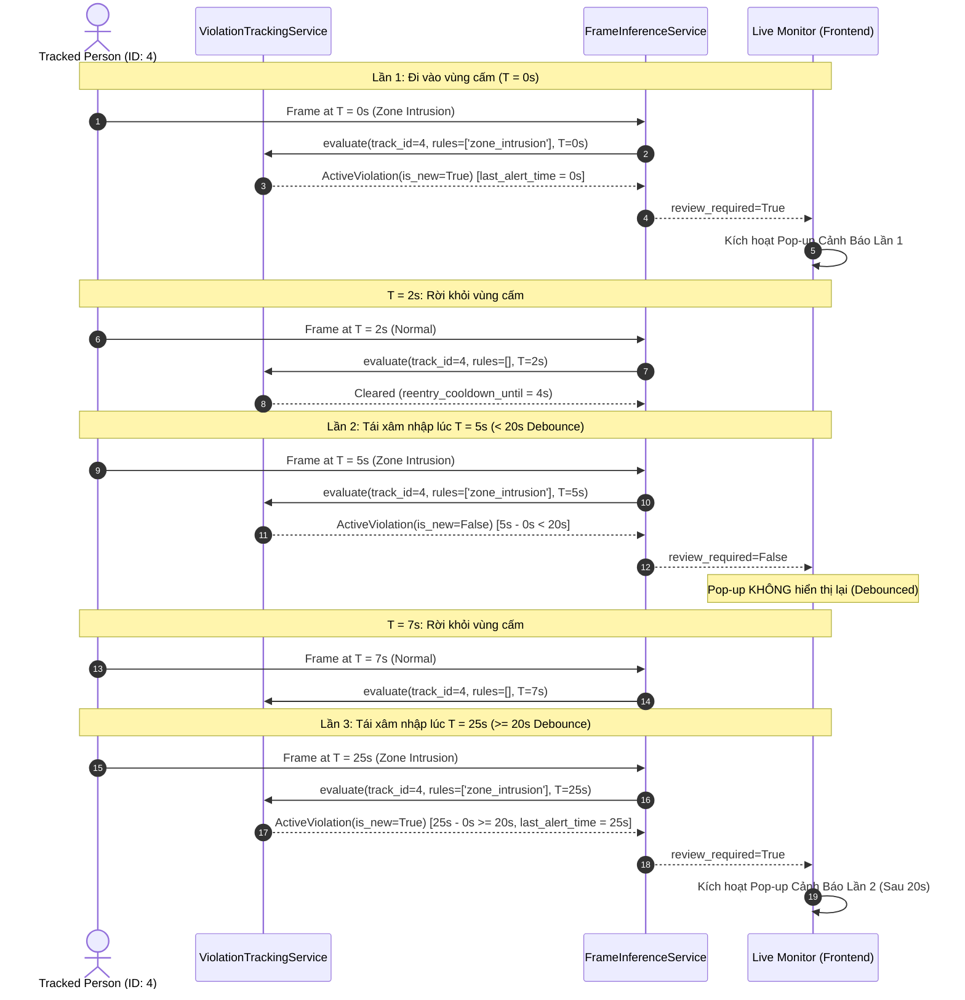

# Violation Pop-up Debounce & Alert Management Specification

## Overview

This specification details the violation tracking, pop-up debounce logic, and multi-violation notification aggregation for the Live Camera Monitoring system.

---

## Technical Objectives

1. **Configurable Debounce Window**:
   - Setting `violation_cooldown_seconds` (default: `20.0` seconds) in `backend/app/core/config.py`.
   - Prevents duplicate review pop-ups for the same tracked person when they temporarily exit and re-enter a restricted zone or momentarily fix PPE within the 20-second debounce window.
   - When 20 seconds elapse after an initial alert, any subsequent violation by the same person re-triggers a new pop-up review (`is_new = True`).

2. **Multi-Violation Aggregation**:
   - If a person triggers multiple violation types simultaneously (e.g. Zone Intrusion + Missing PPE Hat/Vest + Restricted Area), the violations are combined into a single pop-up review notification.
   - The pop-up title dynamically summarizes all active violations (e.g., *"Phát hiện người trong phạm vi hạn chế & Phát hiện xâm nhập vùng nguy hiểm & Phát hiện thiếu PPE"*).

---

## Debounce State Machine Flow



---

## Sequence Diagram: Re-entry within vs after Debounce Window



---

## Configuration Settings

In `backend/app/core/config.py`:

```python
violation_cooldown_seconds: float = Field(default=20.0, ge=0.0, le=300.0)
```

Can be overridden via environment variables:
`VIOLATION_COOLDOWN_SECONDS=20.0`
