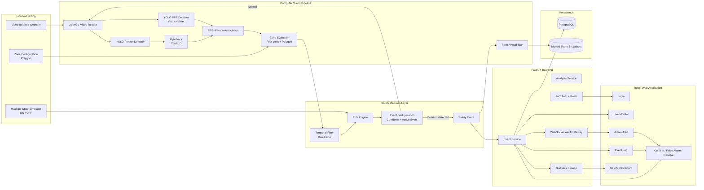
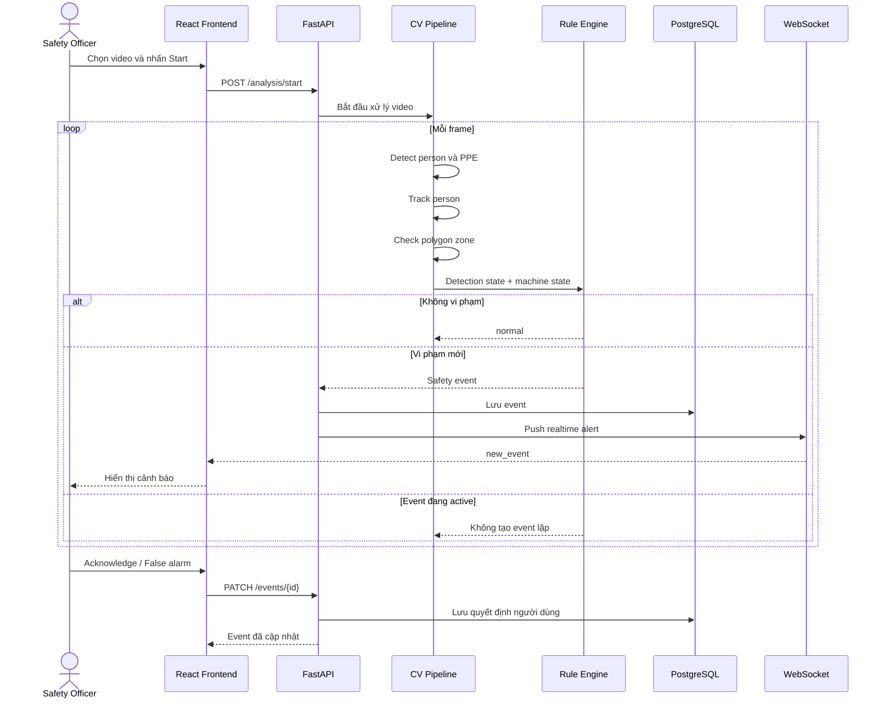
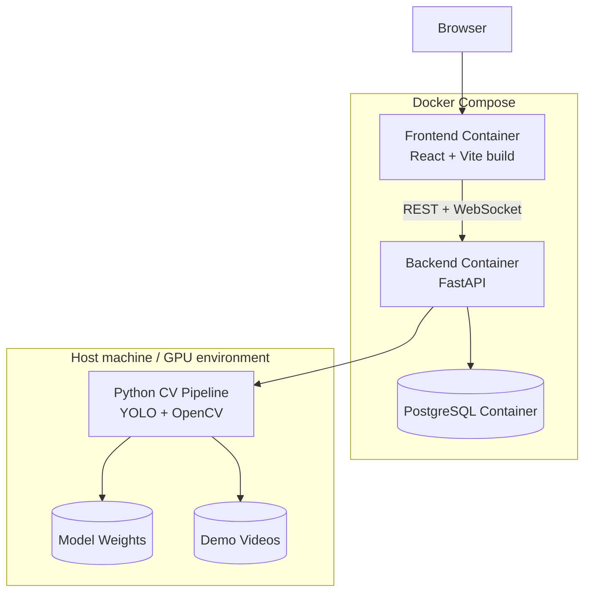

# MFG-20 Prototype — Tech Stack & Architecture

## 1. Tech stack đề xuất

| Layer            | Công nghệ                 | Vai trò                                             |
| ---------------- | ------------------------- | --------------------------------------------------- |
| Computer Vision  | Python, Ultralytics YOLO  | Phát hiện người và PPE                              |
| Tracking         | ByteTrack qua Ultralytics | Giữ `track_id` của người qua nhiều frame            |
| Video processing | OpenCV                    | Đọc video, vẽ box, polygon, làm mờ khuôn mặt        |
| Zone logic       | OpenCV `pointPolygonTest` | Kiểm tra điểm chân người trong/ngoài vùng nguy hiểm |
| Business rules   | Python thuần              | Kết hợp PPE, zone, machine state, confidence        |
| Backend          | FastAPI                   | API, điều phối phân tích video, quản lý event       |
| Realtime         | FastAPI WebSocket         | Đẩy cảnh báo mới đến frontend                       |
| Database         | PostgreSQL                | Lưu user, zone, machine, event và review            |
| ORM              | SQLAlchemy + Alembic      | Truy cập database và migration                      |
| Frontend         | React + TypeScript + Vite | Live monitor, alert, event log, dashboard           |
| UI               | Tailwind CSS              | Xây giao diện nhanh                                 |
| Charts           | Recharts                  | Dashboard thống kê đơn giản                         |
| Authentication   | JWT đơn giản              | Đăng nhập và phân quyền hai vai trò                 |
| Deployment       | Docker Compose            | Chạy frontend, backend và database cùng nhau        |
| Optional report  | Template trước, LLM sau   | Sinh mô tả và báo cáo từ event có cấu trúc          |

---

# 2. Lựa chọn model

## Person detection

Dùng model YOLO pretrained để phát hiện `person`.

```text
YOLO pretrained
→ person bounding box
→ confidence
```

Chưa cần fine-tune nếu model phát hiện tốt trên video mô phỏng.

## PPE detection

Dùng một PPE model pretrained hoặc fine-tuned công khai để phát hiện:

```text
helmet
safety_vest
```

Prototype có thể chạy hai model:

```text
Model 1: person detector
Model 2: PPE detector
```

Sau đó ghép PPE với người dựa trên vị trí không gian.

## Tracking

Dùng ByteTrack thông qua chế độ tracking của Ultralytics. Ultralytics hỗ trợ cả ByteTrack và BoT-SORT; với prototype, ByteTrack là lựa chọn đủ đơn giản để giữ ID và chống tạo cảnh báo ở mỗi frame.

---

# 3. Tại sao chọn OpenCV cho zone?

Vùng nguy hiểm không cần thêm một model AI.

Người vận hành cấu hình polygon:

```json
{
  "zone_id": "zone-a",
  "points": [
    [120, 200],
    [520, 200],
    [590, 600],
    [80, 600]
  ]
}
```

Với mỗi người:

```text
Bounding box
→ lấy bottom-center làm foot point
→ pointPolygonTest
→ inside / outside
```

OpenCV cung cấp `pointPolygonTest` để kiểm tra một điểm nằm trong, ngoài hoặc trên đường biên polygon.

---

# 4. Tại sao chọn FastAPI?

Toàn bộ CV pipeline đang dùng Python. FastAPI giúp nhóm giữ cùng một hệ sinh thái:

```text
Python CV
→ Python rule engine
→ Python backend
```

FastAPI chịu trách nhiệm:

* Nhận video upload.
* Bắt đầu phân tích.
* Quản lý trạng thái machine ON/OFF.
* Tạo và lưu event.
* Trả nhật ký vi phạm.
* Nhận thao tác acknowledge hoặc false alarm.
* Gửi cảnh báo realtime bằng WebSocket.

FastAPI có hỗ trợ WebSocket chính thức, phù hợp với việc đẩy cảnh báo đến nhiều browser đang mở.

Không cần tách CV thành microservice riêng trong prototype. Một FastAPI application có thể chạy pipeline bằng background worker hoặc một process xử lý video nội bộ.

---

# 5. Tại sao chọn React + TypeScript + Vite?

Frontend cần:

* Phát video.
* Hiển thị active alert.
* Cập nhật event realtime.
* Hiển thị event log và dashboard.
* Quản lý trạng thái machine ON/OFF.
* Cho người dùng acknowledge hoặc đánh dấu false alarm.

React phù hợp cho giao diện có nhiều state. TypeScript giúp frontend bám sát event contract của backend.

Không nên dùng Create React App. React đã ngừng khuyến nghị Create React App cho dự án mới và tài liệu chính thức hướng dẫn dùng build tool như Vite khi xây React app từ đầu.

---

# 6. Tại sao chọn PostgreSQL?

Prototype cần lưu dữ liệu có quan hệ rõ:

```text
User
→ phụ trách Zone

Zone
→ có Machine

Event
→ thuộc Zone và Machine

Event
→ có nhiều Review hoặc trạng thái xử lý
```

PostgreSQL phù hợp để:

* Truy vấn event theo thời gian, zone và severity.
* Tính dashboard.
* Lưu audit trail.
* Không mất event khi restart.

Nếu cần làm cực nhanh trong tuần đầu, có thể dùng SQLite. Trước demo tích hợp, nên chuyển sang PostgreSQL để Docker Compose và deployment gần với kiến trúc thật hơn.

---

# 7. Thành phần không cần dùng ngay

## LangGraph

Chưa cần trong core prototype.

Workflow hiện tại có đường đi khá cố định:

```text
Detect
→ Track
→ Evaluate zone/PPE
→ Apply rule
→ Create event
→ Alert
```

Đây là pipeline và state machine thông thường, không phải agent cần tự lập kế hoạch.

Chỉ thêm LangGraph nếu sau này có workflow nhiều nhánh như:

* Gửi cảnh báo qua nhiều kênh.
* Chờ xác nhận.
* Timeout.
* Escalate tới cấp tiếp theo.
* Thu thập thêm bằng chứng.
* Sinh báo cáo và yêu cầu người duyệt.

## LLM

Không để LLM quyết định vi phạm.

LLM chỉ nhận event có cấu trúc:

```json
{
  "zone": "Zone A",
  "violation": "zone_intrusion",
  "machine_status": "running",
  "severity": "critical"
}
```

Sau đó sinh mô tả hoặc báo cáo. Nếu LLM lỗi, dùng template cố định.

## Redis và message queue

Chưa cần ở giai đoạn đầu.

Chỉ thêm Redis hoặc Celery khi:

* Có nhiều video chạy đồng thời.
* Xử lý video lâu.
* Cần retry job.
* Backend API bị block bởi inference.
* Cần chạy CV worker riêng.

---

# 8. Kiến trúc prototype



---

# 9. Luồng dữ liệu chi tiết



---

# 10. Event contract giữa các module

## Output từ CV

```json
{
  "frame_id": 124,
  "timestamp_ms": 4133,
  "persons": [
    {
      "track_id": 7,
      "bbox": [120, 80, 360, 520],
      "person_confidence": 0.96,
      "foot_point": [240, 520],
      "ppe": {
        "vest": "missing",
        "vest_confidence": 0.86,
        "helmet": "unknown"
      },
      "inside_zone": true
    }
  ]
}
```

## Input cho rule engine

```json
{
  "track_id": 7,
  "inside_zone": true,
  "machine_status": "running",
  "ppe": {
    "vest": "missing"
  },
  "confidence": 0.86,
  "inside_duration_ms": 1200→ Track
→ Evaluate zone/PPE
→ Apply rule

}
```

## Safety event

```json
{
  "event_id": "evt-001",
  "camera_id": "camera-demo-01",
  "zone_id": "zone-a",
  "track_id": 7,
  "violation_type": "zone_intrusion",
  "severity": "critical",
  "machine_status": "running",
  "confidence": 0.86,
  "status": "pending",
  "snapshot_url": "/events/evt-001.jpg",
  "started_at": "2026-07-30T21:00:00+07:00"
}
```

---

# 11. Repository structure

```text
mfg20-safety-agent/
├── backend/
│   ├── app/
│   │   ├── api/
│   │   ├── core/
│   │   ├── models/
│   │   ├── schemas/
│   │   ├── services/
│   │   │   ├── analysis_service.py
│   │   │   ├── event_service.py
│   │   │   └── statistics_service.py
│   │   └── main.py
│   ├── migrations/
│   └── tests/
│
├── vision/
│   ├── detection/
│   │   ├── person_detector.py
│   │   └── ppe_detector.py
│   ├── tracking/
│   ├── association/
│   ├── zones/
│   ├── privacy/
│   ├── rules/
│   ├── pipeline.py
│   └── tests/
│
├── frontend/
│   ├── src/
│   │   ├── api/
│   │   ├── components/
│   │   ├── features/
│   │   │   ├── monitor/
│   │   │   ├── alerts/
│   │   │   ├── events/
│   │   │   └── dashboard/
│   │   └── types/
│   └── package.json
│
├── data/
│   ├── demo/
│   ├── edge-cases/
│   └── expected-results.json
│
├── contracts/
│   ├── detection.schema.json
│   └── event.schema.json
│
├── docs/
│   ├── architecture.md
│   ├── rules.md
│   └── limitations.md
│
├── docker-compose.yml
└── README.md
```

---

# 12. Docker Compose architecture



Đối với prototype, CV có thể chạy ngay trong backend container nếu môi trường hỗ trợ model tốt. Nếu GPU hoặc driver làm Docker phức tạp, hãy chạy CV trên host và để backend gọi trực tiếp module Python. Không nên để Docker GPU trở thành blocker của core demo.

---

# 13. Stack tối thiểu theo mức ưu tiên

## P0 — Bắt buộc

```text
Python
Ultralytics YOLO
OpenCV
ByteTrack
FastAPI
SQLAlchemy
PostgreSQL
WebSocket
React + TypeScript + Vite
Docker Compose
```

## P1 — Nên có

```text
Alembic
Tailwind CSS
Recharts
JWT authentication
Face/head blur
Pytest
Vitest
```

## P2 — Chỉ thêm khi core đã ổn

```text
LangGraph
LLM reporting
Redis
Celery
Telegram/email integration
Cloud GPU
Multiple cameras
```

---

# 14. Quyết định kiến trúc quan trọng

## Một repository, không microservice

Prototype nên dùng monorepo và modular monolith:

```text
CV module
+ backend module
+ frontend
+ database
```

Không nên tách:

```text
Person service
PPE service
Tracking service
Zone service
Rule service
Alert service
```

Tách quá sớm làm tăng:

* Network contract.
* Deployment.
* Debugging.
* Logging.
* Configuration.
* Khó tích hợp cho team nhỏ.

## Hai model trước, tối ưu sau

Bắt đầu:

```text
Person detector
+
PPE detector
```

Sau khi pipeline chạy, mới thử một model đa class:

```text
person + helmet + vest
```

Hai model dễ debug hơn trong prototype; một model có thể tối ưu latency ở giai đoạn sau.

## Rule engine thuần Python

Không dùng LLM để xác định severity.

```python
if person.inside_zone and machine.is_running:
    return CriticalZoneIntrusion()

if person.ppe.vest == "missing":
    return MissingPPEWarning()
```

Quyết định an toàn phải dễ kiểm thử, giải thích và thay đổi.

---

# Kết luận

Stack nên chốt là:

```text
React + TypeScript + Vite
          ↓ REST / WebSocket
FastAPI + SQLAlchemy
          ↓
Python CV Pipeline
├── YOLO person
├── YOLO PPE
├── ByteTrack
├── OpenCV polygon
└── Python rule engine
          ↓
PostgreSQL + blurred snapshots
```

Đây là lựa chọn phù hợp cho prototype vì team có thể hoàn thiện một luồng chạy thật mà không phải vận hành microservice, message queue hoặc agent framework quá sớm.
