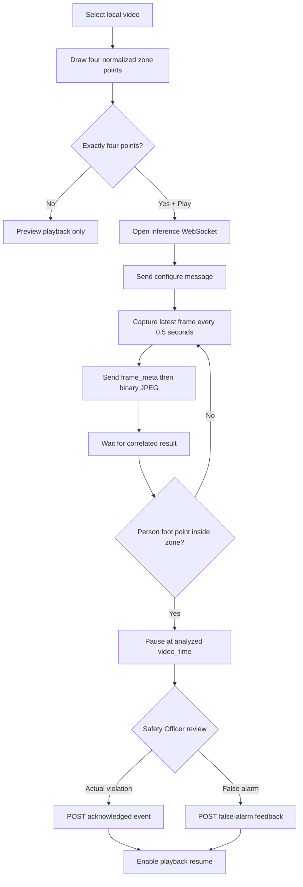

# Frontend Baseline

This module is the single-page HTML/CSS/JavaScript safety-monitoring client. FastAPI serves it at `/`, so there is no frontend build step. It owns video playback, four-point zone configuration, sampled-frame delivery, Canvas overlays, and the Safety Officer review interaction. Person detection and polygon evaluation remain backend responsibilities.

## Run

```bash
uvicorn backend.app.main:app --reload --host 0.0.0.0 --port 8000
```

Open `http://localhost:8000` and hard-refresh after changing frontend assets. The WebSocket client tries the page origin first and `<hostname>:8000` second, which also supports a local static development server.

## Runtime Flow

1. The operator selects a local video. The browser keeps the video local and displays a preview.
2. Four clicks on the overlay Canvas create a normalized polygon. With fewer than four points, Play is preview-only and no inference connection is opened.
3. Play with exactly four points opens `/api/v1/ws/inference` and sends the zone configuration.
4. While playing, the browser samples at most one frame every 0.5 seconds, encodes it as JPEG, and sends it as WebSocket binary data.
5. The backend returns person bounding boxes, foot points, and `inside_zone` results. The frontend draws them in the original video coordinate space.
6. Playback continues for no detections or people outside the zone. It pauses at the analyzed `video_time` only when at least one returned foot point is inside the polygon.
7. The candidate remains in browser memory as `pendingViolation` until the Safety Officer confirms a violation or marks it as a false alarm.

Only one frame may be in flight. If inference is slower than the 0.5-second sampling interval, intermediate video frames are skipped rather than queued. This keeps results recent and prevents stale-frame backlog.



## WebSocket Protocol

The connection uses text JSON for control/result messages and binary JPEG for image frames.

### 1. Configure the connection

```json
{
  "type": "configure",
  "zone_points": [
    {"x": 0.12, "y": 0.20},
    {"x": 0.84, "y": 0.20},
    {"x": 0.88, "y": 0.92},
    {"x": 0.10, "y": 0.92}
  ],
  "machine_state": "running"
}
```

Coordinates are normalized from `0` to `1`, so the zone is independent of displayed video size. The backend acknowledges valid configuration with:

```json
{"type": "configured"}
```

### 2. Send one sampled frame

Send metadata first:

```json
{
  "type": "frame_meta",
  "frame_id": 42,
  "video_time": 12.5
}
```

Immediately send the corresponding JPEG as the next binary WebSocket message. The client does not send another frame until it receives a result or error.

### 3. Receive detections

```json
{
  "type": "inference_result",
  "frame_id": 42,
  "video_time": 12.5,
  "result": "normal",
  "review_required": true,
  "people": [
    {
      "bbox": [320, 110, 470, 610],
      "confidence": 0.91,
      "foot_point": [395, 610],
      "inside_zone": true,
      "safety_shirt": true
    }
  ],
  "snapshot_data": "data:image/jpeg;base64,...",
  "rule": {
    "person_inside_zone": true,
    "machine_state": "running",
    "safety_shirt_required": true
  }
}
```

`bbox` and `foot_point` use original video pixels. Boxes and foot markers are green outside the zone and red inside it. `frame_id` rejects stale results; `video_time` lets the UI pause on the analyzed frame instead of the later playback position.

Errors are JSON messages with `type`, `code`, and `message`. A connection or protocol failure pauses monitored playback; pressing Play starts a new connection.

## Safety Officer Review and Save

The candidate detection is not written to the database before review. On confirmation, the frontend calls `POST /api/v1/events` with the inference result, snapshot, video timestamp, people, and zone points. The current baseline sends:

- `status: "acknowledged"` for an actual violation;
- `status: "false_alarm"` for a rejected detection.

The backend returns `201 Created` and the generated event ID. Event review currently identifies the officer as the baseline string `Safety Officer`; production should derive this identity from authentication.

## Key Files

- `index.html`: monitor and review markup.
- `app.js`: small composition root that wires controllers and callbacks.
- `modules/`: native ES modules for video, zones, inference, rendering, review, state, and UI.
- `styles.css`: Sentinel visual system.
- `baseline.css`: functional video, Canvas, point-editing, and review states.

## Baseline Module Structure

The baseline keeps the same UI, API contracts, and build-free Vanilla JavaScript runtime while splitting responsibilities into native ES modules:

```text
frontend/
├── index.html
├── styles.css
├── baseline.css
├── app.js                    # Composition and event wiring only
└── modules/
    ├── README.md
    ├── config.js
    ├── dom.js
    ├── state.js
    ├── video-controller.js
    ├── video-preview.js
    ├── zone-controller.js
    ├── inference-client.js
    ├── frame-sampler.js
    ├── overlay-renderer.js
    ├── review-controller.js
    └── ui.js
```

`index.html` loads `app.js` with `type="module"`. Implementation files stay near 150 lines or below, with `app.js` serving as the 29-line composition root. The refactor preserves the WebSocket and REST messages exactly.
