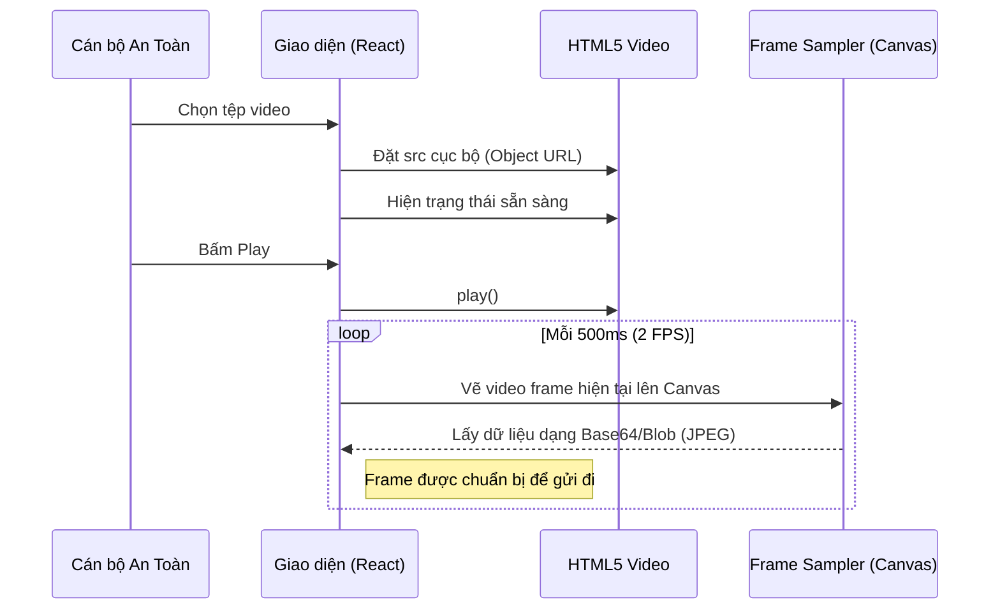

# Chi tiết Spec: US-01 — Tải và phát video mô phỏng

## 1. Cái gì (What)
Cho phép cán bộ an toàn tải lên và phát một tệp video mô phỏng trực tiếp trên giao diện web giám sát (monitor). Video này sẽ đóng vai trò như một luồng camera (camera stream) để hệ thống thực hiện phân tích an toàn.

## 2. Tại sao (Why)
Trong giai đoạn MVP và nguyên mẫu (prototype), hệ thống cần được kiểm thử, demo, và đánh giá tính năng phát hiện vi phạm một cách dễ dàng mà không phụ thuộc vào hạ tầng mạng camera RTSP hay phần cứng vật lý tại nhà máy. Việc phát video cục bộ giúp đơn giản hóa đầu vào.

## 3. Như thế nào (How)
- **Giao diện:** Sử dụng thẻ `<video>` của HTML5 trong ứng dụng React. Cung cấp nút chọn file để người dùng tải lên tệp `.mp4`.
- **Luồng hoạt động:** 
  - Khi video được chọn, URL cục bộ (`URL.createObjectURL`) sẽ được tạo ra để gán vào `src` của thẻ `<video>`.
  - Có các nút điều khiển Play/Pause/Stop.
  - Khi video đang phát (trạng thái playing), một vòng lặp (như `requestAnimationFrame` hoặc `setInterval`) sẽ được kích hoạt để lấy mẫu (sample) các khung hình (frame) bằng thẻ `<canvas>` theo một tốc độ nhất định (ví dụ 2 FPS) để chuẩn bị cho quá trình inference.

## 4. Biểu đồ (Diagram)

## 5. API Contract
Tính năng này chủ yếu xử lý ở phía Frontend, không có API Backend cụ thể ngoài việc cung cấp dữ liệu frame cho WebSocket ở các bước sau.
- **Input (Local):** `File` object từ `<input type="file">`
- **Output (Local):** Dữ liệu ảnh JPEG ở định dạng Blob hoặc Base64 từ `canvas.toBlob()`.
