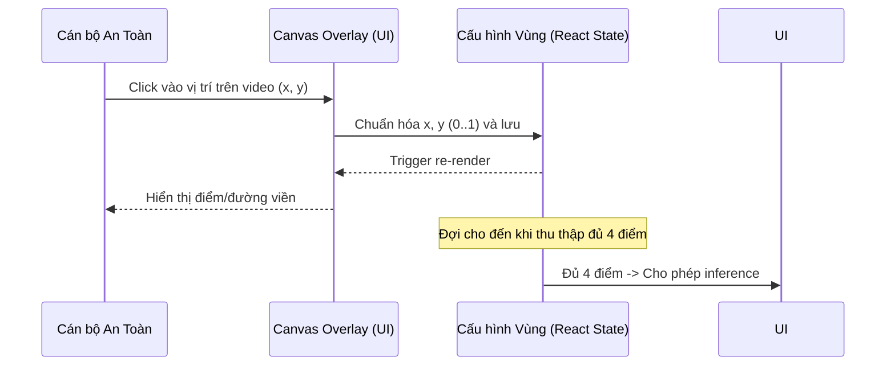

# Chi tiết Spec: US-02 — Cấu hình một vùng nguy hiểm bằng bốn điểm

## 1. Cái gì (What)
Cho phép người dùng vẽ một đa giác 4 điểm (polygon) trên giao diện hiển thị video để xác định vùng nguy hiểm (vùng cấm).

## 2. Tại sao (Why)
Hệ thống cần biết không gian vật lý nào trên camera là không an toàn để kích hoạt báo động. Do góc quay camera có thể thay đổi, cấu hình vùng thủ công cho phép hệ thống linh hoạt thích ứng với các khu vực và thiết lập máy móc khác nhau.

## 3. Như thế nào (How)
- **Giao diện:** Canvas overlay đè lên trên thẻ `<video>`. Bắt sự kiện `onClick` của người dùng để thu thập 4 điểm.
- **Lưu trữ:** Tọa độ các điểm được chuẩn hóa (từ 0.0 đến 1.0) chia cho chiều rộng và chiều cao của video hiện tại để độc lập với kích thước màn hình hiển thị.
- **Kiểm soát:** Chỉ gửi yêu cầu phân tích (inference) khi có đủ cấu hình 4 điểm. Có nút xoá (Reset) để vẽ lại.

## 4. Biểu đồ (Diagram)


## 5. API Contract
**Lưu ý:** Trong phiên bản hiện tại, tọa độ được gửi trực tiếp theo mỗi frame lên WebSocket.
**Cấu trúc dữ liệu Tọa độ Vùng (Frontend State / WebSocket payload):**
```json
{
  "points": [
    {"x": 0.25, "y": 0.25},
    {"x": 0.75, "y": 0.25},
    {"x": 0.75, "y": 0.75},
    {"x": 0.25, "y": 0.75}
  ]
}
```
