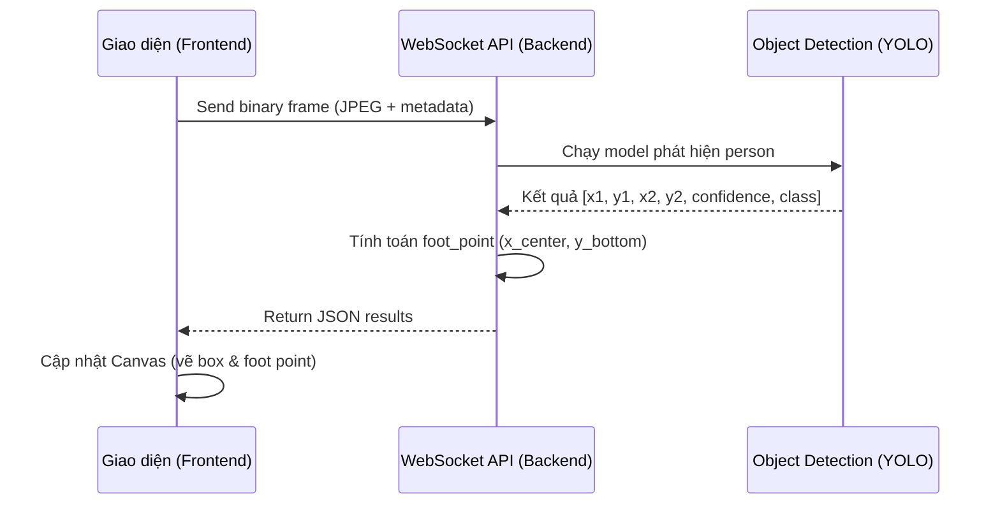

# Chi tiết Spec: US-03 — Phát hiện người gần realtime

## 1. Cái gì (What)
Liên tục nhận diện sự xuất hiện của con người trong các khung hình video đang phát, trả về tọa độ hộp giới hạn (bounding box) và tọa độ điểm chân (foot point) của mỗi người.

## 2. Tại sao (Why)
Đây là năng lực cốt lõi để biết được có người ở trong khu vực hay không. Phải xử lý gần thời gian thực (realtime) để đảm bảo không bỏ lỡ khoảnh khắc vi phạm an toàn, giúp cảnh báo kịp thời.

## 3. Như thế nào (How)
- **Frontend:** Đóng gói từng frame ảnh (JPEG) kèm với siêu dữ liệu (metadata như timestamp) và gửi qua kết nối WebSocket (`/api/v1/ws/inference`). Áp dụng cơ chế backpressure: chỉ gửi frame tiếp theo khi frame trước đó đã được xử lý (một frame in flight).
- **Backend:** Bắt payload, giải mã JPEG, chạy mô hình YOLOv8 để phát hiện đối tượng `person`. Trích xuất bounding box và tính điểm chân (`bottom-center`).
- **Phản hồi:** Trả kết quả JSON về qua WebSocket. Frontend vẽ bounding box lên Canvas.

## 4. Biểu đồ (Diagram)


## 5. API Contract
**WebSocket WebSocket Route:** `/api/v1/ws/inference`

**Input Payload (từ Frontend):** 
Binary dữ liệu chứa JPEG. Metadata có thể được gửi riêng ở phase cấu hình kết nối.

**Output Message (từ Backend - JSON):**
```json
{
  "timestamp": 1690000000.123,
  "detections": [
    {
      "box": [0.1, 0.2, 0.3, 0.8], // [x_min, y_min, x_max, y_max]
      "foot_point": [0.2, 0.8],
      "confidence": 0.95,
      "class_name": "person",
      "attributes": {
        "safety_shirt": true // hoặc dựa vào logic phụ
      }
    }
  ],
  "error": null
}
```
