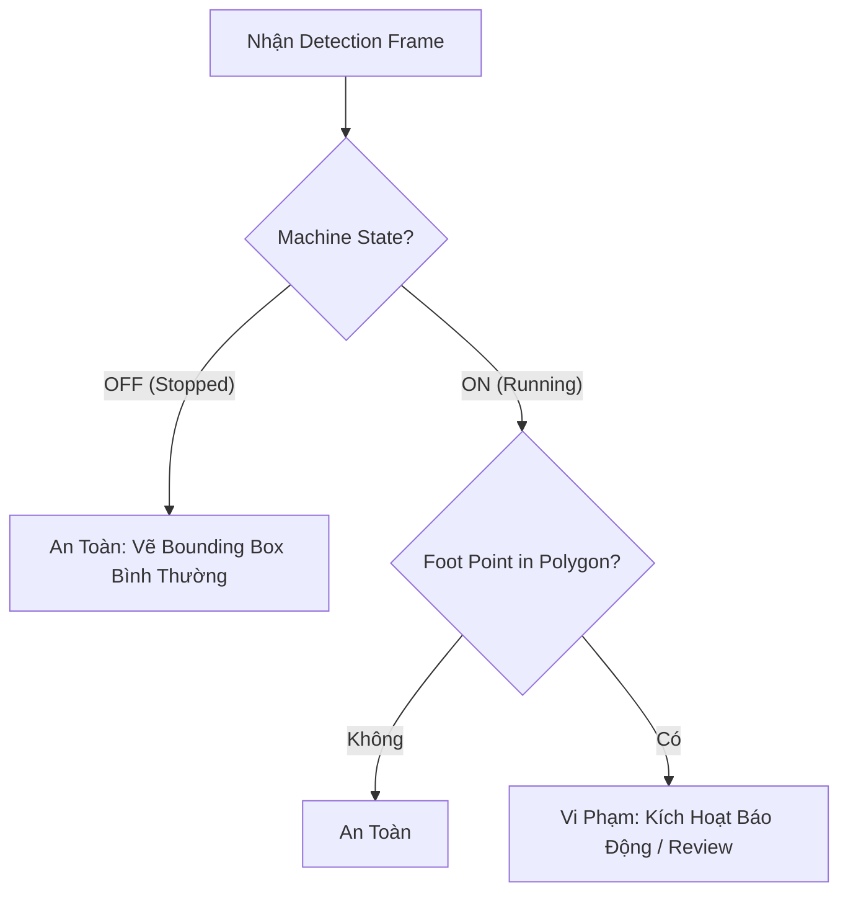

# Chi tiết Spec: US-04 — Kết hợp vùng nguy hiểm với trạng thái máy ON/OFF

## 1. Cái gì (What)
Quyết định một đối tượng `person` có đang ở trong trạng thái nguy hiểm hay không, dựa trên hai yếu tố: (1) Điểm chân của người đó nằm trong vùng cấm (polygon) và (2) Trạng thái hiện tại của thiết bị/máy móc trong vùng đó là đang chạy (ON/running).

## 2. Tại sao (Why)
Công nhân thường xuyên phải vào khu vực máy móc khi máy đã dừng để bảo trì, tiếp nhiên liệu, v.v. Nếu chỉ dựa vào việc bước vào vùng, hệ thống sẽ sinh ra rất nhiều cảnh báo sai (false alarms), làm giảm độ tin cậy của ứng dụng.

## 3. Như thế nào (How)
- **Kiểm tra vùng (Point in Polygon):** Hệ thống lấy `foot_point` (điểm đáy giữa) của bounding box trả về từ YOLO, sử dụng thuật toán Ray Casting để xác định điểm đó có nằm bên trong vùng 4 điểm hay không. (Có thể thực hiện phía Frontend hoặc Backend tùy cấu hình).
- **Trạng thái máy:** Giao diện có một công tắc chuyển đổi mô phỏng `machine_state` (ON/OFF).
- **Luồng logic (Zone-entry rule):**
  - Luôn phát hiện người (kể cả máy OFF).
  - Nếu điểm chân NẰM TRONG vùng VÀ `machine_state` == `running` -> Đánh dấu là Vi Phạm (Violation).
  - Ngược lại -> An Toàn (Safe).

## 4. Biểu đồ (Diagram)

## 5. API Contract
Theo thiết kế hiện tại, logic kết hợp này có thể nằm ở Frontend (khi có đủ tọa độ và trạng thái UI).
- **Input logic:** `foot_point` (từ WS JSON), `polygon` (từ State), `machine_state` (từ State: `'running'` / `'stopped'`).
- **Output:** Boolean `isViolating`.
