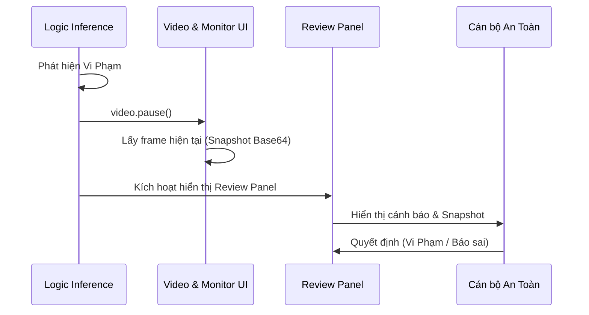

# Chi tiết Spec: US-05 — Nhận cảnh báo và review gần realtime

## 1. Cái gì (What)
Khi xảy ra tình huống vi phạm, hệ thống tự động tạm dừng luồng giám sát (dừng phát video), chụp lại khung hình hiện tại làm bằng chứng (snapshot) và đưa giao diện vào trạng thái "Review" chờ con người can thiệp.

## 2. Tại sao (Why)
Hệ thống AI không đảm bảo độ chính xác tuyệt đối (100%). Cần có sự giám sát của con người (Human-in-the-loop) để loại bỏ các cảnh báo sai. Tạm dừng ngay lập tức giúp cán bộ dễ dàng quan sát sự kiện tại đúng thời điểm xảy ra.

## 3. Như thế nào (How)
- **Tạm dừng (Pause):** Khi cờ `isViolating` (US-04) bật lên, ứng dụng React gọi `video.pause()`.
- **Cập nhật UI:** Component Monitor ẩn/mờ đi, component Review hiện lên, hiển thị tĩnh khung hình chụp được kèm theo cảnh báo (ví dụ: "Phát hiện xâm nhập!").
- **Hành động Review:** Cho phép cán bộ chọn một trong hai hành động:
  - **"Vi phạm thực tế" (Actual Violation):** Xác nhận cảnh báo đúng, tiến hành lưu trữ sự kiện.
  - **"Cảnh báo sai" (False Alarm):** Phớt lờ cảnh báo, nhấn Play để tiếp tục giám sát.

## 4. Biểu đồ (Diagram)

## 5. API Contract
Tính năng này chủ yếu xoay quanh việc quản lý State trên Frontend (React Component Lifecycle) và sự chuyển đổi giữa trạng thái `monitoring` và `reviewing`. Việc lưu sự kiện (khi chọn Vi phạm) được xử lý ở US-06.
