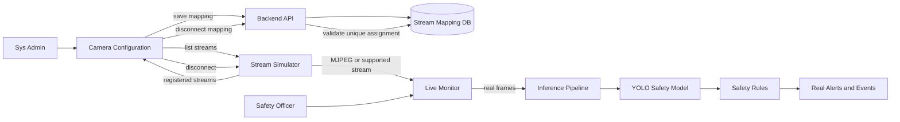

# US-29 — Demo Day: Multi-camera stream configuration

## Mục tiêu

Tạo một luồng Demo Day dễ dùng nhưng có bằng chứng kỹ thuật thật: Sys Admin
chọn stream mô phỏng cho từng camera; Safety Officer mở Live Monitor để xem
đồng thời 4 camera và cảnh báo do pipeline detection thật sinh ra.

## Actors và quyền

| Actor | Quyền |
|---|---|
| `system_admin` | Xem danh sách stream, connect/disconnect từng camera, lưu cấu hình |
| `safety_manager` | Xem Live Monitor, stream và cảnh báo; không đổi cấu hình |
| `area_manager` | Không tham gia cấu hình camera trong Demo Day |

Authentication được rút gọn bằng các tài khoản demo seed sẵn. RBAC backend vẫn
là lớp bảo vệ chính.

## Phạm vi MVP

- Có tab **Cấu hình camera** riêng ở sidebar, gần **Live Monitor**.
- Hệ thống hiển thị tối đa 4 camera theo layout 2 cột × 2 dòng.
- `camera_id` là định danh nội bộ; người dùng thấy tên camera thân thiện.
- Sys Admin chọn stream từ danh sách stream đã được streamer đăng ký sẵn.
- Một stream chỉ được gán cho một camera tại một thời điểm; backend từ chối
  mapping trùng.
- Mapping được lưu bền vững ở backend để dùng chung sau reload và giữa các
  phiên đăng nhập.
- Camera có mapping sẽ kết nối stream thật và hiển thị trên Live Monitor.
- Camera chưa được connect hiển thị `Chưa kết nối`; không phát video thay thế.
- Có nút **Disconnect** cho từng camera. Khi disconnect, backend xoá mapping,
  stream session được dừng, ô camera chuyển về `Chưa kết nối` và detection dừng.
- Stream → frame inference → model → safety rule → cảnh báo phải chạy thật.
- Không upload video từ giao diện Sentinel.

## Ngoài phạm vi

- Không có nút chọn tình huống trên Live Monitor.
- Không có PLC, tự động dừng máy hoặc camera nhà máy thật.
- Không cần giải thích bài toán trong UI; phần này nằm trong slide Demo Day.
- Không dùng fake detection, fake alert hoặc fake stream status.
- Không yêu cầu RTSP/HLS hay scale vô hạn; simulator có thể dùng các stream loop
  đã chuẩn bị sẵn.

## Trạng thái camera

```text
DISCONNECTED → CONNECTING → CONNECTED
                     └────→ ERROR
CONNECTED ────────────────→ DISCONNECTING → DISCONNECTED
```

UI phải hiển thị trạng thái và thời điểm cập nhật cuối. Khi stream lỗi hoặc bị
ngắt, hệ thống không giữ frame cũ và không tiếp tục chạy inference trên frame
đã hết hiệu lực.

## Luồng hệ thống



## Acceptance criteria

1. Sys Admin thấy danh sách stream hợp lệ và có thể gán một stream cho từng
   camera trong 4 camera.
2. Backend lưu mapping và trả cùng kết quả sau reload hoặc đăng nhập bằng user
   khác có quyền xem.
3. Backend từ chối việc gán một stream đang dùng cho camera thứ hai.
4. Live Monitor render đúng 4 ô 2×2; ô chưa có mapping hiển thị `Chưa kết nối`.
5. Bấm **Disconnect** làm mất mapping của đúng camera, dừng stream session và
   không để frame cũ tiếp tục được xử lý.
6. Một video có người từ simulator tạo ra detection/rule/alert thật khi được
   connect; UI không tự tạo alert để minh hoạ.
7. Safety Officer không gọi được API connect, disconnect hoặc update mapping.
8. Có seed configuration/reset demo để trước buổi trình diễn hệ thống đưa về
   trạng thái 4 camera đã biết và không cần nhập URL thủ công.

## Kế hoạch kiểm thử ngắn

### Cần test

- **Backend unit/integration:** lưu mapping, đọc lại sau reload, từ chối stream
  bị gán trùng, xoá đúng mapping khi disconnect.
- **Authorization:** Sys Admin được connect/disconnect; Safety Officer nhận
  `403` và không làm thay đổi cấu hình.
- **Streamer integration:** stream đã chọn trả frame; disconnect dừng stream;
  stream lỗi chuyển camera sang `ERROR`, không phát frame cũ.
- **Frontend component:** render đúng layout 2×2, trạng thái
  `Chưa kết nối`/`Connected`/`Error`, và cập nhật UI sau connect/disconnect.
- **E2E smoke:** seed demo → admin connect 4 camera → mở Live Monitor → một
  video có người tạo detection/rule/alert thật → disconnect một camera.

### Cần chuẩn bị

- Test database cô lập và migration tạo bảng mapping nhiều camera.
- Fixture gồm 4 camera, các stream hợp lệ và một video có người; không dùng
  video giả hoặc mock alert để thay cho inference.
- Fake clock chỉ cho test timeout/trạng thái; không mock model trong integration
  path cần chứng minh detection thật.
- Test doubles chỉ dùng khi kiểm tra lỗi network/streamer unavailable.
- Lệnh focused test cho backend/frontend/streamer và một smoke test local với
  streamer service chạy thật.

### Tiêu chí đạt

Test phải chứng minh **trạng thái cuối và quyền**, không chỉ kiểm tra hàm nội
bộ được gọi. Chạy focused tests sau mỗi slice; trước release Demo Day chạy toàn
bộ test, build frontend và smoke test với streamer thật.

## Ghi chú triển khai

Thiết kế này mở rộng contract hiện tại đang lưu một `active_camera_id` thành
mapping nhiều camera. Cần giữ tương thích hoặc migration rõ ràng cho dữ liệu cũ;
không xoá âm thầm cấu hình hiện tại. Streamer vẫn chỉ sở hữu media và transport,
không biết user, RBAC, model, safety rule hoặc event database.
