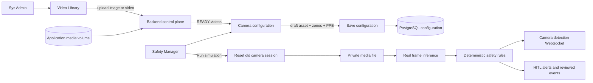

# US-29 — Thư viện video và phiên inference theo camera

## Trạng thái tài liệu

- Trạng thái: **Approved — đã interview và được phép implement ngày 2026-08-23**.
- Owner sản phẩm: Cross-cutting (`backend`, `frontend`, `vision`).
- Mục tiêu delivery: workflow Demo Day dùng video/hình ảnh upload thật, inference thật và
  cảnh báo thật; không còn thao tác Connect/Disconnect stream trong UI.

## Workflow đã xác nhận

Phần này thay thế mọi wording cũ ngụ ý rằng lưu cấu hình tự bắt đầu inference:

1. Safety Manager vào Live Monitor và luôn thấy bốn khung Camera 1–4.
2. Khung chưa cấu hình hiển thị **Bấm vào đây để cấu hình**. Bấm khung sẽ mở
   trang cấu hình đúng camera đó.
3. Safety Manager chọn một asset `READY` từ dropdown. Mỗi lựa chọn hiển thị tên
   do Sys Admin đặt và tag **Video** hoặc **Hình ảnh**. Một asset không được gán
   đồng thời cho hai camera.
4. Video tự phát trong preview; hình ảnh được giữ trên preview. Preview chỉ giúp
   xem nội dung và vẽ vùng/PPE, không chạy inference và không tạo alert/event.
5. **Lưu cấu hình** lưu asset, vùng và PPE rồi tự quay lại Live Monitor. Lưu không
   khởi động inference.
6. Safety Manager có thể tiếp tục cấu hình camera khác hoặc bấm **Chạy mô phỏng**.
   Nút này khởi động đồng thời tất cả camera đã cấu hình hợp lệ.
7. Ảnh inference đúng một lần và không debounce. Video chạy từ đầu, hiển thị
   **FPS infer** thực tế; khi hết video, icon Replay ở góc khung chỉ chạy lại
   camera đó.

## Vấn đề

Workflow hiện tại yêu cầu Sys Admin gán và ngắt stream cho từng camera. Cách này
đưa chi tiết transport vào UI vận hành và làm Safety Manager không thể hoàn tất
toàn bộ quy trình chuẩn bị một phiên giám sát.

Workflow mới tách trách nhiệm rõ ràng:

- Sys Admin quản lý nguồn video được phép sử dụng.
- Safety Manager chọn video cho camera, cấu hình vùng và PPE, lưu, rồi chủ động bấm
  **Chạy mô phỏng** để bắt đầu phiên inference mới.
- Backend tự quản lý asset path và lifecycle; người dùng không thao
  tác Connect/Disconnect.

## Thuật ngữ

| Thuật ngữ | Ý nghĩa |
|---|---|
| Media asset | File video hoặc hình ảnh do Sys Admin upload và được lưu trong thư viện |
| Camera slot | Một trong bốn camera logic `cam_1`–`cam_4` trên Live Monitor |
| Draft configuration | Video, vùng và PPE Safety Manager đang chỉnh nhưng chưa lưu |
| Inference session | Một lần xử lý bắt đầu từ đầu video với tracking và occurrence state mới |
| Safety Manager | Tên actor và nhãn UI của runtime role `safety_manager` |

`asset_id`, `camera_id` và media path do server quản lý. Browser không gửi URL
media tùy ý và không được biết filesystem path.

## Actors và quyền

| Actor | Được phép | Không được phép |
|---|---|---|
| `system_admin` | Mở tab Thư viện video; upload từng video; xem trạng thái xử lý và danh sách video | Cấu hình vùng/PPE thay Safety Manager trong workflow này |
| `safety_manager` (Safety Manager) | Xem thư viện video đã sẵn sàng; chọn video cho camera; xem/chỉnh vùng và PPE; lưu và bắt đầu inference | Upload video; cung cấp URL media; sửa file nguồn |
| `area_manager` | Xem event thuộc khu vực theo quyền hiện có | Upload, chọn video, cấu hình camera hoặc bắt đầu inference |

Backend phải enforce RBAC. Ẩn nút trên frontend không thay thế authorization.

## Phạm vi MVP

### 1. Tab Thư viện media cho Sys Admin

- Sidebar có tab **Thư viện media**, chỉ `system_admin` nhìn thấy.
- Sys Admin upload từng video hoặc hình ảnh bằng form có tên hiển thị và file.
- Hệ thống kiểm tra authentication, quyền, định dạng, dung lượng và tên file an
  toàn trước khi công bố asset.
- Upload sử dụng file tạm và chỉ chuyển asset sang `READY` khi file đã lưu hoàn
  chỉnh và backend decode được frame đầu tiên.
- Danh sách hiển thị tối thiểu: tên, tag `Video | Hình ảnh`, trạng thái `UPLOADING | READY | ERROR`,
  thời điểm upload và camera đang sử dụng nếu có.
- Asset chưa `READY` không xuất hiện trong lựa chọn của Safety Manager.
- Không hiển thị RTSP/HLS URL, credential hoặc filesystem path.

### 2. Safety Manager chọn video cho camera

- Safety Manager mở trang cấu hình bằng cách bấm một trong bốn khung Live Monitor.
- Trang hiển thị danh sách video asset `READY` do Sys Admin upload.
- Không còn nút, nhãn hoặc trạng thái **Connect**, **Disconnect**,
  `Connecting` hay `Disconnected` trong workflow người dùng.
- Safety Manager chọn một asset cho camera bằng `asset_id`; server tự derive path nội bộ.
- Một video chỉ được gán cho một camera tại một thời điểm. Backend trả conflict
  và giữ nguyên cấu hình cũ nếu asset đang được camera khác sử dụng.
- Thay lựa chọn chỉ cập nhật draft; inference đang chạy không bị thay đổi trước
  khi người dùng bấm lưu.

### 3. Cấu hình vùng và PPE

- Sau khi chọn camera và video, Safety Manager vẫn nhìn thấy preview, zone editor,
  trạng thái máy và các requirement PPE hiện có.
- Safety Manager có thể tạo/sửa/xóa nhiều vùng theo contract polygon bốn điểm,
  revision và không giao/chạm/bao nhau hiện hành.
- PPE vẫn cấu hình theo từng `(camera_id, zone_id)` với profile `hat_vest_v1`:
  `hat_required`, `vest_required`, restricted-area và zone-intrusion switches.
- Preview và draft không được tự tạo event hoặc cảnh báo.
- Nút chính có nhãn rõ ràng **Lưu cấu hình**. Lưu xong quay lại Live Monitor.

### 4. Run là command bắt đầu các phiên mới

Lưu cấu hình phải validate và persist atomically nhưng không dừng/bắt đầu worker.
Khi Safety Manager bấm **Chạy mô phỏng** trên Live Monitor, hệ thống thực hiện theo
thứ tự cho tất cả camera đã cấu hình:

1. Xác thực user và role `safety_manager`.
2. Kiểm tra video còn `READY`, chưa thuộc camera khác và camera ID hợp lệ.
3. Kiểm tra zone revision, polygon geometry và PPE payload.
4. Đọc assignment media–camera, zone collection và PPE requirements đã lưu.
5. Dừng worker/session cũ của đúng camera nếu có.
6. Hủy pending AI candidate chưa được review của session cũ; không thay đổi event
   đã được con người submit.
7. Reset frame sequence, ByteTrack state, debounce và occurrence state.
8. Phát video từ đầu hoặc đọc hình ảnh một lần và khởi động inference session mới.
9. Chỉ trả trạng thái `RUNNING` sau khi source đọc được frame và model hoàn thành
   inference đầu tiên.

Nếu bước 1–4 thất bại, không được dừng session đang chạy. Nếu bước 5–9 thất bại,
hệ thống trả `ERROR`, không phát frame/cảnh báo cũ như thể session mới thành công,
và cho phép Safety Manager retry cùng cấu hình.

## Trạng thái UX

```text
DRAFT → SAVING → STARTING → RUNNING
          │          │          │
          └──────────┴──────────→ ERROR → RETRY

RUNNING → EDITING_DRAFT → SAVING → DRAFT
RUNNING → RUN/REPLAY → STARTING → RUNNING(new session)
```

- `DRAFT`: cấu hình chưa được lưu hoặc đã lưu nhưng chưa bấm Chạy mô phỏng; không inference draft.
- `SAVING`: khóa nút lưu để tránh submit trùng.
- `STARTING`: source/model đang mở phiên mới.
- `RUNNING`: đã có ít nhất một `camera_inference_result` của session mới.
- `ERROR`: hiển thị lỗi an toàn, không giữ badge LIVE hoặc detection cũ.
- UI hiển thị video, camera, session status và thời điểm kết quả inference gần
  nhất; không dùng trạng thái giả theo timer.

## Luồng hệ thống



## Safety và data invariants

- Không fake video, detection, inference result, warning hoặc event.
- Không bắt đầu inference trước khi save thành công.
- Không dùng frame, detection hoặc tracking state của video/session cũ cho session
  mới.
- Human-reviewed event đã lưu là authoritative và không bị xóa khi restart video.
- Chỉ snapshot đã qua privacy gate mới được persist; không lưu raw video vào event.
- Browser không quyết định violation, severity, permission hoặc media URL.
- Một save/retry không được tạo hai worker hoặc hai active session cho cùng camera.
- Inference success phải có metric `/camera-inference`, latency và outcome; video EOF
  hoặc provider failure phải tạo failure metric và chuyển/retry theo lifecycle.

## Acceptance criteria

1. Chỉ Sys Admin thấy tab Thư viện video và upload được video hợp lệ.
2. Safety Manager và Area Manager gọi API upload nhận `403`; unauthenticated nhận
   `401`.
3. Safety Manager chỉ thấy video `READY` trong danh sách chọn nguồn camera.
4. UI không còn Connect/Disconnect trong workflow video–camera.
5. Safety Manager có thể chọn video, cấu hình zone/PPE và lưu cho từng Camera 1–4.
6. Thay draft video/zone/PPE không tác động session đang chạy trước khi save.
7. Payload invalid, revision conflict hoặc video đã dùng bị từ chối mà không mutate
   cấu hình/session hiện hành.
8. Save hợp lệ không tạo session; một lệnh Run/Replay hợp lệ tạo đúng một session
   mới, bắt đầu video từ đầu và reset tracking, debounce, occurrence cùng overlay cũ.
9. `RUNNING` chỉ xuất hiện sau inference result đầu tiên của session mới.
10. Video vi phạm tạo detection, deterministic rule, HITL alert và reviewed event
    qua pipeline thật.
11. Video bình thường không tạo fake alert; metrics vẫn chứng minh inference đang
    chạy.
12. Reload trả lại cấu hình đã lưu và trạng thái server hiện hành; frontend không
    tự suy đoán `RUNNING`.
13. Lỗi source/model không giữ frame hoặc alert cũ và có thể retry an toàn.
14. Hai lần bấm Save nhanh không tạo worker/session trùng.

## Contract cần thiết kế trong implementation plan

Spec không chốt endpoint trước khi đọc đầy đủ executable contracts. Plan session
phải thiết kế additive contract cho:

- Video asset inventory và upload do Sys Admin quản lý.
- Draft/save command chứa expected revisions cần thiết.
- Server-owned session ID và lifecycle status theo camera.
- Assignment `camera_id ↔ video_id` không làm browser sở hữu media URL.
- Compatibility/migration từ `stream_camera_id` mapping hiện tại.

Breaking change phải được phê duyệt, ghi vào `DECISIONS.md` và có migration hoặc
compatibility test. Không đổi tên database field hoặc xóa endpoint hiện hành chỉ
dựa trên wording của UI.

## Testing requirements

### Backend và database

- RBAC upload/list/save/start với exact `401/403`.
- Asset states, duplicate assignment, revision conflict và transaction rollback.
- Save idempotency/concurrency: một camera chỉ có một active session.
- Session cũ chỉ dừng sau khi cấu hình mới đã validate và persist thành công.
- PostgreSQL integration cho persistence, uniqueness và fresh-session reload.

### Media và inference

- Upload atomic, size/type validation và corrupt media.
- Video bắt đầu từ frame đầu sau mỗi successful Run/Replay.
- Replace/retry không để worker cũ sống hoặc phát frame cũ.
- Real-model smoke: ít nhất một video vi phạm và một video bình thường.
- Operational metrics chứng minh completed/failed inference theo session mới.

### Frontend

- Role-based navigation và upload controls.
- READY-only selector, camera/zone/PPE draft và dirty-state warning.
- `SAVING/STARTING/RUNNING/ERROR` lấy từ server evidence.
- Double-click save, conflict, retry và stale-overlay cleanup.
- Không còn text/control Connect hoặc Disconnect trong workflow.

### E2E acceptance

```text
Sys Admin upload → asset READY
→ Safety Manager chọn video cho Camera 1
→ cấu hình zone/PPE
→ Lưu cấu hình
→ Chạy mô phỏng
→ first camera_inference_result
→ real rule/HITL alert
→ manager submit review
→ event persisted with new session context
```

Không được kết luận hoàn thành chỉ từ upload, configuration API, playback hoặc model
preload. E2E phải chứng minh frame thật đi qua model, rule, alert và persistence.

## Commands cho implementation session

Chạy từ repository root và dùng command hiện hành của repo:

```bash
make check
PYTHONPATH=. .venv/bin/pytest backend/tests -v
npm --prefix frontend run test
npm --prefix frontend run type-check
npm --prefix frontend run build
```

PostgreSQL và live media verification phải dùng môi trường được cấu hình đúng.
Unit test với test database không thay thế Railway/browser E2E.

## Boundaries

### Luôn phải làm

- Giữ `camera_id`, RBAC backend, deterministic rules và privacy gate.
- Viết RED tests trước behavior mới.
- Preserve reviewed events và compatibility trong migration.
- Deploy theo service ownership và chỉ báo thành công sau terminal Railway
  `SUCCESS`, health, metrics và browser smoke.

### Phải hỏi trước

- Xóa video asset đang hoặc đã được sử dụng.
- Cho phép một video chạy đồng thời trên nhiều camera.
- Tự động resume inference sau backend/Railway restart mà không cần Safety Manager
  bấm lưu lại.
- Breaking API/schema change ngoài cutover US-29 đã được phê duyệt.

### Không được làm

- Đưa credential hoặc arbitrary media URL ra frontend.
- Tạo alert/detection giả để demo.
- Dùng fallback video khi asset/source lỗi.
- Xóa event đã review khi đổi video hoặc restart session.
- Báo `RUNNING` chỉ vì save trả HTTP 200 hoặc model preload thành công.

## Quyết định owner đã xác nhận

1. Sys Admin chỉ xóa được asset chưa gán và chưa được session/event tham chiếu.
2. Sau backend/Railway restart, cấu hình được giữ nhưng chờ Safety Manager bấm **Chạy mô phỏng**.
3. Video chạy một lần rồi dừng; Replay tạo phiên mới riêng cho camera đó.
4. Run nhiều camera xử lý lỗi độc lập; camera tốt tiếp tục chạy.
5. FPS infer là throughput rolling trong cửa sổ năm giây.
