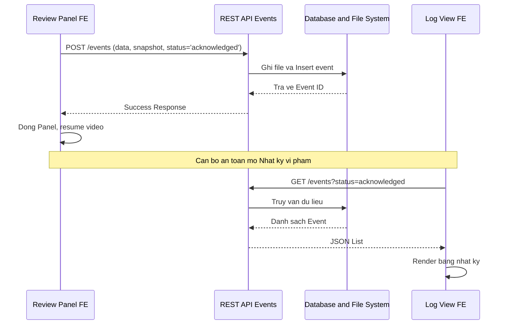

# Chi tiết Spec: US-06 — Lưu và xem nhật ký vi phạm đã xác nhận

## 1. Cái gì (What)
Cung cấp khả năng lưu trữ các vi phạm đã được con người xác nhận vào Cơ sở dữ liệu (Database) và một màn hình danh sách (Dashboard/Logs) để cán bộ an toàn xem lại toàn bộ lịch sử vi phạm.

## 2. Tại sao (Why)
Dữ liệu vi phạm thực tế cần được lưu lại làm bằng chứng (audit log) để phân tích báo cáo an toàn, huấn luyện, hoặc kỷ luật. Việc chỉ lưu các vi phạm "đã xác nhận" giúp cơ sở dữ liệu sạch, không chứa dữ liệu nhiễu (false alarms).

## 3. Như thế nào (How)
- **Lưu sự kiện:** Khi cán bộ bấm "Vi phạm thực tế" trong luồng Review (US-05), Frontend đóng gói dữ liệu (thời gian, hình ảnh snapshot dạng Base64 hoặc File upload, nhãn vi phạm) rồi gọi API `POST /events`. Trạng thái event là `acknowledged`.
- **Backend xử lý:** FastAPI nhận dữ liệu, ghi file hình ảnh xuống bộ nhớ, lưu bản ghi vào CSDL (SQLite hoặc PostgreSQL) thông qua SQLAlchemy, sau đó trả về thông tin event đã lưu.
- **Xem lịch sử:** Khi mở tab "Nhật ký vi phạm", Frontend gọi `GET /events?status=acknowledged` để lấy danh sách.
- **Tiếp tục:** Sau khi lưu thành công, Frontend tắt hộp thoại Review và quay lại trạng thái giám sát.

## 4. Biểu đồ (Diagram)


## 5. API Contract

**1. Tạo Event**
- **Endpoint:** `POST /api/v1/events`
- **Request Body (JSON hoặc FormData - tùy thiết kế upload ảnh):**
```json
{
  "timestamp": "2026-08-03T07:40:00Z",
  "status": "acknowledged",
  "type": "zone_intrusion",
  "snapshot_base64": "data:image/jpeg;base64,..."
}
```
- **Response (201 Created):**
```json
{
  "id": "evt-12345",
  "status": "acknowledged",
  "snapshot_url": "/api/v1/events/evt-12345/snapshot"
}
```

**2. Lấy Danh sách**
- **Endpoint:** `GET /api/v1/events?status=acknowledged`
- **Response (200 OK):** Mảng các Event ID và thông tin đi kèm.
