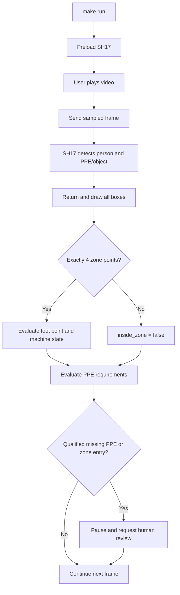

# Spec: US-07 — Phát hiện và cảnh báo PPE

## Mục tiêu

Hệ thống dùng checkpoint SH17 YOLOv8n duy nhất để phát hiện người và PPE/object trên video. Cán bộ an toàn lưu requirement mũ, kính và găng theo camera–zone; backend quyết định cảnh báo, UI hiển thị đầy đủ box detection.

## Phạm vi và hành vi

- SH17 class `0` (`person`) và 16 class còn lại là nguồn detection duy nhất của US-07; không dùng person model riêng.
- Video phát là inference chạy, không phụ thuộc zone. Zone chỉ active khi có đúng bốn điểm; 0–3 điểm được gửi là `[]`, mọi `inside_zone=false`.
- Checkpoint có các class: `person`, `ear`, `ear-mufs`, `face`, `face-guard`, `face-mask`, `foot`, `tool`, `glasses`, `gloves`, `helmet`, `hands`, `head`, `medical-suit`, `shoes`, `safety-suit`, `safety-vest` (ID `0`–`16`).
- Tất cả class được trả/hiển thị. Chỉ `helmet`, `glasses` → `safety_glasses`, và `gloves` có requirement/alert trong US-07.
- Mỗi person có `present`, `missing`, hoặc `unknown` cho ba PPE trên. `missing` là backend suy ra khi person đạt ngưỡng confidence, association hợp lệ và không có detection PPE tương ứng; confidence của `missing` là `null`.
- OFF chỉ chặn alert, không tắt inference. ON + `missing` tạo review/alert; `present`/`unknown` không tạo alert.

```text
missing_required_ppe = required AND status == "missing"
                       AND person_confidence >= threshold
                       AND association_is_valid
```

## Cấu hình PPE

```http
GET /api/v1/ppe-requirements/{camera_id}/{zone_id}
PUT /api/v1/ppe-requirements/{camera_id}/{zone_id}
```

GET chưa có record trả ba requirement OFF và `is_configured=false`. PUT nhận đủ ba boolean, idempotent và atomic. `camera_id`/`zone_id` không rỗng, tối đa 50 ký tự; input sai trả `422`, persistence lỗi trả `503` an toàn.

## Inference contract

REST `POST /api/v1/analysis/frame` và WebSocket `inference_result` giữ field cũ và thêm `detections`:

```json
{
  "people": [{
    "bbox": [420, 115, 535, 610],
    "confidence": 0.91,
    "inside_zone": false,
    "ppe": {"helmet": {"status": "missing", "confidence": null}},
    "missing_required_ppe": ["helmet"]
  }],
  "detections": [{
    "class_id": 10,
    "class_name": "helmet",
    "bbox": [438, 126, 491, 193],
    "confidence": 0.94,
    "person_index": 0
  }]
}
```

- `detections` luôn gồm `class_id`, `class_name`, original-frame `bbox`, confidence và `person_index` (nullable).
- Detections không associate, ví dụ `tool`, vẫn phải trả ngay cả khi không có `people`.
- `rule` echo `camera_id`, `zone_id`, persisted `ppe_requirements` và `ppe_alert`.
- `review_required` là zone entry khi máy chạy hoặc PPE alert đủ điều kiện.

## Rule engine

Backend có một rule engine deterministic, là nơi duy nhất quyết định kết quả an toàn. Nó nhận:

```text
input = model observations + persisted PPE requirements + machine state + optional 4-point zone
output = normal | violate
```

| Điều kiện | Output |
|---|---|
| Không có person trong zone đang chạy và không có PPE thiếu được require | `normal` |
| Person vào zone, machine `running`, zone có đúng 4 điểm | `violate` |
| PPE được require và person đủ điều kiện có status `missing` | `violate` |

- `violate` luôn đặt `review_required=true`; UI pause frame và mở Human-in-the-Loop review.
- `normal` đặt `review_required=false`; UI tiếp tục video.
- Zone 0–3 điểm không tạo zone violation; PPE rule vẫn được evaluate.
- Vision chỉ gửi observation; UI chỉ gửi/lưu configuration và render output. Không bên nào tự tạo `violate`.
- Engine trả evidence gồm `person_inside_zone`, `ppe_alert`, `missing_required_ppe`, requirements đã dùng và machine state để UI/audit giải thích quyết định.

## UI

- Canvas vẽ box + nhãn `<CLASS> · <confidence>` cho mọi detection với màu sắc đồng nhất theo class.
- AlertPanel hiển thị **Danh sách detection tổng hợp** (mũ, áo, giày, kính, găng...) với màu dot khớp 100% với bounding box trên Canvas để chống chồng lấp chữ.
- Human review được nâng cấp thành **Pop-up xác minh (`ReviewModal`)**: tự động bật hoặc bấm vào card cảnh báo để mở pop-up chọn `Vi phạm thực tế (VIOLATE)` hoặc `Bình thường / báo sai (NORMAL)`.
- Chỉ PPE được require mới có badge person: xanh `present`, đỏ `missing`, trung tính `unknown`.
- Draft requirement chỉ có hiệu lực sau **Lưu cấu hình** thành công; reload lấy state backend, không dùng `localStorage`.

## Luồng hoạt động



## Thứ tự ưu tiên

1. **Model sẵn sàng:** SH17 phải preload khi backend khởi động.
2. **Detection luôn chạy:** phát video là có box; zone chưa cấu hình không được chặn inference.
3. **Hiển thị bằng chứng:** UI vẽ mọi detection trước khi áp dụng rule.
4. **Rule an toàn:** PPE được evaluate mọi lúc; zone chỉ evaluate khi đủ bốn điểm.
5. **Human review:** chỉ pause/tạo review khi có PPE alert đủ điều kiện hoặc xâm nhập zone khi máy chạy.

## Ownership và kiểm thử

```text
vision/                         # SH17 detection + association, không có business rule
backend/app/integrations/       # Adapter vision
backend/app/services/           # Qualified absence và alert rule
backend/app/schemas/, api/      # Typed REST/WS contract
frontend/src/types/, features/  # Wire type và canvas overlay
```

- Vision test: 17 ID/name, bbox/confidence, person association, no-person detection.
- Backend test: ON/OFF × present/missing/unknown, confidence/association guard, REST/WS additive contract, zero-zone detection.
- Rule-engine test: model observation + UI configuration → `normal` hoặc `violate`; mọi `violate` phải yêu cầu human review.
- Frontend test: labels/boxes all classes, PPE badges, load/save states and accessible controls.
- Run: `PYTHONPATH=. .venv/bin/pytest backend/tests -v -k "ppe"`, `npm --prefix frontend run test -- --run ppe`, `make check`.

## Boundaries

Always preserve fields, validate API input, keep vision free of DB/rules, and persist only redacted evidence. Ask first before new requirement types, model/dependency changes, or breaking contract changes. Never infer a missing PPE without the confidence/association guard, let frontend/vision own official alerts, or persist raw images.

## Success criteria

1. A playing video displays all SH17 detections with or without four zone points.
2. Exactly four points enable zone intrusion; partial/no zone does not suppress detection or PPE alert.
3. Required helmet/glasses/gloves absence alerts only for qualified persons; OFF never alerts.
4. REST/WS and UI agree on detection/PPE semantics, and focused tests pass.

## Production gates

Confirm SH17 license/provenance, ground truth, false-negative benchmark, association behavior and production thresholds before relying on PPE alerts in the field.
