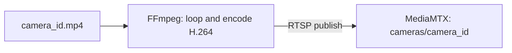
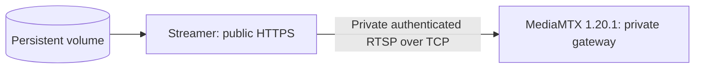

# Mock Camera Streamer

Standalone camera simulator for local testing. It requires FFmpeg on the local
machine, runs on port `8001`, and stores one uploaded video per camera. It
preserves the looped MJPEG rollback endpoint and, when
`MEDIA_RTSP_ENABLED=true`, supervises one FFmpeg H.264 publisher per camera at
`cameras/<camera_id>` in MediaMTX. This service is
deliberately independent from the safety backend; it does not run YOLO or save
events.
The application can select up to four of these registered camera streams; the
same stream cannot be assigned to two display cameras.

## Run locally

```bash
make streamer-run
```

Open <http://localhost:8001/> and upload a video for a camera such as `cam_1`.
The page creates one tab per uploaded camera; selecting a tab displays that
camera's live stream. The direct stream URL is
`http://localhost:8001/stream/cam_1` and the current camera list is available at
`http://localhost:8001/api/cameras`.

Use the **Xóa** button beside a camera tab to delete that camera's uploaded video,
or call `DELETE /api/cameras/{camera_id}` directly.

## Run with Docker

```bash
docker compose up -d --build streamer
```

Uploaded files are stored in `data/streamer/`. RTSP and HLS use the
exact-version MediaMTX service in `docker-compose.yml`. Browser HLS is served
directly on port `8888`; FastAPI never proxies manifests or segments.
`GET /api/media/inventory` returns additive publisher readiness and transport
metadata. Set `VITE_STREAM_TRANSPORT=mjpeg` and restart the frontend to roll back.

## Cách RTSP mode hoạt động

Khi `MEDIA_RTSP_ENABLED=true`, startup scan các file `*.mp4` trong storage. Mỗi
camera có đúng một supervised FFmpeg process:



`GET /api/media/inventory` cho biết publisher state và transport URL. `ready`
nghĩa là process publisher đang sống; khi vận hành phải đối chiếu thêm MediaMTX
log `stream is available and online` để chứng minh gateway đã nhận H.264 track.
Nếu FFmpeg thoát, supervisor retry với bounded backoff. Replace/delete/shutdown
dừng process cũ để không có hai publisher cùng chiếm một camera path.

Các endpoint cần nhớ:

| Endpoint | Mục đích | Có chứng minh RTSP không? |
|---|---|---|
| `GET /health` | HTTP process của streamer sống | Không |
| `GET /api/cameras` | Danh sách source đã upload | Không |
| `GET /api/media/inventory` | Publisher state và media path | Một phần |
| `GET /stream/{camera_id}` | MJPEG compatibility/rollback | Không |
| MediaMTX log/API | RTSP path và track online | Có |

## Railway: hai service media riêng

Production media gồm hai Railway service, không chạy chung với `p047-app`:



Streamer cần các Variable sau; giá trị credential chỉ lưu trong Railway và
không copy vào repository, frontend hoặc log:

| Variable | Ý nghĩa |
|---|---|
| `MEDIA_RTSP_ENABLED=true` | Bật supervised RTSP publishers |
| `MEDIA_RTSP_ORIGIN` | Private RTSP origin, gồm publisher credential reference |
| `MEDIA_PUBLIC_ORIGIN` | HLS origin do inventory trả về |

MediaMTX dùng internal authentication, chỉ cho publisher đã xác thực publish vào
`cameras/<validated-id>`. Service không có public domain ở rollout hiện tại.
Do `MEDIA_PUBLIC_ORIGIN` dùng `*.railway.internal`, browser ngoài Railway không
thể tải HLS; frontend production phải giữ MJPEG cho đến khi có HTTPS playback
ingress và viewer authorization.

Checklist sau mỗi deploy:

```bash
curl -fsS https://<streamer-domain>/health
curl -fsS https://<streamer-domain>/api/media/inventory
railway logs --service <streamer-service> --lines 100
railway logs --service <mediamtx-service> --lines 200
```

Pass khi deployment của cả hai service là `SUCCESS`, health trả `ok`, required
camera có `status=ready`, restart không tăng liên tục và MediaMTX log xác nhận
`path cameras/<id> stream is available and online`. Không in `railway variables`
ra ticket/chat vì output có thể chứa secret.

Rollback an toàn: đặt frontend về `VITE_STREAM_TRANSPORT=mjpeg`; không xóa video
volume hoặc mapping. Nếu lỗi chỉ ở MediaMTX, MJPEG vẫn phục vụ qua streamer.

## Build and publish the streamer image separately

Run these commands from the repository root. The final `.` is the Docker build
context and is required because the Dockerfile copies the `streamer/` directory.

```bash
docker build -f streamer/Dockerfile -t p047-streamer:dev .
docker images p047-streamer
```

Hoặc dùng script trong folder `scripts/`:

```bash
./scripts/build_streamer.sh
```

Script mặc định build image `nguyennaht4/streamer:dev`. Có thể truyền tag khác:

```bash
./scripts/build_streamer.sh DOCKERHUB_USERNAME/streamer:dev
```

Run the locally built image:

```bash
mkdir -p data/streamer
docker run --rm --name p047-streamer \
  -p 8001:8001 \
  -v "$PWD/data/streamer:/app/data/streamer" \
  p047-streamer:dev
```

Then open <http://localhost:8001>. Check readiness with:

```bash
curl http://localhost:8001/health
```

Ví dụ nếu image đã build với Docker Hub username `nguyennaht4`:

```bash
mkdir -p data/streamer
docker run --rm --name p047-streamer \
  -p 8001:8001 \
  -v "$PWD/data/streamer:/app/data/streamer" \
  nguyennaht4/streamer:dev
```

Giải thích:

- `docker run`: tạo và chạy container từ image.
- `--rm`: tự xóa container sau khi container dừng.
- `--name p047-streamer`: đặt tên container.
- `-p 8001:8001`: map cổng 8001 của máy vào cổng 8001 trong container.
- `-v "$PWD/data/streamer:/app/data/streamer"`: lưu video upload trên máy host
  và cho container đọc cùng thư mục đó; video không mất khi container bị xóa.
- `nguyennaht4/streamer:dev`: tên image và tag đã build.

Sau khi chạy, mở <http://localhost:8001>. Dừng bằng `Ctrl+C`. Nếu cổng đang bị
chiếm, kiểm tra và dừng container cũ:

```bash
docker rm -f p047-streamer
```

To publish to Docker Hub, replace `DOCKERHUB_USERNAME` with your account or
organization name. Authenticate interactively; never commit a password or token.

```bash
docker login
docker tag p047-streamer:dev DOCKERHUB_USERNAME/p047-streamer:dev
docker push DOCKERHUB_USERNAME/p047-streamer:dev
```

A `latest` tag can be published explicitly:

```bash
docker tag p047-streamer:dev DOCKERHUB_USERNAME/p047-streamer:latest
docker push DOCKERHUB_USERNAME/p047-streamer:latest
```

The build and push steps can be combined with the repository script. Authenticate
with Docker Hub first; the script never receives or stores a password/token:

```bash
docker login
./scripts/push_streamer.sh DOCKERHUB_USERNAME/p047-streamer latest
```

The script accepts `[IMAGE_NAME] [TAG]` and defaults to
`nguyennaht4/streamer:dev`.

On another machine, pull and run the image with persistent uploaded videos:

```bash
docker pull DOCKERHUB_USERNAME/p047-streamer:dev
mkdir -p data/streamer
docker run --rm --name p047-streamer \
  -p 8001:8001 \
  -v "$PWD/data/streamer:/app/data/streamer" \
  DOCKERHUB_USERNAME/p047-streamer:dev
```

## Concurrency and memory

- Each active camera owns one FFmpeg process, regardless of viewer count.
- Every viewer reads the same immutable latest-frame payload. Slow viewers skip stale
  frames instead of accumulating a per-client backlog.
- Stream responses disable HTTP caching and reverse-proxy buffering. Keep a single
  Uvicorn worker/replica unless the stream registry is moved out of process; multiple
  workers would each start their own FFmpeg process.
- The 100-client target must still be load-tested on the deployment network because
  MJPEG bandwidth grows with `clients × cameras × frame size × FPS`.
